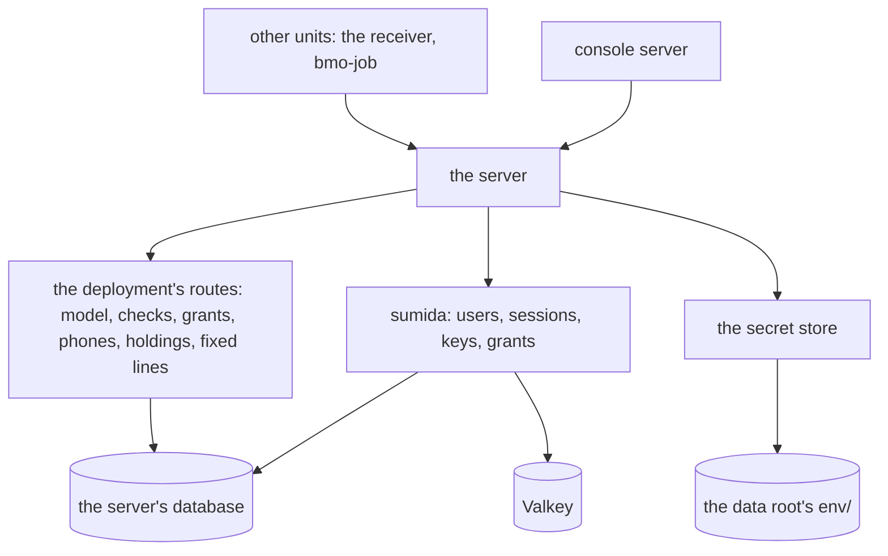

# The account service

## What it is

- **The server, in `server/`:** one Rust process linking sumida's users, sessions, API keys and permission
  layers, with the deployment's own rules file registered beside sumida's.
- **It holds the decisions, never the policy of a screen or a room.** Who a session is, who a phone key
  belongs to, whether a sender holds a relation in a room: the service answers. What a screen shows and what
  a unit does with a refusal are the console's and that unit's.
- **It stands on its own PostgreSQL database** and on a Valkey for sumida's sessions. Its tables are its own:
  sumida's, and the ones its migrations make (「The tables」 below). No other unit's table is read or written.
- **Beside its database it writes one folder:** the data root's `env/`, where the secret store keeps the files every
  unit reads its secrets from (「The secret store」 below).
- **It answers on a runtime of its own, two threads named `account-service`.** sumida reads the operating
  system and the device out of the user agent of every request that reads a session, through about a thousand
  patterns built ASCII-only, and keeps what it read for the last 256 user agents. Each thread that runs the
  patterns keeps a scratch table per pattern, about 9 MB a thread, so on every core of a machine the parser
  alone would hold over 200 MB.

## Where it answers

- **On the listen address its settings name,** over HTTP, every route under the server's bearer token
  (`docs/boundary.md`, 「Wire conventions」). The console's server, the receiver and bmo-job are its callers,
  each with the server's base address and token in its own settings.
- **No browser and no phone reaches it.** The console's server is the only caller on the web side, and sumida's
  session routes are reached through it alone.
- **Its user unit** is the server's own, `deploy/bmo-web-server.service`, linked and restarted by the deployment
  (`testbed.toml`), running `serve` in the release's `server/`, where the deployment's settings stand as
  `settings.local.toml`.
- **Whether it can stand** is `bmo-web-server settings`: it reads the settings and refuses, saying why, where they
  name no `server.token` or no `names.chat_agent`, as `serve` would.
- **Whether it answers** is `bmo-web-server health`: it asks `GET /health` at the address the settings name, an
  unspecified host asked at the loopback one, waiting at most five seconds, and ends 0 where the service answers
  and 1 otherwise, saying why. The deployment waits on it.

## When it is in force

- **The server stands only on its database,** with sumida's tables standing and the deployment's rules
  registered; a database out of reach, or one the rules do not fit, stops it at its start, and its unit starts
  it again.
- **`GET /accounts/model`** answers whether the model is in force — whether the data move has been written —
  and why not where it is not. Once seen in force it stays so for the life of the process.
- **A reader asks this first.** Not in force, it reads as it does without the model: no sender is linked to a
  user and no grant stands.
- **Every route but `GET /health`, `GET /accounts/model` and `POST /accounts/move` answers 503 `not-in-force`
  while the model is not in force,** naming why, so no caller can mistake an absent model for a refusal.

## sumida's own routes

The service mounts sumida's router as sumida builds it, under `/sumida`, so sumida's own paths (its users
among them) never take one other units name; these are the ones the console calls.

- **Every request carries the browser's address in `X-Real-IP`,** which sumida's bans and its login lockout
  read, so the address must be one the browser cannot choose.
  - **The console hands on the address its reverse proxy names.** The proxy in front of the console sets its own
    `X-Real-IP` to the address it took the connection from, after undoing the hops it trusts, and the console
    hands that header on as it came. A request carrying none is handed on as the loopback address.
  - **`X-Forwarded-For` is never read.** Its entries are whatever the browser wrote, with the proxies' own
    appended behind them, so taking any of them would let a browser name a fresh address at every attempt.
  - **The console's port is reached through the proxy alone.** A request reaching the port directly writes its
    own `X-Real-IP`, so the deployment keeps the port off every network but the proxy's.
- **Sign-in:** `POST /sumida/auth/session` with the name and the password. The console always asks for the ordinary
  window, an idle one of seven days which the service extends at every request a session is read on, so
  staying signed in stays the console's own seal (`docs/web.md`, 「Access」). The answer carries the session
  cookie, `bmo.sid`; a refusal is 401.
- **Sign-out:** `DELETE /sumida/auth/session` with that cookie.
- **Who a session is:** `GET /sumida/me` with the cookie; 401 where it is no live session.
- **sumida's settings** are written beside the service at its start and named for sumida, with the database's
  address and Valkey's handed in their own variables; no token is issued here, so no secret is kept.

## The deployment's own routes

All JSON, all under the server's token. `docs/boundary.md` states each route's request and answer; this
section states what each does.

### Checks

- **`POST /checks/room`** — a room, a sender id and a room relation. Answers whether the sender holds the
  relation there, the grant that was asked for (`bmo_room:<chat id>#<relation>`), and the user the sender is
  linked to, where one is.
- **`POST /checks/message`** — a room, a message id and a room relation. The service asks the receiver for the
  message and checks its sender in that room. It refuses, saying so, where no such message stands in that room.
- **`POST /checks/object`** — a kind (`bmo_worker`, `bmo_repository`, `bmo_tools`), an object, a relation and a
  user. Answers whether the user holds it, and the grant asked for.
- **What a check builds:** the sender's user where their identity is linked, and the room's members, always.
  The platform administrator passes every check.

### Grants

- **`GET /grants?room=`** — the grants standing on a room, each with its relation, its subject, its expiry and
  the words beside it.
- **`POST /grants`** — what is granted (a room and a relation, or a kind, an object and a relation), to whom (a
  sender id, a user, or the room's members), the granter's words where any, an expiry where any, and the
  message it is granted on (its room and id).
  - The granter is that message's sender's user, and sumida checks they may grant it, so nobody gives what they
    do not hold.
  - A sender with no user yet is given one, with no way to sign in, and linked.
  - Granting again moves the expiry and the words.
- **`DELETE /grants`** — the same selector and the message it is revoked on, checked the same way.

### The data move

- **`POST /accounts/move`** — the caller hands the service what the move needs out of the deployment's
  configuration: the sender ids the configuration names as the owner's, the rooms the deployment answers, and
  the room rules with their rooms, subjects and words. The console's one account becomes the platform
  administrator's user, its password carried as it stands; a console holding more than one account is refused
  with 409. The service writes the whole move in one transaction with sumida's own machinery and marks it done
  in its own `settings` table; a second call answers that it is done and writes nothing.
- **What the move writes is the service's own:** the users, their links to senders, every room's member grant
  at the deployment's defaults, the rules' grants and their words, and a user's id on the console's own tables
  that are keyed by user. A table of another unit is that unit's to key.

### Users and senders

- **`GET /senders/{sender}/user`** — the user a sender is linked to, or nothing found.
- **`GET /users`** — every user, with their name and whether they are the platform administrator, for the
  administrator alone.
- **`GET /users/{user}`** — a user's name, whether they are the platform administrator, and the sender ids
  linked to them; **`GET /users/{user}/senders`** the sender ids alone.
- **`POST /users/{user}/password`** — the current password and the next; refused with 401 where the current one
  does not match, and hashed as sumida hashes every password.
- **`POST /users/{user}/name`** — another name; refused with 409 where another user holds it.
- **`GET /users/{user}/profile`** — a user's job title, landline, mobile and email, each an empty string where
  the account keeps none; **`POST /users/{user}/profile`** writes all four whole, an empty value clearing it,
  and answers the profile as it now stands. Both are the account's holder's or an administrator's: the console
  hands on the login it acts for in `Owner-Key` and `Owner-Role`, and any other login is refused 403 before a
  row is read or written. The profile is kept in the service's own table, so sumida's `users` stays as sumida
  made it; an account that keeps no profile has no row, and every account that stood before reads empty values.
- **`GET /users/{user}/sections`** — one user's console sections, each with whether they may read and write
  it: the account's holder's or an administrator's. **`PUT /users/{user}/sections`** writes one user's set
  whole, by an administrator alone (「Console sections」).
- **`GET /users/search?q=&limit=`** — the people of the reader's own company whose name, unit, job title or
  permitted contact details hold the words; at most 20 without a `limit`, and never more than 50.
- **`GET /users/{user}/person`** — one person of the reader's own company; 404 where the user does not stand or
  stands in another company (「The people directory」).

### Console sections

- **A console section is one entry of the console's navigation,** from the live status down to the brain, and
  the rooms and the account beside the flat group, or one part of agent management's screen, whose five tabs
  are its five parts. Each screen is named by the first part of its path; each part of agent management is named
  by its tab:

  | Section | The screen |
  |---|---|
  | `live` | the live status |
  | `mail` | bmo-mail's screen |
  | `siren` | the cache siren |
  | `db` | the console's database |
  | `files` | bmo-drive's screen |
  | `artifact` | bmo-artifact's screen |
  | `documents` | the document viewer |
  | `code` | bmo-review's screen |
  | `supervisors` | agent management's supervisors tab |
  | `roles` | agent management's roles tab |
  | `repositories` | agent management's repositories tab |
  | `models` | agent management's registered models tab |
  | `model-files` | agent management's model files tab |
  | `research` | the research screen |
  | `monitor` | the machines and the card board |
  | `remote` | bmo-remote's screen |
  | `brain` | the brain's screen |
  | `rooms` | the reader's rooms and their messages |
  | `account` | the reader's own account and its settings |

- **Agent management's screen opens on any one of its parts the reader may read,** and each tab on its own
  part alone. Its shared reads — the agent list, a provider's models, the provider switches and the fallback,
  an agent's face and tool marks — open on any part read; the provider switches and the fallback are changed in
  the settings dialog, which only the administrator opens. An agent's own page stands under the three parts
  whose rows open it: the supervisors, the roles and the repositories.

- **A section's permission is two relations of the deployment's rules,** `read` and `write`, on a
  `bmo_section` object named by the section. They are checked through sumida's point check as every other
  relation is (`server/src/bmo.sz`); a write is also a read, so nobody changes what they may not see.
- **The platform administrator passes every section.**
- **A user's grants are sumida's relation tuples,** so the service keeps no table of them. An administrator
  writes one user's set whole, and a section named no more is taken away.
- **The defaults in force are the console as it stood before this surface:** `rooms` read, `account` read and
  written, and the sections of the screens units bring that a member could open — `mail`, `files`, `artifact`,
  `code`, `remote` and `brain` — read. A screen whose manifest names the administrator alone stays closed to a
  member by that manifest, whatever its section says. A user made by the account command or linked to a sender
  is given the defaults, and the users who stood before this surface did are given them once, as the service
  starts against a database where that seeding has not run. A user whose administrator has since taken every
  section away keeps none.
- **The console reads them for its navigation and its route guard.** A reader sees only the sections they may
  read, and a route of a section they may not read or write answers them as if nothing stood there. A screen a
  unit brings is held to its manifest's role as well, so a section alone never opens a screen the unit keeps
  for the administrator.

### Companies and organisation units

- **An organisation unit is one of sumida's organisations,** and the units of a deployment form sumida's tree of
  them. A unit standing at the top of the tree, with no parent, is a **company**; every other unit belongs to the
  company at the top of its branch. The words a company calls its units by — division, centre, team, part — are
  their names alone, and nothing here reads a meaning into them (`STRUCTURE.md`, 「Terms」).
- **A user stands in exactly one unit,** the organisation sumida keeps on the user, at any depth of the tree, and
  belongs to that unit's company.
- **A unit's head is a `manager` of it in sumida's rules,** granted as a relation tuple on the unit. sumida's
  `manage` permission reads the tuple on the unit and on every unit above it, so a head heads their own unit and
  everything below it, and the platform administrator heads every unit.
- **`GET /users/{user}/unit`** answers the user's unit, its company and the path between them, from the company
  down to the unit, so a caller tells whether one unit stands under another without a call of its own.
- **`GET /units/{unit}`** answers a unit: its name, its parent, its company, its path, the units directly under
  it, the users granted head of it directly, and the users standing in it.
- **`POST /checks/unit`** answers whether a user heads a unit: sumida's point check of `manage` on the unit, so a
  head of a unit above it is a head of it too.
- **Making, naming and moving units and placing users in them** are sumida's own organisation and user routes,
  reached under `/sumida` as the platform administrator.

### The people directory

- **The directory is the users of the reader's own company:** every user whose unit stands under the company
  the reader's unit belongs to. The reader is named by `Owner-Key`; a call naming no user of the deployment is
  refused 403, and a search never answers a user of another company.
- **A person answers these fields:** their user id, their name (their full name where they keep one, their
  user name otherwise), their unit's name, their job title, and their landline, mobile and email.
- **The contact details are read by the platform administrator and by the person themselves.** Everyone else
  in the company reads the name, the unit and the job title alone; the three contact fields are absent from the
  answer, not empty.
- **A search matches only the fields its reader may see.** A member's words are matched against the name, the
  organisation, the job title and their own contact details; the administrator's against every contact detail
  as well, so a refused field is never an answer to a search.
- **The console's search reads it** as typing stops, and a result opens the person's page at `/people/<user>`
  (`docs/web.md`, 「Sidebar」 and 「Person's page」). The page and its calls are the account section's, so a
  console route that the account section's read does not open answers as if nothing stood there.

### Phones

- **`POST /phones`** — a user; answers a new secured key of theirs, once, and the hash sumida keeps it by.
- **`POST /phones/adopt`** — a phone token issued before the model and the user it belongs to. The token
  becomes a secured key of that user, so the phone goes on without signing in again.
- **`POST /phones/who`** — a key; answers whose it is, or 401 where it is no live key of a user who may sign in.
- **`DELETE /phones/{hash}`** — a key taken away.

### A room's holdings

- **`GET /rooms/{chat}/holdings`** — what the service keeps for a room: the grants made on it or to its members,
  and the senders whose user holds a grant on it. The receiver asks it before it removes a room, and shows the
  answer as what the removal would take; the grants stay, and open nothing once the room is gone.
- **The service declares itself a holder** to the receiver as it starts, under the unit name `web`, naming its
  address — `http://` and its listen address, an unspecified host as the loopback one — and these two holdings:
  `room_grants`, which the receiver warns of, and `room_senders`, which stay. A declaration that does not land
  is said on the service's error stream, and the service declares again at its next start.

### The secret store

- **The store is the data root's `env/` folder,** the one the server's `secrets.dir` setting names. Every unit of the
  platform reads a secret from a file there, by the file's name its own settings carry, so the store's whole work is
  to write a file under a name; agents and settings are then given the name, never the value.
- **It is the administrator's.** The console hands on the signed-in login's role in `Owner-Role`, and every route of
  the store refuses any role but `administrator`.
- **`GET /secrets`** lists the names standing there, each with its size and the time it last changed, and never
  what a file holds.
- **`PUT /secrets/{name}`** writes a value under a name: whole, to a hidden file of mode 600 beside it, then moved
  onto the name, so a reader never meets half a value. A name that stands already is replaced only where the call
  says so; the value replaced stays as `<name>.previous`, mode 600. It answers the name, the size and the time alone.
- **`DELETE /secrets/{name}`** moves the file to `<name>.previous`, in place of any earlier one.
- **No route reads a value back.** The value goes into the file and nowhere else: the server logs no request and no
  body, and no answer, refusal or line on its error stream carries it.
- **A name is a plain file name,** with no slash and no leading dot, and not ending in `.previous`, the suffix the
  store keeps the value before for; a name standing as a folder or a link is no secret's, and is refused
  (`docs/boundary.md`, 「The secret store」).

## The account command

- **The server's binary makes the user a name signs in as, or gives one standing a new password,** with the
  password read from standard input so it stands in no process listing.
  - A user made is enabled, in the organization and role every user is given, and given the console sections
    in force — their rooms read and their account read and written — holding nothing else until it is
    granted; `--administrator` also makes it the platform administrator.
  - A user standing is enabled again with the new password, and keeps its grants and its links.
  - The password is hashed as sumida hashes every password.
- **It writes the database the service reads,** the one its settings name, and refuses where the data move has
  not run.
- **People reach it through the console's user script,** which hands it the name and the password
  (`docs/web.md`, 「Making an account and resetting a password」).

## Whose work a job is

- **A job another user filed is checked by bmo-job as it launches:** `POST /checks/object` for the user's
  `run` on the worker and `change` on its repository. Whether the user holds a Claude account of their own is
  the agency's to answer.
- **What a check decides is the grants and nothing else.** Which item runs on whose authority is the job
  service's own record.

## The tables

Beside sumida's own, which sumida's migrations make, the service's migrations make:

| Table | What it holds |
|---|---|
| `user_senders` | the link from a chat service's sender to a user |
| `user_profiles` | a user's job title and contact details, keyed by sumida's user; an account keeping none has no row and reads empty |
| `grant_words` | the words a grant was made with, beside the grant |
| `settings` | the service's own keys: the mark that the move is written, and the platform administrator's user |
| `web_users` | the console's own accounts, the sign-in that stands before the model is in force |
| `web_push_devices` | a user's browsers that take push notices |
| `web_tab_states` | a user's open tabs per screen |
| `web_palettes` | the bubble palette each user reads rooms in |
| `web_themes` | the theme each user reads the console in |
| `web_room_reads` | how far each user has read each room |
| `document_talk` | the console's threads about a document: each word said over one, by whom, with the passage, heading and version it was said over (`docs/documents-viewer.md`, 「The record」) |

## Tests

- **The grant tests run against sumida itself,** in `server/tests/` on a database of their own: no grant
  refuses every acting relation with the grant named; a grant in one room opens nothing in another; an expired
  grant refuses as an absent one; every room's member grant after the data move is the deployment's default;
  the administrator passes every check in every room.
- **The section tests** stand a user made, read the defaults they are given, have an administrator write one
  person's read and write, and ask the check for a permitted and a refused relation; a user other than the
  administrator is refused the write and the users list.
- **The people tests** read the same company's people by name, unit, job title and contact, across the units
  of one company, see a member's answer carry no contact detail, find nothing of another company, and match no
  contact detail a member may not see.
- **The unit tests** stand a company with units under it, read a user's unit, company and path, read a unit's
  children, heads and members, and check that a head of a unit heads the units below it and not the one above.
- **Every route of `docs/boundary.md`'s 「What the server serves」 answers in a test.**
- **The secret store's tests stand on a temporary folder** in place of the data root's `env/`: the modes a write
  leaves, the value kept before, the names refused, and that no answer and no refusal carries a value.
- **The console's side tests against a stand-in** answering these routes, so a console test needs neither the
  binary nor Valkey.
