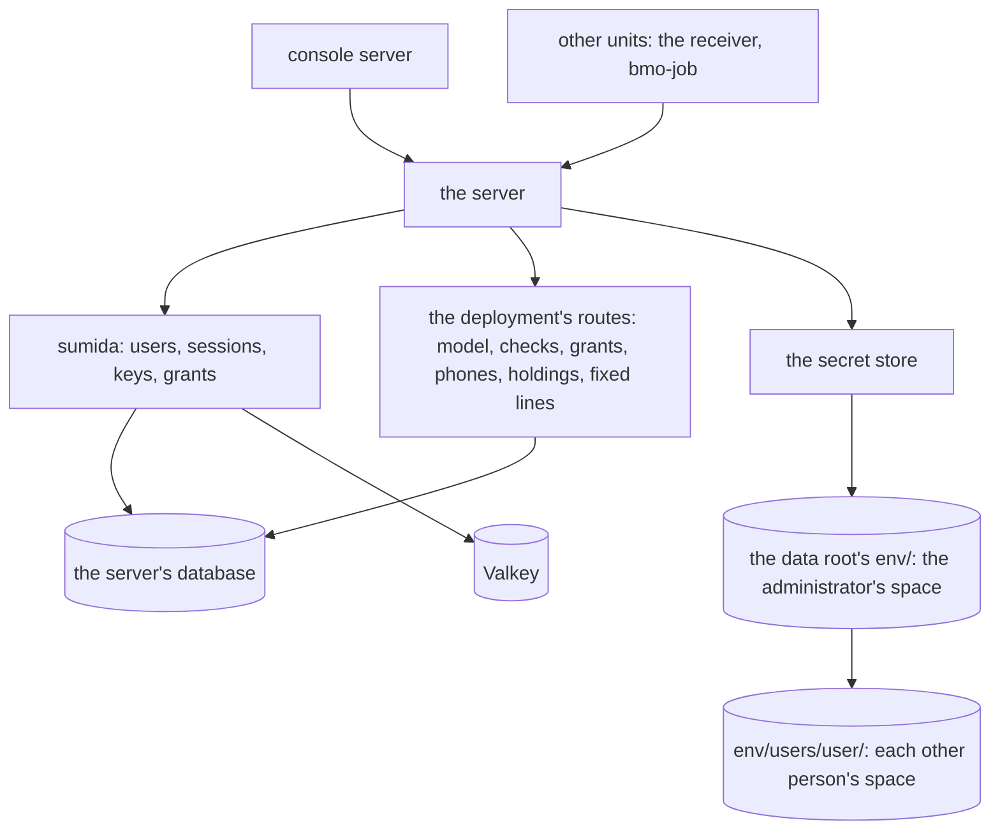

# The account service

## What it is

- **The server, in `server/`:** one Rust process linking sumida's users, sessions, API keys and permission
  layers, with the deployment's own rules file registered beside sumida's.
- **It holds the decisions, never the policy of a screen or a room.** Who a session is, who a phone key
  belongs to, whether a sender holds a relation in a room: the service answers. What a screen shows and what
  a unit does with a refusal are the console's and that unit's.
- **It stands on its own PostgreSQL database** and on a Valkey for sumida's sessions. Its tables are its own:
  sumida's, and the ones its migrations make (「The tables」 below). No other unit's table is read or written.
- **Beside its database it writes one folder:** the data root's `env/`, where the secret store keeps the files every
  unit reads its secrets from, and under it each person's own secret space (「The secret store」 below).
- **It answers on a runtime of its own, two threads named `account-service`.** sumida reads the operating
  system and the device out of the user agent of every request that reads a session, through about a thousand
  patterns built ASCII-only, and keeps what it read for the last 256 user agents. Each thread that runs the
  patterns keeps a scratch table per pattern, about 9 MB a thread, so on every core of a machine the parser
  alone would hold over 200 MB.

## Where it answers

- **On the listen address its settings name,** over HTTP, every route under the server's bearer token
  (`docs/boundary.md`, 「Wire conventions」). The console's server, the receiver and bmo-job are its callers,
  each with the server's base address and token in its own settings.
- **No browser and no phone reaches it.** The console's server is the only caller on the web side, and sumida's
  session routes are reached through it alone.
- **Its user unit** is the server's own, `deploy/bmo-web-server.service`, linked and restarted by the deployment
  (`testbed.toml`), running `serve` in the release's `server/`, where the deployment's settings stand as
  `settings.local.toml`.
- **Whether it can stand** is `bmo-web-server settings`: it reads the settings and refuses, saying why, where they
  name no `server.token` or no `names.chat_agent`, as `serve` would.
- **Whether it answers** is `bmo-web-server health`: it asks `GET /health` at the address the settings name, an
  unspecified host asked at the loopback one, waiting at most five seconds, and ends 0 where the service answers
  and 1 otherwise, saying why. The deployment waits on it.

## When it is in force

- **The server stands only on its database,** with sumida's tables standing and the deployment's rules
  registered; a database out of reach, or one the rules do not fit, stops it at its start, and its unit starts
  it again.
- **`GET /accounts/model`** answers whether the model is in force — whether the data move has been written —
  and why not where it is not. Once seen in force it stays so for the life of the process.
- **A reader asks this first.** Not in force, it reads as it does without the model: no sender is linked to a
  user and no grant stands.
- **Every route but `GET /health`, `GET /accounts/model` and `POST /accounts/move` answers 503 `not-in-force`
  while the model is not in force,** naming why, so no caller can mistake an absent model for a refusal.

## sumida's own routes

The service mounts sumida's router as sumida builds it, under `/sumida`, so sumida's own paths (its users
among them) never take one other units name; these are the ones the console calls.

- **Every request carries the browser's address in `X-Real-IP`,** which sumida's bans and its login lockout
  read, so the address must be one the browser cannot choose.
  - **The console hands on the address its reverse proxy names.** The proxy in front of the console sets its own
    `X-Real-IP` to the address it took the connection from, after undoing the hops it trusts, and the console
    hands that header on as it came. A request carrying none is handed on as the loopback address.
  - **`X-Forwarded-For` is never read.** Its entries are whatever the browser wrote, with the proxies' own
    appended behind them, so taking any of them would let a browser name a fresh address at every attempt.
  - **The console's port is reached through the proxy alone.** A request reaching the port directly writes its
    own `X-Real-IP`, so the deployment keeps the port off every network but the proxy's.
- **Sign-in:** `POST /sumida/auth/session` with the name and the password. The console always asks for the ordinary
  window, an idle one of seven days which the service extends at every request a session is read on, so
  staying signed in stays the console's own seal (`docs/web.md`, 「Access」). The answer carries the session
  cookie, `bmo.sid`; a refusal is 401.
- **Sign-out:** `DELETE /sumida/auth/session` with that cookie.
- **Who a session is:** `GET /sumida/me` with the cookie; 401 where it is no live session.
- **sumida's settings** are written beside the service at its start and named for sumida, with the database's
  address and Valkey's handed in their own variables; no token is issued here, so no secret is kept.

## The deployment's own routes

All JSON, all under the server's token. `docs/boundary.md` states each route's request and answer; this
section states what each does.

### Checks

- **`POST /checks/room`** — a room, a sender id and a room relation. Answers whether the sender holds the
  relation there, the grant that was asked for (`bmo_room:<chat id>#<relation>`), and the user the sender is
  linked to, where one is.
- **`POST /checks/message`** — a room, a message id and a room relation. The service asks the receiver for the
  message and checks its sender in that room. It refuses, saying so, where no such message stands in that room.
- **`POST /checks/object`** — a kind (`bmo_worker`, `bmo_repository`, `bmo_tools`), an object, a relation and a
  user. Answers whether the user holds it, and the grant asked for.
- **`POST /checks/entry`** — a room, the user acting and the user to let in or take out. Answers whether the one
  acting may let that person into the room (「A room's callers」), the decision asked for named as
  `bmo_room:<chat id>#entry`, and the person it was asked for.
- **What a check builds:** the sender's user where their identity is linked, and the room's members, always.
  The platform administrator passes every check but the entry check's company bound.

### Grants

- **`GET /grants?room=`** — the grants standing on a room, each with its relation, its subject, its expiry and
  the words beside it.
- **`POST /grants`** — what is granted (a room and a relation, or a kind, an object and a relation), to whom (a
  sender id, a user, or the room's members), the granter's words where any, an expiry where any, and the
  message it is granted on (its room and id).
  - The granter is that message's sender's user, and sumida checks they may grant it, so nobody gives what they
    do not hold.
  - A sender with no user yet is given one in the first company, with the default role and no way to sign in,
    and linked.
  - Granting again moves the expiry and the words.
- **`DELETE /grants`** — the same selector and the message it is revoked on, checked the same way.

### A room's callers

- **A room's callers are the users granted `ask` on the room directly:** each may call their own supervisor into
  the room by name, and the receiver asks the check of `ask` for the sender who calls.
- **They are set from the console with no message to make the grant on,** by the administrator, by the room's
  leader, the user who owns a supervisor the room names, by a head of the unit the room belongs to, the leader's, or
  by a head of the user's unit. The person adding a
  member to a room sets it then, and anyone of them changes it later from the room's list of callers.
- **Callers stay within one company:** a user of another company than the one who sets it is never made a caller,
  but by the administrator.
- **Letting a person into a room and the call grant are set together.** A console room's members are accounts, kept
  by the receiver; the console asks `POST /checks/entry` before it lets a person in or takes one out, and with the
  person let in sets their call grant in the same act where the one letting them in asks for it.
- **Who may let a person in:** the room's opener, a head of the opener's unit, or the administrator. A room opened in
  the console names its opener's own BMO as its leader, so its opener is its leader and the room belongs to the
  opener's unit; the check reads them as the callers' check does, through the room's leaders.
- **Only within the room's company.** The room stands in its leader's company, and a person of another company is
  never let in, by the administrator neither; a room with no leader is bounded by the company of the one letting in,
  but for the administrator. Leaving is every member's own and asks no check.

### The data move

- **`POST /accounts/move`** — the caller hands the service what the move needs out of the deployment's
  configuration: the sender ids the configuration names as the owner's, the rooms the deployment answers, and
  the room rules with their rooms, subjects and words. The console's one account becomes the platform
  administrator's user, its password carried as it stands; a console holding more than one account is refused
  with 409. The service writes the whole move in one transaction with sumida's own machinery and marks it done
  in its own `settings` table; a second call answers that it is done and writes nothing.
- **It makes the deployment's first company and its default role,** `member`, which every user holds. The
  company is named `bmo` at first and may be renamed like any unit; nothing reads it by its name after the
  move. A user made outside an invitation, by the account command or for a sender, goes into the first
  company, the unit with no parent made before every other one.
- **What the move writes is the service's own:** the users, their links to senders, every room's member grant
  at the deployment's defaults, the rules' grants and their words, and a user's id on the console's own tables
  that are keyed by user. A table of another unit is that unit's to key.

### Users and senders

- **Every account has an identity on the record road,** the console's own, beside whatever chat services' identities
  it has. The receiver keeps it, one for each account, made the first time it is asked for and the same ever after
  (the receiver's `PUT /accounts/{account}/identity`), since a message the account says in the console is filed
  under a sender as every message is. It is linked to the account in `user_senders` exactly as any identity is, so
  everything keyed by an account's senders — its own words, what it has read, its acts on a message — reads it as
  one of them.
- **`PUT /users/{user}/senders/{sender}`** — a sender linked to the user where it is linked to none, by the
  administrator, `Owner-Role: administrator`; answers 204, and the same again where the link already stands. A
  sender linked to another user is refused 409 `sender-linked`, since a link is the person and moving it would move
  their grants. The console's server calls it with the account's record identity as it makes an account ready
  (「Invitations and a person's machine」), and once each time it starts for every user the service holds, so an
  account that stood before the record road gained its identity then; both calls are idempotent, so the start
  repeats nothing that stands.
- **`GET /senders/{sender}/user`** — the user a sender is linked to, or nothing found.
- **`POST /senders/users`** — of the senders asked, those linked to a user, each with that user and whether they
  may sign in. A user made for a sender by a grant, an invitation not yet accepted and an account that has left
  cannot; the console marks a room's member as a console user only where they can (`docs/web.md`, the room
  screen's 대화상대).
- **`GET /users`** — every user, with their name and whether they are the platform administrator, for the
  administrator alone.
- **`GET /users/{user}`** — a user's name, whether they are the platform administrator, and the sender ids
  linked to them; **`GET /users/{user}/senders`** the sender ids alone.
- **`POST /users/{user}/password`** — the current password and the next; refused with 401 where the current one
  does not match, and hashed as sumida hashes every password.
- **`POST /users/{user}/name`** — another name; refused with 409 where another user holds it.
- **`GET /users/{user}/profile`** — a user's job title, landline, mobile and email, each an empty string where
  the account keeps none; **`POST /users/{user}/profile`** writes all four whole, an empty value clearing it,
  and answers the profile as it now stands. Both are the account's holder's or an administrator's: the console
  hands on the login it acts for in `Owner-Key` and `Owner-Role`, and any other login is refused 403 before a
  row is read or written. The profile is kept in the service's own table, so sumida's `users` stays as sumida
  made it; an account that keeps no profile has no row, and every account that stood before reads empty values.
- **`GET /users/{user}/sections`** — one user's console sections, each with whether they may read and write
  it: the account's holder's or an administrator's. **`PUT /users/{user}/sections`** writes one user's set
  whole, by an administrator alone (「Console sections」).
- **`GET /users/search?q=&limit=`** — the people of the reader's own company whose name, unit, job title or
  permitted contact details hold the words; at most 20 without a `limit`, and never more than 50.
- **`GET /users/{user}/person`** — one person of the reader's own company; 404 where the user does not stand or
  stands in another company (「The people directory」).
- **`GET /users/members`** — every person of the reader's own company who has not left, by user id and name
  alone, with no limit (「The people directory」).

### The owner's account

- **The owner's account is the user the owner's sender is linked to:** the sender the receiver names as the owner's
  (its `GET /owner`, from its own configuration), linked to a user in `user_senders` as any identity is. The
  receiver files the owner's account's words under that sender and takes his private chat as that account's.
- **The console stands the link where it stands linked to none,** to the user the data move made the platform
  administrator (「The data move」: the console's one account before the model, which was the owner's, written once
  in `settings` and changed by no route). It asks at its start, in the pass that stands every account's record
  identity, and again at the first request that needs the owner's account, so the owner is his account from the
  start with nothing for him to do. A link that stands is never moved: the service refuses one sender linked to two
  users. Where the receiver names no owner's sender, no move names an administrator or the service does not answer,
  the console writes so to its log and the request goes on.
- **Until the link stands the move's administrator keeps the owner's own road:** the console sends his words on the
  receiver's owner routes, holds the owner's private chat as his own room, and takes him for the owner's login, as it
  did before accounts had rooms of their own. On that road he writes in his own private chat always and in no
  account's private room, his own BMO's among them, until the link names his account, as the receiver takes the
  owner's road. A console login standing before the account model writes on the same road, for the owner's account
  once the link stands and for no account while it does not.

### Console sections

- **A console section is one entry of the console's navigation,** a screen of the sidebar's two sections, the
  rooms and the account beside them, or one part of agent management's screen, whose five tabs are
  its five parts, or `live`, what runs now, which no one screen holds and every screen that shows a run reads. Each screen is named by the first part of its path; each part of agent management is named
  by its tab:

  | Section | The screen |
  |---|---|
  | `live` | what runs now, read across the console: the bot's live picture, the queue and its items, the questions and the deployment |
  | `mail` | bmo-mail's screen |
  | `siren` | the cache siren |
  | `db` | the console's database |
  | `files` | bmo-drive's screen |
  | `artifact` | bmo-artifact's screen |
  | `documents` | the document viewer |
  | `code` | bmo-review's screen |
  | `supervisors` | agent management's 에이전트 tab, the supervisors and the roles' agents with what each is doing now |
  | `roles` | agent management's roles tab |
  | `repositories` | agent management's repositories tab |
  | `models` | agent management's registered models tab |
  | `model-files` | agent management's model files tab |
  | `research` | the research screen |
  | `monitor` | the machines and the card board |
  | `remote` | bmo-remote's screen |
  | `brain` | the brain's screen |
  | `rooms` | the reader's rooms and their messages |
  | `account` | the reader's own account, its settings and its secrets |

- **Agent management's screen opens on any one of its parts the reader may read,** and each tab on its own
  part alone. Its shared reads — the agent list, a provider's models, the provider switches and the fallback,
  an agent's face and tool marks — open on any part read; the provider switches and the fallback are changed on
  관리자's 공급자 tab, which only the administrator opens. An agent's own page stands under the three parts
  whose rows open it: the supervisors, the roles and the repositories.

- **A section's permission is two relations of the deployment's rules,** `read` and `write`, on a
  `bmo_section` object named by the section. They are checked through sumida's point check as every other
  relation is (`server/src/bmo.sz`); a write is also a read, so nobody changes what they may not see.
- **The platform administrator passes every section.**
- **A user's grants are sumida's relation tuples,** so the service keeps no table of them. An administrator
  writes one user's set whole, and a section named no more is taken away.
- **The defaults in force are the console as it stood before this surface:** `rooms` read, `account` read and
  written, and the sections of the screens units bring that a member could open — `mail`, `files`, `artifact`,
  `code`, `remote` and `brain` — read. A screen whose manifest names the administrator alone stays closed to a
  member by that manifest, whatever its section says. A user made by the account command or linked to a sender
  is given the defaults, and the users who stood before this surface did are given them once, as the service
  starts against a database where that seeding has not run. A user whose administrator has since taken every
  section away keeps none.
- **The console reads them for its navigation and its route guard.** A reader sees only the sections they may
  read, and a route of a section they may not read or write answers them as if nothing stood there. A screen a
  unit brings is held to its manifest's role as well, so a section alone never opens a screen the unit keeps
  for the administrator.

### Companies and organisation units

- **An organisation unit is one of sumida's organisations,** and the units of a deployment form sumida's tree of
  them. A unit standing at the top of the tree, with no parent, is a **company**; every other unit belongs to the
  company at the top of its branch, and a company holds units under units to any depth. The words a company calls its units by — division, centre, team, part — are
  their names alone, and nothing here reads a meaning into them (`STRUCTURE.md`, 「Terms」).
- **A user stands in exactly one unit,** the organisation sumida keeps on the user, at any depth of the tree, and
  belongs to that unit's company.
- **A person's role in their unit is its head or a member,** the two places a move and an invitation name. What a
  person may open in the console is not a role's: it is their own sections, set one person at a time (「Console
  sections」).
- **A unit's head is a `manager` of it in sumida's rules,** granted as a relation tuple on the unit. sumida's
  `manage` permission reads the tuple on the unit and on every unit above it, so a head heads their own unit and
  everything below it, and the platform administrator heads every unit.
- **`GET /users/{user}/unit`** answers the user's unit, its company and the path between them, from the company
  down to the unit, so a caller tells whether one unit stands under another without a call of its own.
- **`GET /units/{unit}`** answers a unit: its name, its parent, its company, its path, the units directly under
  it, the users granted head of it directly, and the users standing in it.
- **`POST /checks/unit`** answers whether a user heads a unit: sumida's point check of `manage` on the unit, so a
  head of a unit above it is a head of it too.
- **Making, naming and moving units, granting and taking away their heads, and placing users in them** are the
  platform administrator's, on the routes `docs/boundary.md` lists under 「Organisation units」. A unit stays in its
  company: a move under a parent of another company, or under the unit itself or one below it, is refused, and a
  unit with no parent is a new company. sumida rebuilds its tree as the units change, so every check reads the
  tree as it now stands.
- **Several people are moved into one unit in one act,** each with their place in it: its head or a member. The
  act names, for each person, the unit they stood in when it was shown, and is written in one transaction, so a
  person moved by someone else since, an account that has left, or a person or unit that does not stand refuses
  it whole and nobody is moved. A person coming from another unit is no longer granted head of the unit they
  leave, since heading a unit one has left would keep its permissions; a grant on a unit above it is the higher
  unit's and stays. A person already standing in the unit keeps standing there and takes the place named, so one
  act also changes a role without a move.
- **The console's organisation screen,** 조직's 조직도 tab, draws the units as a tree and does each of these for
  the administrator (`docs/web.md`, 「조직도」).

### Invitations and a person's machine

- **An invitation is a link that makes one account in one unit,** made by the platform administrator for any unit,
  or by a head for their unit or one below it. The unit is a company itself or a unit under it at any depth. It
  names the person's role there, the unit's head or a member, the head being the administrator's alone to give,
  and how many hours it stands open; past them, or once used, it opens nothing.
- **The units a login may invite into are answered with their parents and their company,** each unit after its
  parent, so the maker chooses a company and then a unit of its tree. A head reads their own unit and those below
  it, their own unit standing at the top of what they read under its company.
- **The link is opened with no sign-in.** It shows the unit and its company and asks for a name and a password.
  Accepting it makes the account disabled, in the unit, a head where the invitation says so, with the console
  sections every user is given, and binds it to the machine name `u<user>`.
- **Acceptance needs the invitation open, the name free and the default role standing.** The account's
  organisation is the invitation's unit, so no unit's or company's name is read, and a company renamed after
  the invitation was made takes it in just the same. Where the default role does not stand, acceptance is refused 409
  `not-ready`, and the console says the deployment is not ready to make accounts.
- **An account is enabled only once its machine is proven:** the person installs jake with the command the
  acceptance answers, which names the machine and carries a credential made for that name alone (jake's
  `docs/architecture.md`), and the service asks the jake hub whether an agent of that name is attached. Attached,
  the account is enabled and the machine recorded as proven.
- **An account made ready is given its own BMO and its identity on the record road.** As the proof answers the
  account active, the console's server has the receiver stand the account's BMO with its private room and the
  account's record identity, and links that identity to the account (「Users and senders」), so the person reads and
  speaks in the console from their first sign-in with no chat service's identity at all.
- **A proven machine becomes the node the account's runs stand on.** As the proof answers the account active, the
  console's server reads the machine the account is bound to and sets it in agency's record of the account's node,
  `PUT /person-nodes/{ownerAccount}` with the user's id and `node` the machine's name (agency's
  `docs/person-nodes.md`, 「Which node is a person's」), so the person's BMO and agents run on their own PC. Every
  proof that answers active sets it again, so opening the invitation's link once more sets a record that did not
  land. A refusal — 422 `not-a-hub-node`, where the node service keeps no hub node of that name free of every
  service, or agency out of reach — is written to the console's log, and the account stands active all the same.
- **The administrator binds an account to another machine or takes its machine away.** Bound again, the account
  is given the machine the administrator names, or a fresh name of its own (`u<user>` and a random tail), so the
  credential of the machine it was bound to before proves nothing now; the answer carries the new machine's
  credential and one-line installs, as acceptance does. A name another account is bound to is refused 409
  `node-taken`, and an account that has left is bound to no machine again, 409 `left`. The binding is proven as it
  is made where the hub holds the machine already, and otherwise once it attaches, by the console asking again from
  the organisation screen or by the person's first sign-in after it attaches.
- **The administrator may declare a machine shared,** binding several accounts to one machine. A binding that says
  so is made where every other account bound to that name was bound shared as well; a binding that does not say so,
  or one naming a machine another account holds unshared, is refused 409 `node-taken` as above, so no account comes
  to share a machine its binding never declared shared. The binding keeps whether it is shared and answers it on
  every read of the account's machine. Each account on a shared machine works in a root of its own there, out of
  reach of the others' (agency's `docs/person-nodes.md`, 「Several accounts on one node」). An invitation never binds
  a shared machine: acceptance always binds the person's own `u<user>`.
- **Agency's record follows the binding.** The console's server sets the new machine as the account's node in
  agency once it is proven, with whether the binding is shared, and not before, since agency takes only a hub node
  the node service keeps; until then the record names the machine it was bound to before. Taken away, the binding is removed and the console's server
  takes agency's record away with it (`DELETE /person-nodes/{ownerAccount}`), so the account is held to no machine
  and its runs are placed as any run of no node is. A refusal by agency is said on the organisation screen; at a
  sign-in it is written to the console's log.
- **An account whose machine is gone cannot be used until it is proven again:** the console refuses its sign-in
  while the hub holds no agent of its machine's name, and lets it in again once one attaches. An account bound to
  no machine — the administrator's, and every account made before invitations — is held to none of this.
- **The credential is made with the hub's agent key,** which the service's settings carry beside the hub's address,
  its control address and its control token; a service whose settings name no hub makes no invitation.

### Desktop pairing

- **The console's desktop app is given its person's machine credential by pairing,** never by asking for a secret:
  the app asks for a pairing with no sign-in, the person approves it on the console's page while signed in
  (`docs/web.md`, 「The desktop pairing page」), and the app then reads the machine and its credential once. It
  stands beside the invitation and its one-line installs, which go on as they are.
- **A pairing is asked with no sign-in** and answers an unguessable id, which the app alone keeps; a code of eight
  letters and digits, leaving out 0, 1, I and O and written as two groups of four, which the app and the console's
  page both show so the person can see they are one; when it closes; and how many seconds the app waits between
  reads. A pairing stands ten minutes.
- **Asking is limited by the asker's address.** The console hands on the address its proxy names, as it does for a
  sign-in (「sumida's own routes」). An address that asked ten pairings in the last ten minutes is refused 429
  `too-many-pairings` until the oldest of them is ten minutes old, and at most a thousand pairings wait at once, past
  which every address is refused the same way.
- **The code is read and answered by a signed-in person,** whom the console names in `Owner-Key`. Read, a pairing
  answers its code, when it closes, its state (waiting, approved, refused or expired) and the machine it will be for:
  while it waits, the machine the reader's account is bound to, none where it is bound to none; once approved by
  the reader, the machine it was approved for.
- **Approving binds the pairing to the approver's machine:** the machine their account is bound to (「Invitations and
  a person's machine」), or, for an account bound to none, a fresh binding made as the administrator's rebind makes
  one where no name is named, `u<user>` and a random tail. From then on the account is bound to that machine as any
  bound account is, so an account other than the administrator's signs in only while the hub holds it. An account
  that has left is refused 409 `left`.
- **Refusing closes the pairing.** A pairing approved, refused or expired is approved or refused no more, 410
  `pairing-closed`, and one being approved at that moment is refused to a second approver the same way.
- **The app reads its pairing by the id:** 202 while it waits; once approved, 200 with the machine's name, its
  credential and the hub's address, and only once, since the read takes the pairing away and a second read finds
  nothing, 404. Refused or expired, it answers 410 `pairing-closed` for ten minutes past its close, and nothing after.
  An approved pairing unread when its ten minutes end is expired like any other.
- **The credential is made at that read and kept nowhere.** A pairing holds the approving user and their machine's
  name, never a credential; the read makes it with the hub's agent key, as an invitation's credential is made, for
  the machine the approver's account is still bound to at that moment. An account bound to another machine since, to
  none, or marked left closes the pairing at the read instead, 410. So a pairing never answers a credential for any
  machine but the approving person's, and never the hub's agent key or a control credential. No answer but that one
  read's carries the credential, and the service logs no request, body or answer.
- **Pairings are held in the service's memory, never in its database,** so a restart forgets every one and the app
  asks again.
- **The machine is proven as any binding is,** once the app's agent attaches: the console's page asks the approver's
  machine's proof, `POST /users/{user}/node/proof`, and sets agency's record of the account's node, as the
  organisation screen's check does (「Invitations and a person's machine」).
- **A service whose settings name no hub makes no pairing,** 503 `no-hub`.

### A person who leaves

- **A person who leaves is marked so, never removed:** the administrator, or a head of the unit the person stands
  in, marks the account left. Its sign-in is disabled for good, the moment and who marked it are kept, and the
  account stays in its unit with everything it held, so what it did stays where it was done.
- **What stays readable is what was public:** the person's public projects and their records go on being read by
  the heads above, as any public project is (bmo-project's `docs/design.md`). Their private projects, their private
  conversations and their supervisor's memory are sealed: nobody is given them.
- **Their supervisor is woken nowhere again,** and a quiet instruction for it is let go (the receiver's
  `docs/wake.md`): the receiver reads the departure off the account's machine standing.

### The people directory

- **The directory is the users of the reader's own company:** every user whose unit stands under the company
  the reader's unit belongs to. The reader is named by `Owner-Key`; a call naming no user of the deployment is
  refused 403, and a search never answers a user of another company.
- **A person answers these fields:** their user id, their name (their full name where they keep one, their
  user name otherwise), their unit's name, their job title, and their landline, mobile and email.
- **The contact details are read by the platform administrator and by the person themselves.** Everyone else
  in the company reads the name, the unit and the job title alone; the three contact fields are absent from the
  answer, not empty.
- **The members list is every person of the reader's company who has not left,** the users of the company at the
  top of the reader's branch of the tree but those marked left (「A person who leaves」), each by their user id and
  their name alone, in the directory's order and with no limit: what a picker needs to find a person and show
  them, and nothing of their unit, job title or contact.
  It is refused as a search is, for a call naming no user of the deployment or a reader whose unit stands in no
  company. The console hands it to the screens a unit brings (`docs/web.md`, 「Screens a unit brings」).
- **A search matches only the fields its reader may see.** A member's words are matched against the name, the
  organisation, the job title and their own contact details; the administrator's against every contact detail
  as well, so a refused field is never an answer to a search.
- **The console's search reads it** as typing stops, and a result opens the person's page at `/people/<user>`
  (`docs/web.md`, 「Sidebar」 and 「Person's page」). The page and its calls are the account section's, so a
  console route that the account section's read does not open answers as if nothing stood there.

### Phones

- **`POST /phones`** — a user; answers a new secured key of theirs, once, and the hash sumida keeps it by.
- **`POST /phones/adopt`** — a phone token issued before the model and the user it belongs to. The token
  becomes a secured key of that user, so the phone goes on without signing in again.
- **`POST /phones/who`** — a key; answers whose it is, or 401 where it is no live key of a user who may sign in.
- **`DELETE /phones/{hash}`** — a key taken away.

### A room's holdings

- **`GET /rooms/{chat}/holdings`** — what the service keeps for a room: the grants made on it or to its members,
  and the senders whose user holds a grant on it. The receiver asks it before it removes a room, and shows the
  answer as what the removal would take; the grants stay, and open nothing once the room is gone.
- **The service declares itself a holder** to the receiver as it starts, under the unit name `web`, naming its
  address — `http://` and its listen address, an unspecified host as the loopback one — and these two holdings:
  `room_grants`, which the receiver warns of, and `room_senders`, which stay. A declaration that does not land
  is said on the service's error stream, and the service declares again at its next start.

### The secret store

- **The store is the data root's `env/` folder,** the one the server's `secrets.dir` setting names, and its whole
  work is to write a file under a name; agents and settings are then given the name, never the value.
- **A secret is a person's.** The store holds one space for each person, and a space is listed, written and
  emptied by its own person alone: the console hands on the signed-in login's user in `Owner-Key`, and every route
  of the store refuses a call whose key is not the space's user. Nobody lists another person's names, the
  administrator included; a login with no user holds no space.
- **Where a space stands:**
  - **The platform administrator's space is `env/` itself.** The platform's own work runs on the administrator's
    accounts (「The data move」), every unit reads the deployment's secrets there by the file name its own settings
    carry, and every secret the store wrote before people held spaces of their own stands there; so it is all the
    administrator's, read where it always was, and nothing moves.
  - **Every other person's space is `users/<user>/` under it,** `<user>` being their user's id written as a decimal
    number, the key `Owner-Key` carries and the one their supervisor `u<user>` is named by. The login name, which a
    person may change, names no space. The folder is made, mode 700, at the person's first write, and `users` itself
    is no secret's name in `env/`, since a folder stands there under it.
  - **The space follows the administrator's place,** read from the service's `settings` at each call: a user who
    stops being the platform administrator writes into `users/<user>/` from then on, and what they wrote in `env/`
    stays the deployment's, with the user who is made the administrator.
- **A secret's address** is its space and its name, relative to `env/`: `<name>` for the administrator's, and
  `users/<user>/<name>` for anyone else's.
- **Who reads a secret:**
  - **A unit reads the deployment's secrets** by the path its own settings name under `env/`, as it always has.
  - **The administrator's agents** (the supervisor of no account, and the workers and runners it orders) are handed
    a name and read it in `env/`, where the chat agent's request names it (agency's chat procedure 「Asking for a
    secret」).
  - **A person's own secret is read on this machine, by a unit acting for that person,** which takes the person from
    the account its caller's credential names, never from an argument, and reads `users/<user>/<name>`. A person's
    agents stand on their own PC (agency's `docs/person-nodes.md`, 「Which node is a person's」), where the data
    root's credentials are never sent (agency's `docs/work-nodes.md`, 「The link」); so they hand the name to such a
    unit, reached through the tool host's port the link carries back, and never read the file. A unit that comes to
    need a person's secret adds that reading by this address; none reads a person's space today.
  - **The console and this service never read a value back.**
- **A person who leaves keeps their space as it stood,** sealed with their other private records (「A person who
  leaves」): their sign-in disabled, nobody lists it, and nothing reads it for them.
- **`GET /users/{user}/secrets`** lists the names standing in the person's space, each with its size, the time it
  last changed and the kind its file reads as, and never what a file holds. The administrator's lists `env/`'s own
  files, never a folder under it.
- **A secret's kind is read off its file's shape,** since the store keeps no kind: a file of at most 16 KiB made of
  `KEY=VALUE` lines alone, each key one field of a kind of several fields, none twice and every required one
  among them, reads as the first such kind in the kinds' order (「Secret kinds」). Only the keys before each `=` are
  read, and only the kind's key is answered. A kind of one field gives its value alone, which no shape tells
  apart, so no file reads as one, and a secret reading as none is listed with no kind.
- **`PUT /users/{user}/secrets/{name}`** writes a value under a name in the person's space: whole, to a hidden file
  of mode 600 beside it, then moved onto the name, so a reader never meets half a value. A name that stands already
  is replaced only where the call says so; the value replaced stays as `<name>.previous`, mode 600. It answers the
  name, the size and the time alone. The value comes as text, or as base64 where the call says so, so a file that is
  not text is written as its own bytes.
- **`DELETE /users/{user}/secrets/{name}`** moves the file to `<name>.previous`, in place of any earlier one.
- **No route reads a value back.** The value goes into the file and nowhere else: the server logs no request and no
  body, and no answer, refusal or line on its error stream carries it.
- **A name is a plain file name,** with no slash and no leading dot, and not ending in `.previous`, the suffix the
  store keeps the value before for; a name standing as a folder or a link is no secret's, and is refused
  (`docs/boundary.md`, 「The secret store」).

### Secret kinds

- **A kind is the shape a secret is asked in,** kept in the service's database and never holding a value: a key the
  console's address names it by, a name and a description a person reads, and its fields. Each field has the key its
  line is written under in the file — the name the unit that reads the file looks for, such as
  `AWS_ACCESS_KEY_ID` — a label, whether its value is masked as it is typed, how it is typed (one line, several
  lines, or a file) and whether it is required.
- **The fields decide the file's shape.** A kind of one field gives a file holding that value alone, the shape a
  token or a key file has; a kind of several gives one `KEY=VALUE` line to each field given, the shape of an
  environment file, so its fields are one line each. A several-line or file field stands alone in its kind, and its
  file is its bytes unchanged. The console's form writes the file by these rules and hands the store the whole of
  it (`docs/web.md`, 「비밀 보관함」); the store keeps no kind, and its list reads one off a file's shape
  (「The secret store」).
- **The deployment's, kept by the administrator.** Every person's secret form asks in the same kinds, so any login
  reads them; the administrator alone adds, changes and removes one, and the routes refuse a kind that breaks the
  rules above (`docs/boundary.md`, 「Secret kinds」). A kind's key does not change once added.
- **The defaults are seeded once each,** with their names and labels from the server's pack (`secret-kinds`), in
  this order: API key; account login, a user name and a password; AWS access key, the access key id, the secret
  access key and the region; OAuth client, the client id and the client secret; database connection, the host, the
  port, the user, the password and the database; SSH private key, one several-line field; file, one file field, for
  a certificate, a service account's JSON and the like; card (`card`), the card number `CARD_NUMBER` masked, the
  expiry `CARD_EXPIRY`, the security code `CARD_CVC` masked and the holder's name `CARD_HOLDER_NAME`; and delivery
  address (`delivery-address`), the recipient `RECIPIENT`, the phone `PHONE`, the postal code `POSTAL_CODE`, the
  address `ADDRESS` and the detail `ADDRESS_DETAIL`, the detail alone optional. Every field of the last two is one
  line. The migration that makes the table seeds the first seven, and a later migration the card and the delivery
  address; each puts its kinds after every kind standing and leaves a kind standing under one of its keys as it
  stands, so a deployment made before gains the two once and keeps every kind it holds. From then on they are the
  owner's to change or remove like any other.

## The account command

- **The server's binary makes the user a name signs in as, or gives one standing a new password,** with the
  password read from standard input so it stands in no process listing.
  - A user made is enabled, in the first company with the default role (「The data move」), and given the
    console sections in force — their rooms read and their account read and written — holding nothing else
    until it is granted; `--administrator` also makes it the platform administrator.
  - A user standing is enabled again with the new password, and keeps its grants and its links.
  - The password is hashed as sumida hashes every password.
- **It writes the database the service reads,** the one its settings name, and refuses where the data move has
  not run.
- **People reach it through the console's user script,** which hands it the name and the password
  (`docs/web.md`, 「Making an account and resetting a password」).

## Whose work a job is

- **A job another user filed is checked by bmo-job as it launches:** `POST /checks/object` for the user's
  `run` on the worker and `change` on its repository. Whether the user holds a Claude account of their own is
  the agency's to answer.
- **What a check decides is the grants and nothing else.** Which item runs on whose authority is the job
  service's own record.

## The tables

Beside sumida's own, which sumida's migrations make, the service's migrations make:

| Table | What it holds |
|---|---|
| `user_senders` | the link from a chat service's sender to a user |
| `user_profiles` | a user's job title and contact details, keyed by sumida's user; an account keeping none has no row and reads empty |
| `grant_words` | the words a grant was made with, beside the grant |
| `user_invites` | each invitation: its token, its unit, whether it makes a head, who made it, when it closes, and who used it and when |
| `user_nodes` | the machine each invited account is bound to, whether the administrator bound it shared, and when it was last proven |
| `user_departures` | each account marked left: when, and by whom |
| `secret_kinds` | each secret kind: its key, name, description and fields, and the order kinds were added in |
| `settings` | the service's own keys: the mark that the move is written, and the platform administrator's user |
| `web_users` | the console's own accounts, the sign-in that stands before the model is in force |
| `web_push_devices` | a user's browsers that take push notices |
| `web_tab_states` | a user's open tabs per screen |
| `web_palettes` | the bubble palette each user reads rooms in |
| `web_themes` | the theme each user reads the console in |
| `web_room_reads` | how far each user has read each room |
| `document_talk` | the console's threads about a document: each word said over one, by whom, with the passage, heading and version it was said over (`docs/documents-viewer.md`, 「The record」) |

## Tests

- **The grant tests run against sumida itself,** in `server/tests/` on a database of their own: no grant
  refuses every acting relation with the grant named; a grant in one room opens nothing in another; an expired
  grant refuses as an absent one; every room's member grant after the data move is the deployment's default;
  the administrator passes every check in every room.
- **The section tests** stand a user made, read the defaults they are given, have an administrator write one
  person's read and write, and ask the check for a permitted and a refused relation; a user other than the
  administrator is refused the write and the users list.
- **The people tests** read the same company's people by name, unit, job title and contact, across the units
  of one company, see a member's answer carry no contact detail, find nothing of another company, and match no
  contact detail a member may not see.
- **The invitation tests** stand a stand-in hub: a head invites a member into their unit and not a head, reads
  the units they may invite into with their parents and their company, an invitation into a unit three levels
  down makes its head there and one into the company itself a member of it, an invitation already standing in the
  table is listed, viewed and accepted into its unit and role as it was made, an expired or used invitation opens
  nothing, acceptance makes a disabled account bound to its machine with a credential the hub's key verifies,
  proof enables it once the hub holds the agent, and the machine check says gone where the hub holds none. A
  binding to a machine another account holds is refused unless both bindings are declared shared, and two shared
  bindings to one machine stand side by side, each read back as shared.
- **The pairing tests** stand the same stand-in hub and a clock of their own: a pairing asked, read as waiting,
  approved by a person bound to a machine and read once with a credential the hub's key verifies for that machine,
  then gone; a person bound to none given a fresh binding; a refused pairing and an expired one answering 410 and
  approved no more; a second approver refused; an approver bound elsewhere or marked left before the read answering
  410 and no credential; and an address refused past its tenth pairing until its window passes.
- **The organisation tests** make a company and units under it as the administrator, rename and move one, refuse
  a move into another company and under itself, grant and take away a head, place a user, and refuse every one
  of these to a member.
- **The unit tests** stand a company with units under it, read a user's unit, company and path, read a unit's
  children, heads and members, and check that a head of a unit heads the units below it and not the one above.
- **Every route of `docs/boundary.md`'s 「What the server serves」 answers in a test.**
- **The secret store's tests stand on a temporary folder** in place of the data root's `env/`: the modes a write
  leaves, the value kept before, the names refused, a base64 value written as its bytes, and that no answer and no
  refusal carries a value; the administrator's space at the folder and a member's under `users/<user>/`, neither
  listing the other's, and every route refused to a key that is not its space's user, the administrator's
  included.
- **The secret kind tests** read the seeded defaults with their fields, migrate a store made before the card and
  delivery-address kinds and see it gain both once after every kind it keeps, the owner's changes and a kind of its
  own under a seeded key left as they stand, add, change and remove a kind as the administrator, refuse each
  rule a kind can break and a key that does not match its path, read the kinds as a member, and refuse a member
  every change.
- **The console's side tests against a stand-in** answering these routes, so a console test needs neither the
  binary nor Valkey.
