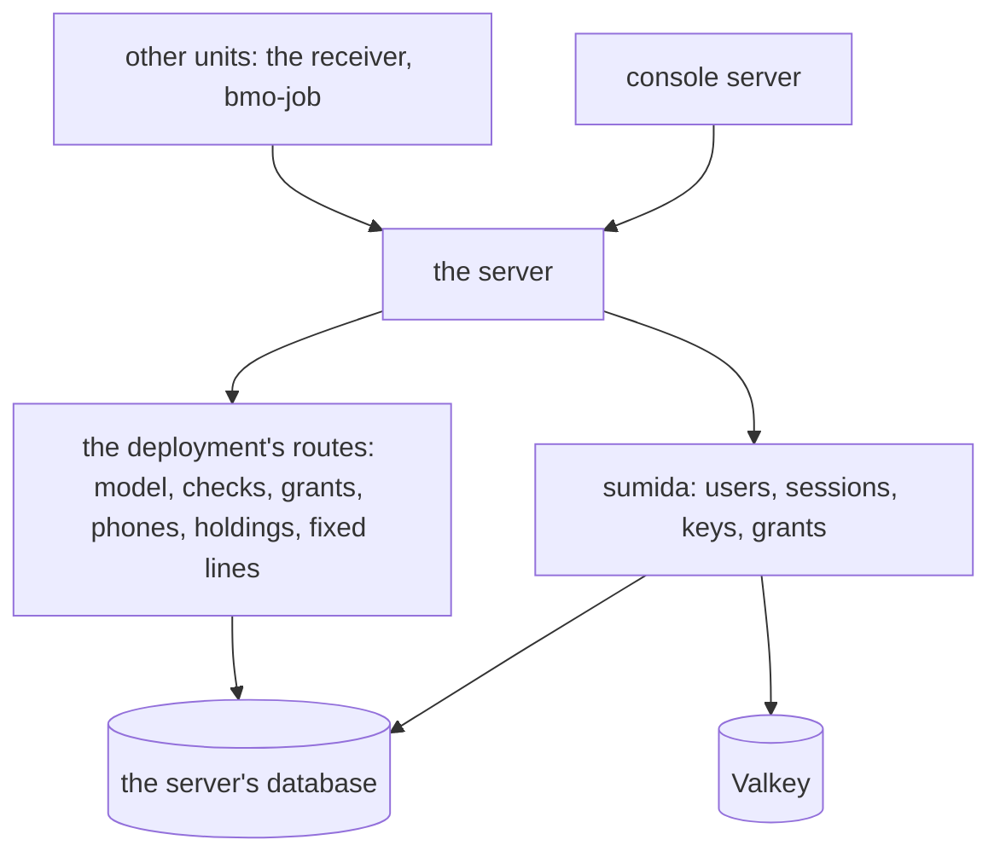

# The account service

## What it is

- **The server, in `server/`:** one Rust process linking sumida's users, sessions, API keys and permission
  layers, with the deployment's own rules file registered beside sumida's.
- **It holds the decisions, never the policy of a screen or a room.** Who a session is, who a phone key
  belongs to, whether a sender holds a relation in a room: the service answers. What a screen shows and what
  a unit does with a refusal are the console's and that unit's.
- **It stands on its own PostgreSQL database** and on a Valkey for sumida's sessions. Its tables are its own:
  sumida's, and the ones its migrations make (「The tables」 below). No other unit's table is read or written.
- **It answers on a runtime of its own, two threads named `account-service`.** sumida reads the operating
  system and the device out of the user agent of every request that reads a session, through about a thousand
  patterns built ASCII-only, and keeps what it read for the last 256 user agents. Each thread that runs the
  patterns keeps a scratch table per pattern, about 9 MB a thread, so on every core of a machine the parser
  alone would hold over 200 MB.

## Where it answers

- **On the listen address its settings name,** over HTTP, every route under the server's bearer token
  (`docs/boundary.md`, 「Wire conventions」). The console's server, the receiver and bmo-job are its callers,
  each with the server's base address and token in its own settings.
- **No browser and no phone reaches it.** The console's server is the only caller on the web side, and sumida's
  session routes are reached through it alone.
- **Its user unit** is the server's own, `deploy/bmo-web-server.service`, linked and restarted by the deployment
  (`testbed.toml`), running `serve` in the release's `server/`, where the deployment's settings stand as
  `settings.local.toml`.
- **Whether it can stand** is `bmo-web-server settings`: it reads the settings and refuses, saying why, where they
  name no `server.token` or no `names.chat_agent`, as `serve` would.
- **Whether it answers** is `bmo-web-server health`: it asks `GET /health` at the address the settings name, an
  unspecified host asked at the loopback one, waiting at most five seconds, and ends 0 where the service answers
  and 1 otherwise, saying why. The deployment waits on it.

## When it is in force

- **The server stands only on its database,** with sumida's tables standing and the deployment's rules
  registered; a database out of reach, or one the rules do not fit, stops it at its start, and its unit starts
  it again.
- **`GET /accounts/model`** answers whether the model is in force — whether the data move has been written —
  and why not where it is not. Once seen in force it stays so for the life of the process.
- **A reader asks this first.** Not in force, it reads as it does without the model: no sender is linked to a
  user and no grant stands.
- **Every route but `GET /health`, `GET /accounts/model` and `POST /accounts/move` answers 503 `not-in-force`
  while the model is not in force,** naming why, so no caller can mistake an absent model for a refusal.

## sumida's own routes

The service mounts sumida's router as sumida builds it, under `/sumida`, so sumida's own paths (its users
among them) never take one other units name; these are the ones the console calls.

- **Every request carries the browser's address in `X-Real-IP`,** which sumida's bans and its login lockout
  read, so the address must be one the browser cannot choose.
  - **The console hands on the address its reverse proxy names.** The proxy in front of the console sets its own
    `X-Real-IP` to the address it took the connection from, after undoing the hops it trusts, and the console
    hands that header on as it came. A request carrying none is handed on as the loopback address.
  - **`X-Forwarded-For` is never read.** Its entries are whatever the browser wrote, with the proxies' own
    appended behind them, so taking any of them would let a browser name a fresh address at every attempt.
  - **The console's port is reached through the proxy alone.** A request reaching the port directly writes its
    own `X-Real-IP`, so the deployment keeps the port off every network but the proxy's.
- **Sign-in:** `POST /sumida/auth/session` with the name and the password. The console always asks for the ordinary
  window, an idle one of seven days which the service extends at every request a session is read on, so
  staying signed in stays the console's own seal (`docs/web.md`, 「Access」). The answer carries the session
  cookie, `bmo.sid`; a refusal is 401.
- **Sign-out:** `DELETE /sumida/auth/session` with that cookie.
- **Who a session is:** `GET /sumida/me` with the cookie; 401 where it is no live session.
- **sumida's settings** are written beside the service at its start and named for sumida, with the database's
  address and Valkey's handed in their own variables; no token is issued here, so no secret is kept.

## The deployment's own routes

All JSON, all under the server's token. `docs/boundary.md` states each route's request and answer; this
section states what each does.

### Checks

- **`POST /checks/room`** — a room, a sender id and a room relation. Answers whether the sender holds the
  relation there, the grant that was asked for (`bmo_room:<chat id>#<relation>`), and the user the sender is
  linked to, where one is.
- **`POST /checks/message`** — a room, a message id and a room relation. The service asks the receiver for the
  message and checks its sender in that room. It refuses, saying so, where no such message stands in that room.
- **`POST /checks/object`** — a kind (`bmo_worker`, `bmo_repository`, `bmo_tools`), an object, a relation and a
  user. Answers whether the user holds it, and the grant asked for.
- **What a check builds:** the sender's user where their identity is linked, and the room's members, always.
  The platform administrator passes every check.

### Grants

- **`GET /grants?room=`** — the grants standing on a room, each with its relation, its subject, its expiry and
  the words beside it.
- **`POST /grants`** — what is granted (a room and a relation, or a kind, an object and a relation), to whom (a
  sender id, a user, or the room's members), the granter's words where any, an expiry where any, and the
  message it is granted on (its room and id).
  - The granter is that message's sender's user, and sumida checks they may grant it, so nobody gives what they
    do not hold.
  - A sender with no user yet is given one, with no way to sign in, and linked.
  - Granting again moves the expiry and the words.
- **`DELETE /grants`** — the same selector and the message it is revoked on, checked the same way.

### The data move

- **`POST /accounts/move`** — the caller hands the service what the move needs out of the deployment's
  configuration: the sender ids the configuration names as the owner's, the rooms the deployment answers, and
  the room rules with their rooms, subjects and words. The console's one account becomes the platform
  administrator's user, its password carried as it stands; a console holding more than one account is refused
  with 409. The service writes the whole move in one transaction with sumida's own machinery and marks it done
  in its own `settings` table; a second call answers that it is done and writes nothing.
- **What the move writes is the service's own:** the users, their links to senders, every room's member grant
  at the deployment's defaults, the rules' grants and their words, and a user's id on the console's own tables
  that are keyed by user. A table of another unit is that unit's to key.

### Users and senders

- **`GET /senders/{sender}/user`** — the user a sender is linked to, or nothing found.
- **`GET /users/{user}`** — a user's name, whether they are the platform administrator, and the sender ids
  linked to them; **`GET /users/{user}/senders`** the sender ids alone.
- **`POST /users/{user}/password`** — the current password and the next; refused with 401 where the current one
  does not match, and hashed as sumida hashes every password.
- **`POST /users/{user}/name`** — another name; refused with 409 where another user holds it.

### Phones

- **`POST /phones`** — a user; answers a new secured key of theirs, once, and the hash sumida keeps it by.
- **`POST /phones/adopt`** — a phone token issued before the model and the user it belongs to. The token
  becomes a secured key of that user, so the phone goes on without signing in again.
- **`POST /phones/who`** — a key; answers whose it is, or 401 where it is no live key of a user who may sign in.
- **`DELETE /phones/{hash}`** — a key taken away.

### A room's holdings

- **`GET /rooms/{chat}/holdings`** — what the service keeps for a room: the grants made on it or to its members,
  and the senders whose user holds a grant on it. The receiver asks it before it removes a room, and shows the
  answer as what the removal would take; the grants stay, and open nothing once the room is gone.
- **The service declares itself a holder** to the receiver as it starts, under the unit name `web`, naming its
  address — `http://` and its listen address, an unspecified host as the loopback one — and these two holdings:
  `room_grants`, which the receiver warns of, and `room_senders`, which stay. A declaration that does not land
  is said on the service's error stream, and the service declares again at its next start.

## The account command

- **The server's binary makes the user a name signs in as, or gives one standing a new password,** with the
  password read from standard input so it stands in no process listing.
  - A user made is enabled, in the organization and role every user is given, and holds nothing until it is
    granted; `--administrator` also makes it the platform administrator.
  - A user standing is enabled again with the new password, and keeps its grants and its links.
  - The password is hashed as sumida hashes every password.
- **It writes the database the service reads,** the one its settings name, and refuses where the data move has
  not run.
- **People reach it through the console's user script,** which hands it the name and the password
  (`docs/web.md`, 「Making an account and resetting a password」).

## Whose work a job is

- **A job another user filed is checked by bmo-job as it launches:** `POST /checks/object` for the user's
  `run` on the worker and `change` on its repository. Whether the user holds a Claude account of their own is
  the agency's to answer.
- **What a check decides is the grants and nothing else.** Which item runs on whose authority is the job
  service's own record.

## The tables

Beside sumida's own, which sumida's migrations make, the service's migrations make:

| Table | What it holds |
|---|---|
| `user_senders` | the link from a chat service's sender to a user |
| `grant_words` | the words a grant was made with, beside the grant |
| `settings` | the service's own keys: the mark that the move is written, and the platform administrator's user |
| `web_users` | the console's own accounts, the sign-in that stands before the model is in force |
| `web_push_devices` | a user's browsers that take push notices |
| `web_tab_states` | a user's open tabs per screen |
| `web_palettes` | the bubble palette each user reads rooms in |
| `web_themes` | the theme each user reads the console in |
| `web_room_reads` | how far each user has read each room |
| `document_talk` | the console's threads about a document: each word said over one, by whom, with the passage, heading and version it was said over (`docs/documents-viewer.md`, 「The record」) |

## Tests

- **The grant tests run against sumida itself,** in `server/tests/` on a database of their own: no grant
  refuses every acting relation with the grant named; a grant in one room opens nothing in another; an expired
  grant refuses as an absent one; every room's member grant after the data move is the deployment's default;
  the administrator passes every check in every room.
- **Every route of `docs/boundary.md`'s 「What the server serves」 answers in a test.**
- **The console's side tests against a stand-in** answering these routes, so a console test needs neither the
  binary nor Valkey.
