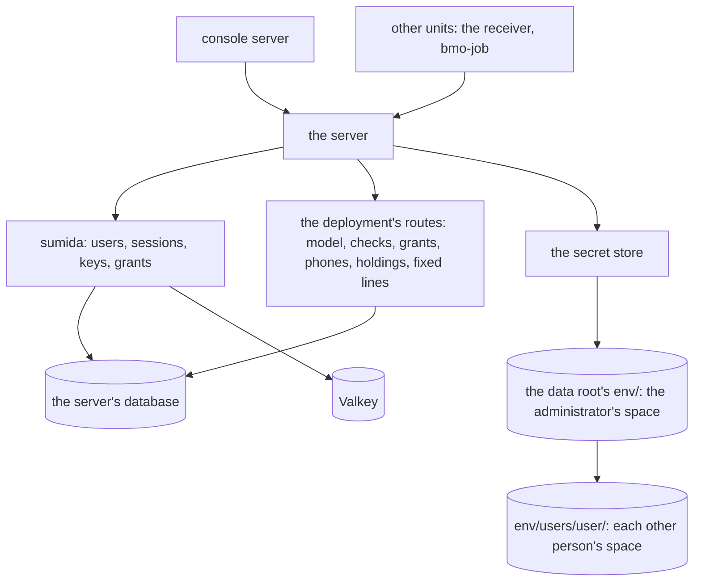

# The account service

## What it is

- **The server, in `server/`:** one Rust process linking sumida's users, sessions, API keys and permission
  layers, with the deployment's own rules file registered beside sumida's.
- **It holds the decisions, never the policy of a screen or a room.** Who a session is, who a phone key
  belongs to, whether a sender holds a relation in a room: the service answers. What a screen shows and what
  a unit does with a refusal are the console's and that unit's.
- **It stands on its own PostgreSQL database** and on a Valkey for sumida's sessions. Its tables are its own:
  sumida's, and the ones its migrations make (「The tables」 below). No other unit's table is read or written.
- **Beside its database it writes one folder:** the data root's `env/`, where the secret store keeps the files every
  unit reads its secrets from, and under it each person's own secret space (「The secret store」 below).
- **It answers on a runtime of its own, two threads named `account-service`.** sumida reads the operating
  system and the device out of the user agent of every request that reads a session, through about a thousand
  patterns built ASCII-only, and keeps what it read for the last 256 user agents. Each thread that runs the
  patterns keeps a scratch table per pattern, about 9 MB a thread, so on every core of a machine the parser
  alone would hold over 200 MB.

## Where it answers

- **On the listen address its settings name,** over HTTP, every route under the server's bearer token
  (`docs/boundary.md`, 「Wire conventions」). The console's server, the receiver and bmo-job are its callers,
  each with the server's base address and token in its own settings.
- **No browser and no phone reaches it.** The console's server is the only caller on the web side, and sumida's
  session routes are reached through it alone.
- **Its user unit** is the server's own, `deploy/bmo-web-server.service`, linked and restarted by the deployment
  (`testbed.toml`), running `serve` in the release's `server/`, where the deployment's settings stand as
  `settings.local.toml`.
- **Whether it can stand** is `bmo-web-server settings`: it reads the settings and refuses, saying why, where they
  name no `server.token` or no `names.chat_agent`, as `serve` would.
- **Whether it answers** is `bmo-web-server health`: it asks `GET /health` at the address the settings name, an
  unspecified host asked at the loopback one, waiting at most five seconds, and ends 0 where the service answers
  and 1 otherwise, saying why. The deployment waits on it.

## When it is in force

- **The server stands only on its database,** with sumida's tables standing and the deployment's rules
  registered; a database out of reach, or one the rules do not fit, stops it at its start, and its unit starts
  it again.
- **`GET /accounts/model`** answers whether the model is in force — whether the data move has been written —
  and why not where it is not. Once seen in force it stays so for the life of the process.
- **A reader asks this first.** Not in force, it reads as it does without the model: no sender is linked to a
  user and no grant stands.
- **Every route but `GET /health`, `GET /accounts/model` and `POST /accounts/move` answers 503 `not-in-force`
  while the model is not in force,** naming why, so no caller can mistake an absent model for a refusal.

## sumida's own routes

The service mounts sumida's router as sumida builds it, under `/sumida`, so sumida's own paths (its users
among them) never take one other units name; these are the ones the console calls.

- **Every request carries the browser's address in `X-Real-IP`,** which sumida's bans and its login lockout
  read, so the address must be one the browser cannot choose.
  - **The console hands on the address its reverse proxy names.** The proxy in front of the console sets its own
    `X-Real-IP` to the address it took the connection from, after undoing the hops it trusts, and the console
    hands that header on as it came. A request carrying none is handed on as the loopback address.
  - **`X-Forwarded-For` is never read.** Its entries are whatever the browser wrote, with the proxies' own
    appended behind them, so taking any of them would let a browser name a fresh address at every attempt.
  - **The console's port is reached through the proxy alone.** A request reaching the port directly writes its
    own `X-Real-IP`, so the deployment keeps the port off every network but the proxy's.
- **Sign-in is the service's own `POST /sign-ins`** (「Signing in」), which makes sumida's session as sumida's
  sign-in does; sumida's `POST /sumida/auth/session` answers 404. The session is the ordinary window, an idle one
  of seven days which the service extends at every request a session is read on, so staying signed in stays the
  console's own seal (`docs/web.md`, 「Access」). The answer carries the session cookie, `bmo.sid`.
- **Sign-out:** `DELETE /sumida/auth/session` with that cookie.
- **Who a session is:** `GET /sumida/me` with the cookie; 401 where it is no live session, a device its person
  ended among them (「Sessions and devices」).
- **sumida's settings** are written beside the service at its start and named for sumida, with the database's
  address and Valkey's handed in their own variables; no token is issued here, so no secret is kept.

## The deployment's own routes

All JSON, all under the server's token. `docs/boundary.md` states each route's request and answer; this
section states what each does.

### Checks

- **`POST /checks/room`** — a room, a sender id and a room relation. Answers whether the sender holds the
  relation there, the grant that was asked for (`bmo_room:<chat id>#<relation>`), and the user the sender is
  linked to, where one is.
- **`POST /checks/message`** — a room, a message id and a room relation. The service asks the receiver for the
  message and checks its sender in that room. It refuses, saying so, where no such message stands in that room.
- **`POST /checks/object`** — a kind (`bmo_worker`, `bmo_repository`, `bmo_tools`), an object, a relation and a
  user. Answers whether the user holds it, and the grant asked for.
- **`POST /checks/entry`** — a room, the user acting and the user to let in or take out. Answers whether the one
  acting may let that person into the room (「A room's callers」), the decision asked for named as
  `bmo_room:<chat id>#entry`, and the person it was asked for.
- **What a check builds:** the sender's user where their identity is linked, and the room's members, always.
  Every platform administrator passes every check but the entry check's company bound.

### Grants

- **`GET /grants?room=`** — the grants standing on a room, each with its relation, its subject, its expiry and
  the words beside it.
- **`POST /grants`** — what is granted (a room and a relation, or a kind, an object and a relation), to whom (a
  sender id, a user, or the room's members), the granter's words where any, an expiry where any, and the
  message it is granted on (its room and id).
  - The granter is that message's sender's user, and sumida checks they may grant it, so nobody gives what they
    do not hold.
  - A sender with no user yet is given one in the first company, with the default role and no way to sign in,
    and linked.
  - Granting again moves the expiry and the words.
- **`DELETE /grants`** — the same selector and the message it is revoked on, checked the same way.
- **A room's relations are the deployment's rules' own,** each a thing its holder may have the chat agent do in
  the room: `ask`, `search`, `notes`, `memories`, `reminders`, `file_todo`, `approve`, `launch`, `watch`,
  `room_rules`, `deploy`, `worker_talk` and `console`; `system`, asking the agent about its own system, which it
  answers nobody else; and `rule`, a standing rule whose words the agent judges, which opens every other relation
  of the room for its holder and is held by a user alone. Every relation but `rule` may be granted to a user or
  to the room's members.

### A room's callers

- **Membership is the call right.** Every member of a room calls their own supervisor into it by name: a console
  member, an account the receiver holds among the room's members, or a chat service's member whose sender is linked
  to a user, whose words reach the receiver over the chat service carrying the room. The receiver reads membership
  itself (its `docs/wake.md`, 「Who reaches the session」) and asks the check of `ask` only for a sender who is no
  member. Nobody manages a list of callers: no screen shows or changes who may call.
- **The `ask` grant on the room is the mechanism under it.** The console grants it to each person it lets into a
  room in the same act, and takes it away as it takes a person out, where the one taking them out may change it. The
  grant is set from the console with no message to make it on, by the administrator, by the room's leader, the
  user who owns a supervisor the room names, by a head of the unit the room belongs to, the leader's, or by a head
  of the user's unit (`docs/boundary.md`, 「A room's callers」).
- **The grant stays within one company:** a user of another company than the one who sets it is never granted it,
  but by the administrator.
- **Letting a person into a room and the call grant are set together.** A console room's members are accounts, kept
  by the receiver; the console asks `POST /checks/entry` before it lets a person in or takes one out, and with the
  person let in sets their call grant in the same act.
- **Who may let a person in:** the room's opener, a head of the opener's unit, or the administrator. A room opened in
  the console names its opener's own BMO as its leader, so its opener is its leader and the room belongs to the
  opener's unit; the check reads them as the call grant's check does, through the room's leaders.
- **Only within the room's company.** The room stands in its leader's company, and a person of another company is
  never let in, by the administrator neither; a room with no leader is bounded by the company of the one letting in,
  but for the administrator. Leaving is every member's own and asks no check.

### The data move

- **`POST /accounts/move`** — the caller hands the service what the move needs out of the deployment's
  configuration: the sender ids the configuration names as the owner's, the rooms the deployment answers, and
  the room rules with their rooms, subjects and words. The console's one account becomes the platform
  administrator's user, its password carried as it stands; a console holding more than one account is refused
  with 409. The service writes the whole move in one transaction with sumida's own machinery and marks it done
  in its own `settings` table; a second call answers that it is done and writes nothing.
- **It makes the deployment's first company and its default role,** `member`, which every user holds. The
  company is named `bmo` at first and may be renamed like any unit; nothing reads it by its name after the
  move. A user made outside an invitation, by the account command or for a sender, goes into the first
  company, the unit with no parent made before every other one.
- **What the move writes is the service's own:** the users, their links to senders, every room's member grant
  at the deployment's defaults, the rules' grants and their words, and a user's id on the console's own tables
  that are keyed by user. A table of another unit is that unit's to key.

### The platform administrators

- **A platform administrator is a user holding sumida's `admin` on the platform's root.** The data move writes
  it for the console's one account, and the account command for every user it names `--administrator`
  (「The account command」), so a deployment may hold several. That one relation is the whole of the standing:
  each of them passes every check, every section and every secret kind, heads every unit, reads every contact
  detail and holds the platform's secret space, and every route that answers `administrator` of a user reads it,
  `GET /users` and `GET /users/{user}` among them. The relation taken away, the user is an administrator no more
  at the next call that asks.
- **The move's administrator is a fact of its own:** the one user the data move made the administrator, written
  once in the service's `settings` and changed by no route, and readable in SQL as `bmo_administrator()`. It is
  the anchor the owner's account is linked to (「The owner's account」), and the user the console's own reads
  stand under where nobody is signed in. It says nothing of who administers the platform now: the move's
  administrator is one while the relation stands, and no other administrator becomes the owner by holding it.

### Users and senders

- **Every account has an identity on the record road,** the console's own, beside whatever chat services' identities
  it has. The receiver keeps it, one for each account, made the first time it is asked for and the same ever after
  (the receiver's `PUT /accounts/{account}/identity`), since a message the account says in the console is filed
  under a sender as every message is. It is linked to the account in `user_senders` exactly as any identity is, so
  everything keyed by an account's senders — its own words, what it has read, its acts on a message — reads it as
  one of them. The console names it by the name the account is shown by, the person's name or the login where none
  stands, handed as the identity's `name` as an account is made ready, once each time the console starts and as a
  person's name is changed, so every reading of the person on the receiver names them by it with no words sent.
- **`PUT /users/{user}/senders/{sender}`** — a sender linked to the user where it is linked to none, by the
  administrator, `Owner-Role: administrator`; answers 204, and the same again where the link already stands. A
  sender linked to another user is refused 409 `sender-linked`, since a link is the person and moving it would move
  their grants. The console's server calls it with the account's record identity as it makes an account ready
  (「Invitations and a person's machine」), and once each time it starts for every user the service holds, so an
  account that stood before the record road gained its identity then; both calls are idempotent, so the start
  repeats nothing that stands.
- **`GET /senders/{sender}/user`** — the user a sender is linked to, or nothing found.
- **`POST /senders/users`** — of the senders asked, those linked to a user, each with that user and whether they
  may sign in. A user made for a sender by a grant, an invitation not yet accepted and an account that has left
  cannot; the console marks a room's member as a console user only where they can (`docs/web.md`, the room
  screen's 대화상대).
- **A user has a login and a person's name.** The login, sumida's user name, is what the person signs in with
  and what the routes below call `name`; the person's name, sumida's full name, is what people read them by, and
  every answer carries it as `fullName`, an empty string where none stands. A screen shows the person's name
  and the login only where none stands; the console's sign-in form and its 로그인 정보 show the login itself.
- **A login is one line of 1 to 254 characters with no control character,** the spaces around it trimmed; an
  email address is a login like any other. The console reads every login it is handed by this one rule — an
  invitation's acceptance, the sign-in, a rename on 로그인 정보 and the console's `scripts/user.ts` — so every login
  an invitation makes is one the sign-in takes.
- **`GET /users`** — every user, with their login, their person's name and whether they are a platform
  administrator, for an administrator alone.
- **`GET /users/{user}`** — a user's login, their person's name, whether they are a platform administrator
  (「The platform administrators」), and the sender ids linked to them; the console asks it for the signed-in user's
  standing. **`GET /users/{user}/senders`** answers the sender ids alone.
- **`POST /users/{user}/password`** — the current password and the next; refused with 401 where the current one
  does not match, and hashed as sumida hashes every password.
- **`POST /users/{user}/name`** — another name; refused with 409 where another user holds it.
- **`GET /users/{user}/profile`** — a user's person's name, job title, rank, duty, landline, mobile and email,
  each an empty string where the account keeps none; **`POST /users/{user}/profile`** writes the name, the job
  title and the three contact details whole, an empty value clearing it, the name trimmed, writes the rank and
  the duty where the body names them and leaves them as they stand where it does not, and answers the profile as
  it now stands. Both are the account's holder's or an administrator's: the console hands on the login it acts
  for in `Owner-Key` and `Owner-Role`, and any other login is refused 403 before a row is read or written. The
  person's name is sumida's own full name on `users`, so the directory and every answer above read the same one;
  the rest is kept in the service's own table, so sumida's `users` keeps the columns sumida made, and an account
  that keeps no profile has no row there and reads empty values.
- **A person's title is three things kept apart** (「Roles and unit kinds」):
  - **the rank,** one line of free text the profile keeps, such as a grade in the company's pay scale;
  - **the role,** one of the company's catalogue the person carries in their unit, set by the organisation and
    never by the profile;
  - **the duty,** free text of what the person is in charge of, one line or a few.
  The job title the profile keeps stands beside them as free text. **The one line a reader is shown as the
  person's title,** the `jobTitle` the directory and the roster answer, is composed from the rank and the role
  where either is set, the rank and then the role, joined as the server's language pack writes them; where
  neither is set it is the job title kept. The profile's own `jobTitle` is the text kept, so a form writes back
  what it read.
- **`GET /users/{user}/sections`** — one user's console sections, each with whether they may read and write
  it: the account's holder's or an administrator's. **`PUT /users/{user}/sections`** writes one user's set
  whole, by an administrator alone (「Console sections」).
- **`GET /users/search?q=&limit=`** — the people of the reader's own company, of every company for the platform
  administrator, whose name, unit, title, rank, role, duty or permitted contact details hold the words; at most
  20 without a `limit`, and never more than 50.
- **`GET /users/{user}/person`** — one person of the reader's own company, of any company for the platform
  administrator; 404 where the user does not stand or, for any other reader, stands in another company
  (「The people directory」).
- **`GET /users/members`** — every person of the reader's own company who has not left, by user id and name
  alone, with no limit (「The people directory」).

### Showing one's presence

- **Each account has one switch, to show its presence,** on unless the account turns it off. Off, nobody sees the
  account's presence or its last moment seen, every reader included, and typing stays shown (bmo-chat's
  `docs/presence.md`, 「Who sees what」).
- **The console keeps it,** in its own table `web_presence_hidden`, one row for each account that turned it off; it
  reads and writes the table and holds every reader's stream to it (`docs/web.md`, 「Presence and typing」). No route
  of the service carries it.

### Whose BMO a supervisor is

- **A supervisor is the BMO of the account the agency files it under** (its `ownerAccount`). Where the agency names
  none and the supervisor's name is exactly a person's BMO's, `u<user>` — the user's id as a decimal number with no
  leading zero — it is that user's: the BMOs accounts were given before the receiver passed the account on to the
  agency stand registered under no owner, and the agency takes no owner onto a standing registration. Any other
  supervisor naming no owner is nobody's, the administrator's.
- **Everything that asks whose BMO a supervisor is reads it so:** a person's own agents and the log and turns they
  read, the BMO beside a group room, the supervisor a group room may name, and whether an account made ready already
  has its BMO, so a `u<user>` standing under no owner is not added again.

### The owner's account

- **The owner's account is the user the owner's sender is linked to:** the sender the receiver names as the owner's
  (its `GET /owner`, from its own configuration), linked to a user in `user_senders` as any identity is. The
  receiver files the owner's account's words under that sender and takes his private chat as that account's.
- **The console stands the link where it stands linked to none,** to the user the data move made the platform
  administrator (「The data move」: the console's one account before the model, which was the owner's, written once
  in `settings` and changed by no route). It asks at its start, in the pass that stands every account's record
  identity, and again at the first request that needs the owner's account, so the owner is his account from the
  start with nothing for him to do. A link that stands is never moved: the service refuses one sender linked to two
  users. Where the receiver names no owner's sender, no move names an administrator or the service does not answer,
  the console writes so to its log and the request goes on.
- **Being a platform administrator makes nobody the owner.** The console links the owner's sender to the move's
  administrator alone, never to another administrator, and everything the owner holds — his private chat as his own
  room, his own road, his sender's words as his own, the deployment's own account on a chat service — hangs on his
  account, whatever administrators the platform holds beside it.
- **Until the link stands the move's administrator keeps the owner's own road:** the console sends his words on the
  receiver's owner routes, holds the owner's private chat as his own room, and takes him for the owner's login, as it
  did before accounts had rooms of their own. On that road he writes in his own private chat always and in no
  account's private room, his own BMO's among them, until the link names his account, as the receiver takes the
  owner's road. A console login standing before the account model writes on the same road, for the owner's account
  once the link stands and for no account while it does not.

### Console sections

- **A console section is one entry of the console's navigation,** a screen of the sidebar's sections, the
  rooms and the account beside them, or one part of agent management's screen, whose five tabs are
  its five parts, or `live`, what runs now, which no one screen holds and every screen that shows a run reads. Each screen is named by the first part of its path; each part of agent management is named
  by its tab:

  | Section | The screen |
  |---|---|
  | `live` | what runs now, read across the console: the bot's live picture, the queue and its items, the questions and the deployment |
  | `mail` | bmo-mail's screen |
  | `siren` | the cache siren |
  | `db` | the console's database |
  | `files` | bmo-drive's screen |
  | `artifact` | bmo-artifact's screen |
  | `documents` | the document viewer |
  | `code` | bmo-review's screen |
  | `supervisors` | agent management's 에이전트 tab, the supervisors and the roles' agents with what each is doing now |
  | `roles` | agent management's roles tab |
  | `repositories` | agent management's repositories tab |
  | `models` | agent management's registered models tab |
  | `model-files` | agent management's model files tab |
  | `research` | the research screen |
  | `monitor` | the machines and the card board |
  | `remote` | bmo-remote's screen |
  | `brain` | the brain's screen |
  | `rooms` | the reader's rooms and their messages |
  | `account` | the reader's own account, its settings and its secrets |
  | `supply` | the account screen's settings section supply |

- **Agent management's screen opens on any one of its parts the reader may read,** and each tab on its own
  part alone. Its shared reads — the agent list, a provider's models, the provider switches and the fallback,
  an agent's face and tool marks — open on any part read; the provider switches are changed on 플랫폼 설정's 공급자 tab
  and the fallback on 조직's 공급 with the platform chosen, which only the administrator opens. An agent's own page stands under the three parts
  whose rows open it: the supervisors, the roles and the repositories.

- **A section's permission is two relations of the deployment's rules,** `read` and `write`, on a
  `bmo_section` object named by the section. They are checked through sumida's point check as every other
  relation is (`server/src/bmo.sz`); a write is also a read, so nobody changes what they may not see.
- **Every platform administrator passes every section.**
- **A user's grants are sumida's relation tuples,** so the service keeps no table of them. One user's set is
  written whole, and a section named no more is taken away.
- **The administrator writes anyone's set, and a head the set of a person standing in a unit they head,** the
  person's home unit or a unit where they hold a post, at it or below it. A head passes on only what the platform
  gave them: a write that would change a section's read or write the head does not hold themselves is refused 403
  `forbidden` whole, so a head gives no section and takes none away beyond their own. The person, the administrator
  and such a head read the set; nobody else does.
- **The defaults in force let a person use the console as a messenger of its own:** `rooms` read and written,
  so a person reads their rooms, speaks in them and in their own BMO's private room, and opens a room, with no
  grant asked of anyone; `account` read and
  written, `supply` read and written so every person with an account reaches their own supply settings
  (「Supply」 below), and the sections of the screens units bring that a member could open — `mail`, `files`, `artifact`,
  `code`, `remote` and `brain` — read. A screen whose manifest names the administrator alone stays closed to a
  member by that manifest, whatever its section says. A user made by the account command or linked to a sender
  is given the defaults, and the users who stood before this surface did are given them once, as the service
  starts against a database where that seeding has not run. A user whose administrator has since taken every
  section away keeps none.
- **A user given the defaults before they held the rooms' write is given it once,** as the service starts
  against a database where that has not run: every user whose rooms read was written as a default, by whichever
  road made the user, and who holds no rooms write. A user an administrator set by hand keeps what was set.
- **The console reads them for its navigation and its route guard.** A reader sees only the sections they may
  read, and a route of a section they may not read or write answers them as if nothing stood there. A screen a
  unit brings is held to its manifest's role as well, so a section alone never opens a screen the unit keeps
  for the administrator.

### Companies and organisation units

- **An organisation unit is one of sumida's organisations,** and the units of a deployment form sumida's tree of
  them. A unit standing at the top of the tree, with no parent, is a **company**; every other unit belongs to the
  company at the top of its branch, and a company holds units under units to any depth. The words a company calls its units by — division, centre, team, part — are
  their names alone, and nothing here reads a meaning into them (`STRUCTURE.md`, 「Terms」).
- **A user has one home unit,** the organisation sumida keeps on the user, at any depth of the tree. It alone
  decides their company, their path and which heads read the works assigned to them, and `GET /users/{user}/unit`
  answers it. Beside it a person may hold posts in other units of the same company (「Concurrent posts」).
- **A person's place in their unit is its head or a member,** the two places a move and an invitation name, and
  it is the one authority a unit gives. Beside it a person may carry one role of their company's catalogue in
  their home unit, and one in each post (「Roles and unit kinds」); a role is a fact others read, such as an
  approval rule naming the holder of a role, and it opens nothing by itself. What a person may open in the console
  is neither's: it is their own sections, set one person at a time (「Console sections」).
- **A unit may carry three attributes beside its name and parent:** a kind of its company's list, a short name, and
  the unit it reports to.
  - **The kind** is a label in the company's own words, such as site, branch or task force. It is shown and may
    narrow a list, and no permission, check or behaviour of any unit reads it (`STRUCTURE.md`, 「Terms」).
  - **The short name** is what the company numbers a unit's letters by: one line of 1 to 20 characters, no two
    units of one company holding the same, case set aside.
  - **The unit it reports to** is the unit of the same company its matters go up through, where that is not its
    parent: a site standing under its division whose matters a head-office team reviews. Where none is set the
    parent stands in its place. It changes nothing of the tree: who heads the unit, what stands under it and every
    check read the tree as they did.
- **A unit's head is a `manager` of it in sumida's rules,** granted as a relation tuple on the unit. sumida's
  `manage` permission reads the tuple on the unit and on every unit above it, so a head heads their own unit and
  everything below it, and every platform administrator heads every unit.
- **`GET /users/{user}/unit`** answers the user's unit, its company and the path between them, from the company
  down to the unit, so a caller tells whether one unit stands under another without a call of its own.
- **`GET /units/{unit}`** answers a unit: its name, its parent, its company, its path, the units directly under
  it, the users granted head of it directly, and the users standing in it; and beside them its kind, its short
  name and the unit it reports to, the roles its people carry, the people holding a post in it, and the person
  acting for its head while an appointment runs. The fields it answered before keep their shape: `heads` and
  `members` stay lists of user ids, so a reader that reads them reads what it read.
- **`POST /checks/unit`** answers whether a user heads a unit: sumida's point check of `manage` on the unit, so a
  head of a unit above it is a head of it too, and so is a person whose acting appointment runs (「Acting」).
- **Making, naming and moving units, setting their kind, short name and the unit they report to, granting and
  taking away their heads, and placing users in them** are the platform administrator's, on the routes
  `docs/boundary.md` lists under 「Organisation units」. A unit stays in its company: a move under a parent of
  another company, or under the unit itself or one below it, is refused, and a unit with no parent is a new
  company. A unit reports to a unit of its own company alone, and never so that its line passes one unit twice
  (「The line of a unit」): a unit to report to of another company is refused as a parent of another company is,
  and one that would make the line come round, or a parent move that would, as a move under itself is. sumida
  rebuilds its tree as the units change, so every check reads the tree as it now stands.
- **Several people are moved into one unit in one act,** each with their place in it, its head or a member, and
  where the act names one, their role there. The act names, for each person, the unit they stood in when it was
  shown, and is written in one transaction, so a person moved by someone else since, an account that has left, a
  role their new unit's company does not keep, or a person or unit that does not stand refuses it whole and
  nobody is moved. A person coming from another unit is no longer granted head of the unit they leave, since
  heading a unit one has left would keep its permissions; a grant on a unit above it is the higher unit's and
  stays, and so does the grant a post carries. They carry no role there until the act names one. A person
  already standing in the unit keeps standing there and takes the place named, and keeps their role where the
  act names none, so one act also changes a place or a role without a move. A person moved into a unit where
  they hold a post loses the post, the unit being their home now; a person moved into another company loses
  every post, since a post stands in the home unit's company alone. Placing one person in a unit
  (`PUT /users/{user}/unit`) moves them as a move does, but for heads, which it leaves as they stand: the role
  they carried stood in the unit they left and goes with it, and their posts end as above.
- **The console's organisation screen,** 조직's 조직도 tab, draws the units as a tree and does each of these for
  the administrator (`docs/web.md`, 「조직도」).

### Roles and unit kinds

- **Each company keeps two lists in its own words:** its roles, ordered lowest first, and its unit kinds. An
  entry is a key, which stays as long as the entry does and is what other units name it by, and a name, which a
  person reads and the company may change. A role also has its place in the order, counted from 1 for the lowest.
  The company's words are its data: no code here or in any unit names a role or a kind, and an approval rule that
  names a role names it by its key.
- **A key** is 1 to 40 characters of lowercase letters, digits and hyphens, beginning with a letter; **a name** one
  line of 1 to 40 characters. A list holds at most 100 entries, no two of one key and no two of one name, case set
  aside. A list out of that shape is refused 400 `bad-catalogue`.
- **A list is written whole,** in its order, so a reorder, a rename, an addition and a removal are one act. An
  entry still in use is never removed: a role a person carries in their home unit or in a post is refused 409
  `role-held`, and a kind a unit carries 409 `kind-held`, so whoever edits the list moves those people or units
  first.
- **Who keeps them:** the platform administrator and a head of the company's own unit, the unit with no parent,
  write them. Anyone standing in the company reads them, and a unit acting for one of them, which calls with that
  person in `Owner-Key`, as a company's own services do; anyone of another company is answered as if
  no such company stood.
- **A role is carried in a unit:** at most one in a person's home unit, set by the move that places them
  (「Companies and organisation units」), and at most one in each post (「Concurrent posts」). It is always one of
  the catalogue of the unit's company; a key the catalogue does not hold is refused 400 `no-such-role`.
- **A kind is carried by a unit,** at most one, of its company's list, set on the unit's form; a key the list does
  not hold is refused 400 `no-such-kind`. Two answers change with it and no other: the units listed by kind and the
  roster narrowed by kind (「The people roster」). A test holds every other answer the same with a unit's kind set,
  changed and taken away.

### Concurrent posts

- **A post is a person's standing in a unit other than their home unit,** of the same company, with a role of the
  catalogue or none, and with the unit's head granted or not. A person holds at most one post in a unit and none in
  their home unit.
- **What a post does:**
  - it lists the person in that unit, marked concurrent, apart from the unit's members, so `members` stays the
    people whose home unit it is;
  - it puts them in that unit's line, holding their post's role there (「The line of a unit」);
  - it counts, marked, where the roster is narrowed by unit or by kind (「The people roster」);
  - it may carry a head grant on the unit, which a move of the person's home unit leaves standing and taking the
    post takes away.
- **What a post does not do:** it decides nothing of the person's company, path or the heads who read the works
  assigned to them, which are their home unit's, and gives no authority but the head grant it carries. Reading
  what is shared to a unit through a post, the documents another unit shares with it among them, is not
  provided: such a unit reads a person's home unit (`GET /users/{user}/unit`), so a post opens nothing shared to
  its unit.
- **Who gives and takes a post:** the platform administrator, and a head of the unit or of a unit above it, by
  sumida's `manage` on the unit. Giving a post that stands again changes its role and its head grant.
- **A post ends** when it is taken away, when the person is moved into its unit as their home, when they are moved
  into another company, and when they leave (「A person who leaves」): a person who leaves loses every post.
- **`GET /users/{user}/posts`** answers a person's posts, each with its unit and path, its role, whether it carries
  the unit's head, and when and by whom it was given; for anyone of the person's company, the administrator, and as
  if nothing stood there for anyone of another.

### Acting

- **A person may be named to act for a unit's head for a period.** While the appointment runs they pass the unit
  check as a head does (`manage` on the unit and every unit below it) and are marked acting wherever heads are
  listed: the unit's own answer, the administrator's list of units, the line of a unit and the roster. When its end
  passes the standing ends with no further act.
- **An appointment is a head grant with an end and a mark.** The grant is sumida's `manager` tuple on the unit
  with its `expires_at` at the appointment's end, which sumida's check reads, so the check needs nothing of its own;
  the mark is the service's own record of the appointment, which says the grant is an acting one, who named it and
  when.
- **It starts as it is made** and runs to the end it names, a moment still to come. A unit has at most one
  appointment running: naming another person ends the one that runs, and naming the same person again moves its
  end. It may be ended before its end by the same callers who make it.
- **Who appoints:** the platform administrator, and a head of a unit above the unit, by sumida's `manage` on its
  parent; a company's own unit, having none above it, is the administrator's alone. The person named stands in the
  unit's company and has not left.
- **A person already granted the unit's head lastingly is not appointed** (409 `already-head`), and a lasting head
  grant on the unit ends a running appointment of the same person, the lasting grant taking its place. A move out
  of their home unit that takes its head grant away ends an appointment on that unit as well, and so does leaving.

### The line of a unit

- **A unit's line is the chain its matters go up:** from the unit, to the unit it reports to where one is set and
  to its parent otherwise, and so on up to its company. No line passes one unit twice; setting a unit to report to,
  or moving a unit, so that one would is refused 409 `cycle`.
- **`GET /units/{unit}/line`** answers the chain, the unit first, each step with its unit, its kind and short
  name, how it was reached (the unit it reports to or its parent), its heads with the acting one marked, and the
  people holding each role there: those whose home unit it is with that role, and those whose post there carries
  it, marked concurrent.
- **`GET /units/{unit}/line/{role}`** answers who stands for one role for the unit:
  1. the holders of that role at the nearest step of the line holding any, all of them where several do;
  2. where no step holds it, the holders of the next lower role of the catalogue, read the same way along the
     line, then of the role below that, down to the lowest; the answer is then marked acting, with its reason,
     `no-holder`, that nobody on the line holds the role asked, and the role the holders hold;
  3. nobody, where no step holds that role or any lower one.
  It answers the rule that where a unit holds nobody in a role, the holder of the next lower role acts. An acting
  appointment gives head standing and no role, so it answers the first read's heads and not this
  one.
- **Both read for anyone of the unit's company and the administrator,** with the reader in `Owner-Key`; a unit of
  another company, and a role key its catalogue does not hold, is answered 404 as if nothing stood there.

### Everyone under a unit

- **`GET /units/{unit}/subtree`** answers a unit and every unit below it in one read, so a view of everyone a head
  heads needs no walk from one unit to its children. The units stand in tree order: the asked unit first, and
  each unit followed by every unit under it before its next sibling, siblings in the order a unit's `children`
  stand in (by name, then by id).
- **Each unit carries** its id, its name, its parent (absent for a company), its kind and short name where set,
  and the people standing in it, each with their name (the person's name, the login where none stands), in the
  order of their names, then their ids:
  - its heads granted directly, as a line's heads are: each marked acting where the grant is a running
    appointment's (「Acting」) and concurrent where the person holds a post in it; a head of a unit above stands
    under that unit alone;
  - its members, the people whose home unit it is, each with the role they carry there and whether their account
    has left (「A person who leaves」);
  - the people holding a post in it (「Concurrent posts」), each with the post's role and whether it carries the
    unit's head.
- **Who reads it:** the administrator, and a head of the unit or of a unit above it by sumida's `manage` on the
  unit, so an acting head reads it while the appointment runs and a head through a post as any head does; the
  reader is named in `Owner-Key`. A reader of the unit's company who heads neither is refused 403, and a unit of
  another company is answered 404 as if nothing stood there, so the read says nothing across companies.

### A unit's org memory

- **A unit's org memory is what every agent serving a person of the unit, or of a unit under it, shares:** the
  company's industry, a team's working hours, where its site photographs go. The brain keeps it, in an org brain of
  its own for each unit (the brain's `docs/design.md`, 「Org brains」); the brain calls no unit, so who may write it
  is this service's to say, and its caller asks before every write.
- **Who writes it:** a head of the unit, by sumida's `manage` on it, so a head of a unit above, a person whose acting
  appointment runs and every platform administrator too; and a person a head has granted the unit's org memory write.
  A head's and a holder's word is a fact at once; anyone else's is a proposal, which a writer accepts or declines.
- **The grant is a relation of the deployment's rules,** `write` on a `bmo_org_memory` object named by the unit's id
  (`server/src/bmo.sz`), so the service keeps no table of it; the tuple names who gave it. It is the unit's alone: it
  reaches no unit under it, and it gives nothing else a head holds, so giving and taking it, the unit's people and its
  settings stay the heads'.
- **Who gives and takes it:** the platform administrator and a head of the unit, by sumida's `manage` on it, with the
  one acting named in `Owner-Key`. It is given to a person of the unit's company who has not left: a person of
  another company is refused 409 `other-company` and one who left 409 `left`. Giving it again, or taking away a grant
  nobody holds, changes nothing.
- **`GET /units/{unit}/memory-writers`** answers the people holding the grant on the unit, each with their name, the
  login where none stands, and who gave it where a person did, for the administrator and a head of the unit; a reader
  of the unit's company who heads it not is refused 403, and a unit of another company is answered 404.
- **`GET /org-memory/units`** answers the units whose org memory the reader in `Owner-Key` writes, in the tree's
  order, each with its parent, its company and whether the reader heads it: every unit for the administrator, and
  otherwise the units they head and those they hold the grant on.
- **`POST /checks/org-memory`** answers whether a user writes a unit's org memory, by heading it or holding its
  grant, the grant asked for named as `bmo_org_memory:<unit>#may_write`, so a caller names the brain write's standing
  from it: `head` where it is allowed, `member` where it is not.
- **A memory about one person** stands in a unit's org memory only as what the organisation may know of them — their
  role, the duties they carry, how they prefer to be reached — and is marked shared (the brain's `docs/design.md`,
  「Org brains」). A writer of the unit writes one about a person standing in the unit or under it, who is of the unit's
  company and has not left; the person writes their own into their home unit's org memory, under the standing
  `person`, which the brain takes as a head's word for a shared memory about them alone. Anyone else's word on a
  person stays a proposal. Their circumstances, their health and any evaluation of them stay in their agents' own
  brains, and nothing of those is carried into an org memory by itself: a writer or the person puts it there.
- **Whether a person's agents read the org memory at all,** and the platform's base beside it, is the brain's two
  kinds of the delegation chain, `brain.organisation` and `brain.global`, declared by the brain's deployment (the
  brain's `docs/design.md`, 「The layers a reading takes」): a company or a unit turns either off for the people under
  it, and no unit below turns it on again.

### A person's history

- **Every change of a person's place is kept:** a move of their home unit, a role set or taken away, a head granted
  or taken away, an acting appointment made or ended early, a post given, changed or taken away, and leaving. Each
  entry holds who it was of, what changed, the unit it changed in and the unit they came from where they moved, the
  role before and after by its key and the name it had then, an appointment's end, who did it and when. A change made
  where no person stands behind the call, as the account command's, keeps no one as its doer.
- **The history holds what was done since the service kept it;** an appointment that runs to its end adds nothing
  as it ends, its entry naming the end.
- **Nothing in it is changed or removed while the person stands.** Deleting the account for good removes it with
  the account (「Deleting an account for good」). It is read on the roster's person read (「The people roster」), by the
  administrator and a head of the company's own unit.

### A person's BMO profile

- **Every account's own BMO stands under a profile:** the name it is called, the names that call it in a room, its
  picture and its persona. The account's own BMO is the supervisor the account owns (「Whose BMO a supervisor is」),
  the one a person calls 내 BMO. The owner's own BMO, the supervisor that answers rooms naming none and every
  supervisor of no account hold no profile here and keep the name, picture and persona they stand with.
- **The service is where the profile is decided.** It keeps a company's default, each person's own choice and who
  may make one, and answers the profile that stands for a person. The agency keeps the supervisor's label, call
  names and persona, and the receiver its picture, as the console applies them from this answer (`docs/web.md`,
  「A person's BMO profile on the agency and the receiver」); neither decides one.
- **An organisation sets a default for its people's BMOs:** a name, the names that call it, and a picture, each a
  setting of the delegation chain (「The delegation chain」): `agent-profile.name`, a text; `agent-profile.call-names`,
  a list this service judges; and `agent-profile.picture`, a flag saying the link's own kept picture stands. Each is
  held at the platform's link and a unit's, resolved nearest first down the person's units, so a unit below the
  company sets its own where the company leaves it open and a company's lock holds its own for every unit below
  it. Any part may stand empty. The company's own default is set on the company's routes below by the platform
  administrator and the company's heads — a head of the company unit itself, by sumida's `manage` on it — and a
  unit's below it on the chain's own routes by that unit's heads, its picture's bytes kept beside the chain under
  the unit whose link holds the flag. The platform's own name and call names, the default of every company that sets
  none, are the platform administrator's, on the platform's route below; a picture stands at a unit alone, since its
  bytes are kept under the unit.
- **A person may set their own,** where they may personalise their BMO: a name, the names that call it, a picture and
  a persona. Each part may stand empty. What they set is kept whether or not they may use it, so a permission taken
  away and given back finds it as it was.
- **Each part of the profile stands by one order:**
  1. the person's own part, where they may personalise their BMO and the part is set;
  2. the organisation's default part, the nearest unit's of the person's path that sets it;
  3. the deployment's own: the name the language pack gives a BMO, the label alone and no further names to call it by, no
     picture of the console's (the receiver's own or the initials stand), and no persona of the person's (the
     agency's own composition stands).
  The account's administrators are no exception for their own BMO, and nothing of one person's profile reaches another.
- **Whether a person may personalise their BMO is set as 허용 or 막음 on a person, on a unit or for the platform.** It
  is the delegation chain's `agent-profile.personalize` (「The delegation chain」), a flag resolved nearest first: the
  person's own setting, then their unit's, then each unit above it up to the company, then the platform's own. Where
  none of them is set it is withheld: nothing is open until it is granted. A platform administrator may always.
- **Who sets it:** the platform administrator anywhere, the platform's link among it; a unit's head on that unit and every unit below it, and on every
  person standing in one of them, by sumida's `manage` on the unit. A setting is taken away by setting it to follow
  the unit above, which removes it. Where a unit above locks the setting on the chain, a change below the lock is
  refused 409 `locked` to anyone but the platform administrator, and what was set below it stands unread.
- **The routes.** Each takes the login it is made for in `Owner-Key` and `Owner-Role`, as the profile's routes do; a
  caller the route does not name is refused 403 `forbidden`, a company or unit that does not stand 404 `not-found`,
  and a unit that is no company where a company is named 404 `not-found` as well.
  - **`GET /companies/{company}/agent`** answers the company's own default, `name?`, `callNames` and `picture`
    (whether one is kept), its own link's values, for the administrator and anyone of the company; **`PUT`** with
    `name?` and `callNames` writes them on the company's link and answers the default as it stands, for the
    administrator and the company's heads, refused 409 `locked` where the platform locks them.
  - **`GET /platform/agent`** answers the platform's own default the same way, `name?` and `callNames`, its `picture`
    always false, for any caller; **`PUT`** with `name?` and `callNames` writes them on the platform's link and answers
    it as it stands, for the platform administrator alone.
  - **`GET`, `PUT` and `DELETE /companies/{company}/agent/picture`**: the default picture's bytes with their type, 404
    `not-found` where none is kept, read by the callers of the default's `GET`; set from the request's body, the
    bytes as they are, and taken away by the callers of its `PUT`, both answering 204. Bytes that are no PNG, JPEG, WebP or GIF are
    refused 400 `not-a-picture`, and more than 10 MB 413 `picture-too-large`.
  - **`GET /users/{user}/agent`** answers the profile standing for the user: `personalize`, whether they may
    personalise their BMO; `company?`, their company as a unit reference; `name`, `callNames`, `persona` and `picture`, each with `from`,
    `own`, `company` (the organisation's default, whichever unit of the person's path set it) or `deployment`, and the value where it is text (`name?`, `callNames`, `persona?`; the
    deployment's name is null, for the console's pack to say); and `own`, the person's own parts as kept, `name?`,
    `callNames`, `persona?` and `picture`. For the user themselves, the administrator and a head of the user's unit.
  - **`GET /users/{user}/agent/picture`** answers the bytes of the picture standing for the user, their own or their
    organisation's, 404 `not-found` where the deployment's stands, for the same callers.
  - **`PUT /users/{user}/agent`** with `name?`, `callNames` and `persona?` replaces the person's own parts and answers
    the profile as it stands; **`PUT` and `DELETE /users/{user}/agent/picture`** set and take away their own picture
    as the company's are. For the user themselves alone, 403 `personalize-withheld` where they may not personalise
    their BMO, so nothing is kept for a person who may not.
  - **`GET /units/{unit}/agent-permissions`** answers `units`, the unit and every unit below it, each after its
    parent, each with its `id`, `name`, `parent?` (absent for a company alone), `setting` (`allow`, `deny` or
    `inherit`) and `allowed`, what a person standing in it with no setting of their own resolves to; and `people`,
    every person standing in one of them, each with `user`, `name` (the person's name, the login where none
    stands), `unit`, the unit they stand in, `setting` and `allowed`. For the administrator and a head of the unit.
  - **`PUT /units/{unit}/agent-permission`** and **`PUT /users/{user}/agent-permission`** with `setting` set it, `inherit`
    removing it, and answer 204; for the administrator and a head of the unit, or of the person's unit.
  - A name is one line of 1 to 40 characters, a call name 1 to 40 with no comma, at most 10 of them and no two the same
    but for case, and a persona at most 100,000 characters, the agency's ceiling for a supervisor's persona; an empty
    name or persona is none. A value out of shape is refused 400 `bad-agent-profile`.

### Invitations and a person's machine

- **An invitation is a link that makes one account in one unit,** made by the platform administrator for any unit,
  or by a head for their unit or one below it. The unit is a company itself or a unit under it at any depth. It
  names the person's role there, the unit's head or a member, the head being the administrator's alone to give,
  how many hours it stands open, and, where its maker gives one, the person's name; past those hours, or once
  used, it opens nothing. The open invitations are listed with the name each was made for.
- **The units a login may invite into are answered with their parents and their company,** each unit after its
  parent, so the maker chooses a company and then a unit of its tree. A head reads their own unit and those below
  it, their own unit standing at the top of what they read under its company.
- **The link is opened with no sign-in.** It shows the unit and its company and the person's name the invitation
  was made for, and asks for a login, the person's name and a password, the name standing as the invitation gave
  it for the person to correct. Accepting it makes the account disabled, in the unit, a head where the invitation
  says so, with the person's name as its full name (the invitation's where the acceptance gives none), the
  console sections every user is given, and binds it to the machine name `u<user>`.
- **Acceptance needs the invitation open, the login free and the default role standing.** The account's
  organisation is the invitation's unit, so no unit's or company's name is read, and a company renamed after
  the invitation was made takes it in just the same. Where the default role does not stand, acceptance is refused 409
  `not-ready`, and the console says the deployment is not ready to make accounts.
- **An account is enabled only once its machine is proven,** connected one of two ways: the person opens the
  console's desktop app on their PC and approves its pairing with the invitation (「Desktop pairing」), or installs
  jake with the command the acceptance answers, which names the machine and carries a credential made for that name
  alone (jake's `docs/architecture.md`). Where the service's settings name the ports the machine's agent lets the hub
  stream to, the command names them too (jake's `--stream-ports`, `-StreamPorts` on Windows), so the agent offers
  agency's link to a person's PC its two ports from its first start (agency's `docs/person-nodes.md`, 「What the PC
  needs」) and the PC's workplace is set up and linked with nothing done on the PC by hand. Either way the service asks the jake hub whether an agent of that name is
  attached. Attached, the account is enabled and the machine recorded as proven.
- **One machine, one agent.** A machine name is served by the desktop app's built-in agent or by an installed jake
  agent, never by both attached at once: the desktop app keeps its built-in agent off where a jake agent of its
  machine's name is installed on the PC, offering to switch to it by stopping the installed one through its own
  uninstaller, which keeps its configuration; and the hub refuses a hello under a name another install already
  holds, the one attached first keeping it (jake's `docs/desktop.md`, 「One agent per name」, and
  `docs/architecture.md`, 「Many agents, one hub」). The machine read answers which of the two is connected.
- **An account made ready is given its own BMO and its identity on the record road.** As the proof answers the
  account active, the console's server has the receiver stand the account's BMO with its private room and the
  account's record identity, and links that identity to the account (「Users and senders」), so the person reads and
  speaks in the console from their first sign-in with no chat service's identity at all.
- **A proven machine becomes the node the account's runs stand on.** As the proof answers the account active, the
  console's server reads the machine the account is bound to and sets it in agency's record of the account's node,
  `PUT /person-nodes/{ownerAccount}` with the user's id and `node` the machine's name (agency's
  `docs/person-nodes.md`, 「Which node is a person's」), so the person's BMO and agents run on their own PC. Every
  proof that answers active sets it again, so opening the invitation's link once more sets a record that did not
  land. The account stands active whatever agency answers.
- **A node the node service has not listed yet is asked again until it lands.** The node service lists a machine
  some moments after it attaches, so agency may answer the first set 422 `not-a-hub-node` for a machine the hub
  already holds. The console's server then asks again every 5 seconds for 2 minutes, each time reading the binding
  afresh and stopping where the account is bound to another machine or the hub no longer holds it; one ask runs for
  an account at a time. Past the 2 minutes it is asked again at the account's next sign-in and every time the account
  is made ready again, each a fresh round of the same. Any other refusal, or agency out of reach, is written to the
  console's log at once and asked again only at those moments. The same holds for the node set as the desktop
  pairing page and a sign-in prove the machine.
- **Whether the node landed is read from agency's own record** (`GET /person-nodes`): the reader's machine read
  answers it beside the binding, as `nodeSettled` — true where agency's record names the machine, false while it
  names another or none, and absent where agency cannot be read — so the settings' machine section says when the
  account's runs cannot stand there yet; a read that finds it false with no ask running starts a round of asks, as a
  sign-in does.
  The services that drive a program on a person's own PC reach the machine with nothing asked from here: the
  node service lists it as a personal node as it attaches, with the callers its configuration lets onto every
  personal node (bmo-node's `docs/nodes.md`, 「A node's callers」), and agency's record makes it the person's.
- **A binding keeps when the account was connected to its machine,** set as the binding is made, by an invitation's
  acceptance, by a pairing's approval for an account bound to none, or by the administrator binding it to another
  machine, and kept while the binding stays on the same machine; a binding made before the moment was kept answers
  none. **A machine the hub holds is answered with how it is connected:** `desktop` where the agent it holds
  announced itself as the desktop app's built-in agent, its version beginning `desktop-` (jake's `docs/desktop.md`,
  「Pairing」), and `installed` for any other agent; nothing while the hub holds none.
- **The administrator binds an account to another machine or takes its machine away.** Bound again, the account is
  given the machine the administrator names, or a fresh name of its own (`u<user>` and a random tail), so the
  credential of the machine it was bound to before proves nothing for the account now, though the hub still admits it
  under its old name; the answer carries the new machine's credential and one-line installs, as acceptance does. A
  name another account is bound to is refused 409 `node-taken`, and an account that has left is bound to no machine
  again, 409 `left`. The binding is proven as it is made where the hub holds the machine already, and otherwise once
  it attaches, by the console asking again from the organisation screen or by the person's first sign-in after it
  attaches.
- **A person takes their own machine away too.** Taking an account's machine away is the administrator's for any
  account, and the account's own for itself: the person signed in as that account, named in `Owner-Key`, takes it
  from the settings' machine section (`docs/web.md`, 「Settings」). Anyone else is refused 403. Binding to another
  machine and declaring sharing stay the administrator's alone, but for the share an invited account asks for its
  person's PC, which a head decides too (「A machine shared at an invitation's ask」).
- **A machine taken away is revoked, so its credential works no more.** A machine's credential is made from its name
  alone, so once the binding is removed the console's server asks the service to revoke the name
  (`POST /machines/{agent}/revoke`), and the service asks the hub through its own control (`POST /revoke`, jake's
  hub control): the hub records the name as revoked and sends a leave to the machine where it is attached, and
  answers any later hello under that name with a leave, so a machine that is off at that moment is told as it comes
  back. The desktop app answers a leave by deleting its credential and offering pairing again, and an installed agent
  by uninstalling itself; a later pairing binds a fresh name. The revoke goes only where the binding was not
  declared shared, since a shared machine stays for the other accounts on it, and the service refuses it 409
  `node-taken` while any account is still bound to the name. A revoke the service or the hub refuses leaves the
  machine taken away all the same and is written to the console's log.
- **The administrator may declare a machine shared,** binding several accounts to one machine. A binding that says
  so is made where every other account bound to that name was bound shared as well; a binding that does not say so,
  or one naming a machine another account holds unshared, is refused 409 `node-taken` as above, so no account comes
  to share a machine its binding never declared shared. The binding keeps whether it is shared and answers it on
  every read of the account's machine. Each account on a shared machine works in a root of its own there, and its
  programs still read the other accounts' roots (agency's `docs/person-nodes.md`, 「Several accounts on one node」).
  An invitation never binds a shared machine as it is accepted: acceptance always binds the person's own `u<user>`,
  and a share is asked for afterwards (「A machine shared at an invitation's ask」).
- **The account already on a machine is declared shared where it stands,** with no new binding: the administrator
  declares it from the organisation screen (`PUT /users/{user}/node/shared`), and a second account can be bound to
  the machine shared from then on. The declaration keeps the machine, its credential and its proof, and is taken
  back only while no other account is bound to the machine, 409 `node-taken` otherwise; an account bound to none
  has nothing to declare, 404.
- **Agency's record follows the binding.** The console's server sets the new machine as the account's node in
  agency once it is proven, with whether the binding is shared, and not before, since agency takes only a hub node
  the node service keeps; until then the record names the machine it was bound to before. A declaration of sharing
  is set in agency the same way. Taken away, the binding is removed and the console's server takes agency's record
  away with it (`DELETE /person-nodes/{ownerAccount}`), so the account is held to no machine and its runs are placed
  as any run of no node is.
- **The account service's word comes first, and agency's refusal takes the change back.** A binding and a declaration
  of sharing made from the organisation screen are written in the account service first, since it judges the account,
  its leaving, the machine's name and who else is bound there; agency is asked next, where the machine is attached.
  Where agency refuses — 409 `node-taken`, a node another account's record names and not shared by both, among them —
  the console's server puts the account's binding back as it stood before, the same machine with the same declaration
  or none, and answers agency's refusal, so a refused change leaves nothing in either unit. **A removal goes the other
  way round,** from the organisation screen or the settings: agency's record is taken away first and the binding next,
  since putting a binding back is the administrator's alone while agency's record is set back for any account. Where
  agency refuses, nothing has changed; where the account service refuses, agency's record is set again as it stood,
  and the refusal is answered. A refusal at a proof, where the binding was made earlier, leaves the binding standing
  and agency's record as it was: on the organisation screen it is said, and at a sign-in it is written to the
  console's log.
- **An account whose machine is gone cannot be used until it is proven again:** the console refuses its sign-in
  while the hub holds no agent of its machine's name, and lets it in again once one attaches. An account bound to
  no machine — the administrator's, and every account made before invitations — is held to none of this.
- **The credential is made with the hub's agent key,** which the service's settings carry beside the hub's address,
  its control address and its control token; a service whose settings name no hub makes no invitation.

### A machine shared at an invitation's ask

- **One PC carries one agent,** so a person whose PC already serves another machine name cannot connect it as the
  invited account's own `u<user>`: the install stops before changing anything, naming the agent that holds the
  machine, and the hub refuses a second agent of one machine anyway (jake's `docs/install.md`, 「One jake per
  machine」, and `docs/architecture.md`, 「Many agents, one hub」). The account then asks to share that machine
  instead, by its name, while it waits for its machine, with the invitation's token and no sign-in, as a pairing
  is approved (`POST /invites/{token}/share`): an invitation not yet accepted is refused 409 `invite-open`, one whose
  account is enabled already 409 `account-active`.
- **Only a machine the hub holds now is asked for,** by the name a machine is bound by, and a name the hub holds no
  agent of is refused 404 `no-machine`, so a mistyped name asks nobody anything.
- **The asker's own machine binds at once.** The console names, as `owner`, the account the browser that asks is
  signed in to; where that account is bound to the machine and has not left, the machine is the same person's, and
  the share is bound as the ask is made. Otherwise the ask waits for a decision, one per account, a later ask
  replacing the account's earlier one.
- **The administrator decides any ask, and a head one wholly within their units:** a head of the asking account's
  unit, or one above it, who heads the unit of every account bound to the machine as well, so no head shares the
  machine of a person outside their units; a machine bound to no account is the administrator's alone to share.
  `GET /machine-shares` lists the asks the reader may decide, each with the asking account, its unit and company,
  the machine and the accounts bound to it; `POST /machine-shares/{user}/approve` binds it and
  `POST /machine-shares/{user}/refuse` refuses it; anyone else is refused 403, and an ask that no longer waits 404.
- **Binding a share** declares every account already bound to the machine shared, where it was not, and binds the
  asking account to the machine shared, proven at once where the hub holds it, as the administrator's shared binding
  is made (「Invitations and a person's machine」). The answer names the accounts whose binding was declared shared,
  so the console's server sets agency's record of each as shared, a refusal written to its log. The asking account's
  next proof then finds its machine attached and answers it active, as for any machine, and its node is set as
  every proof sets it.
- **The ask is read back with the token** (`GET /invites/{token}/share`): the machine, when it was asked, and
  whether it is asked, approved or refused; 404 where the account asked for none.

### Desktop pairing

- **The console's desktop app is given its person's machine credential by pairing,** never by asking for a secret:
  the app asks for a pairing with no sign-in, the person approves it on the console's page while signed in
  (`docs/web.md`, 「The desktop pairing page」), or on the join page with the invitation that made their account
  while that account waits for its machine, and the app then reads the machine and its credential once. It stands
  beside the invitation's one-line installs, which go on as they are.
- **A pairing is asked with no sign-in** and answers an unguessable id, which the app alone keeps; a code of eight
  letters and digits, leaving out 0, 1, I and O and written as two groups of four, which the app and the console's
  page both show so the person can see they are one; when it closes; and how many seconds the app waits between
  reads. A pairing stands ten minutes.
- **Asking is limited by the asker's address.** The console hands on the address its proxy names, as it does for a
  sign-in (「sumida's own routes」). An address that asked ten pairings in the last ten minutes is refused 429
  `too-many-pairings` until the oldest of them is ten minutes old, and at most a thousand pairings wait at once, past
  which every address is refused the same way.
- **The code is read and answered by a signed-in person,** whom the console names in `Owner-Key`. Read, a pairing
  answers its code, when it closes, its state (waiting, approved, refused or expired) and the machine it will be for:
  while it waits, the machine the reader's account is bound to, none where it is bound to none; once approved by
  the reader, the machine it was approved for.
- **Approving binds the pairing to the approver's machine:** the machine their account is bound to (「Invitations and
  a person's machine」), or, for an account bound to none, a fresh binding made as the administrator's rebind makes
  one where no name is named, `u<user>` and a random tail. From then on the account is bound to that machine as any
  bound account is, so an account other than the administrator's signs in only while the hub holds it. An account
  that has left is refused 409 `left`.
- **An invitation approves a pairing for the account it made, before that account is enabled.** Its link is all
  the person holds then, since an account bound to a machine signs in only once the machine is attached, so the
  join page approves with the invitation's token and no sign-in (`POST /invites/{token}/pairings/{code}/approve`):
  the pairing is bound to the account's machine `u<user>` exactly as the account's own approval binds it, and the
  app's agent attaching proves the machine as the invitation's proof reads it. An invitation not yet accepted is
  refused 409 `invite-open`, and one whose account is enabled already 409 `account-active`, so a link kept past
  the account's first proof approves nothing; its person signs in and approves on the pairing page instead.
- **Refusing closes the pairing.** A pairing approved, refused or expired is approved or refused no more, 410
  `pairing-closed`, and one being approved at that moment is refused to a second approver the same way.
- **The app reads its pairing by the id:** 202 while it waits; once approved, 200 with the machine's name, its
  credential and the hub's address, and only once, since the read takes the pairing away and a second read finds
  nothing, 404. Refused or expired, it answers 410 `pairing-closed` for ten minutes past its close, and nothing after.
  An approved pairing unread when its ten minutes end is expired like any other.
- **The credential is made at that read and kept nowhere.** A pairing holds the approving user and their machine's
  name, never a credential; the read makes it with the hub's agent key, as an invitation's credential is made, for
  the machine the approver's account is still bound to at that moment. An account bound to another machine since, to
  none, or marked left closes the pairing at the read instead, 410. So a pairing never answers a credential for any
  machine but the approving person's, and never the hub's agent key or a control credential. No answer but that one
  read's carries the credential, and the service logs no request, body or answer.
- **Pairings are held in the service's memory, never in its database,** so a restart forgets every one and the app
  asks again.
- **The machine is proven as any binding is,** once the app's agent attaches: the console's page asks the approver's
  machine's proof, `POST /users/{user}/node/proof`, and sets agency's record of the account's node, as the
  organisation screen's check does (「Invitations and a person's machine」).
- **A service whose settings name no hub makes no pairing,** 503 `no-hub`.

### A person who leaves

- **Leaving seals an account; it removes nothing.** The administrator, or a head of the unit the person stands
  in, marks the account left. What stands of the account is removed only by the platform administrator's permanent
  delete (「Deleting an account for good」), which asks for the account to be marked left first. Being a head is sumida's `manage` on that unit (「Companies and organisation units」,
  「Acting」), so a head of a unit above it and an acting head mark the person too, and a head of a unit beside or
  below it does not. Its sign-in is disabled for good, the moment and who marked it are kept, and the account stays
  in its unit with everything it held, so what it did stays where it was done. Its posts end, with the head grants
  they carried, and an acting appointment of theirs ends, each kept in their history.
- **A unit marks who among its members has left:** `GET /units/{unit}` and the administrator's list of units answer
  them beside the members, so a caller acting on a unit's people passes them over with no call for each person.
- **What stays readable is what was a unit's:** the unit's works assigned to the person stay their unit's, read
  and changed by the heads above as any unit's work is.
- **What was theirs alone is read by the platform administrator alone:** their own works, their private room with their supervisor (the receiver's `docs/receiver.md`) and their
  supervisor's memory (the brain's `docs/design.md`, 「The screen」). The administrator reads each of them and
  changes none; nobody else is given them, the person included once their sign-in is gone.
- **Their supervisor is woken nowhere again,** and a quiet instruction for it is let go (the receiver's
  `docs/wake.md`): the receiver reads the departure off the account's machine standing.

### Deleting an account for good

- **The platform administrator alone deletes an account for good,** and only an account marked left
  (「A person who leaves」). The removal takes everything keyed to the account in every unit and then the account
  itself, and nothing of it is kept to be brought back; only the removal record says it happened
  (「The removal record」).
- **The console runs it as one cascade, unit by unit** (`docs/web.md`, 「영구 삭제」): it asks this service whether the
  account may go and what would go, marks it left where the administrator asked for both in one act, asks each
  content unit — the agency, the receiver, the brain, bmo-artifact, bmo-note, bmo-mail, the tool host and
  bmo-calendar, in that order — to remove what it keeps of the account, and asks this service last to remove its own
  rows and the person's secret space, handing it every unit's result to keep. A unit whose address the console's
  settings do not name is passed over and named; one that answers anything but its counts, a route it does not
  serve yet among them, fails. A unit that fails stops the cascade
  with what was removed so far, and running it again resumes it: every unit's removal is idempotent, and this
  service's own rows go last, so an account the service no longer holds is a cascade already finished.
- **`GET /users/{user}/removal`** answers, changing nothing, the person's login and name, whether the account has
  left, the refusal that would stop the removal now or none, and the count of each kind of row the removal would
  delete here:
  - `users`: sumida's user itself;
  - `sessions`, `remembered-devices`, `second-factors`, `recovery-codes`, `account-links` and `email-checks`: what
    keeps the account its holder's (「Account security」);
  - `senders`: the identities linked to it;
  - `grants`: every relation tuple naming the user, as a subject or as an object, with the words a grant was made
    with;
  - `roles`, `posts`, `appointments` and `history`: the person's role in their home unit, their posts, their acting
    appointments and their history;
  - `invitations`: the invitation the account was made by and sumida's own invitations of the user;
  - `profiles` and `own-agents`: the person's profile and their own BMO profile;
  - `console-settings`: the console's own rows of the account — its guide, language, palette, theme, presence switch,
    push devices, open tabs and how far it read each room, and the console login standing under its login;
  - `sign-ins`: when it last signed in, every sign-in tried naming it and a lock on its login;
  - `supply`: its supply reservations, its settled costs and the supply audit's entries about it;
  - `memberships`: sumida's wallets, subscriptions, purchases and coupons the person owns, with everything kept under
    them;
  - `chain-settings`: its own link of the delegation chain, the rules naming it and its places in groups;
  - `departures`, `machines` and `keys`: its departure, the machine bound to it and its phone keys;
  - `access-records`: sumida's access logs, bans, preferences and verifications of the user;
  - `secrets`: the files standing in the person's secret space.
- **What it refuses,** in this order, each 409 with its code: the administrator's own account (`own-account`); the
  move's administrator (`owner-account`, 「The platform administrators」); the last user holding the platform
  administrator's standing (`last-administrator`); and an account not marked left (`not-left`). The read answers
  the same code as `refusal` rather than refusing, so the console says why before anything is asked of another
  unit.
- **`DELETE /users/{user}`** removes those rows in one transaction, after the person's secret space folder,
  `users/<user>/` under the store, so a removal broken half-way leaves the account standing to be removed again. It
  answers what it removed and the removal record it kept. An account that does not stand is 404 `not-found`, which
  the console takes as a removal already finished.
- **What another account keeps of the person stays as a number:** who gave a post, made an invitation, marked a
  departure or set a value, and the entries of other people's histories the person made, keep the user's id and
  read as nobody, as a change nobody stands behind does (「A person's history」).
- **Sessions on Valkey end with the account:** a sign-in disabled for good ends every session at its next check,
  and a session whose user does not stand is no session.

### Deleting a unit or a company

- **The platform administrator alone deletes a unit for good, with every unit under it;** a company is a unit with
  no parent, so the same removal deletes a whole company.
- **Nobody may stand in what goes:** a unit whose subtree is any person's home unit is refused until each such person
  is deleted for good, the console deleting them first where the administrator asks for it in the same act, and a
  subtree any platform administrator stands in is refused whatever is asked, so the platform's own company stays
  while an administrator stands in it.
- **The console runs it as a cascade too:** each person's account first where asked, then for each unit of the
  subtree, the deepest first, every content unit's removal of what it keeps of that unit, and this service's removal
  last, once for the whole subtree.
- **`GET /units/{unit}/removal`** answers, changing nothing, the unit's name and company, the units of its subtree
  the deepest first, each id and name, the people whose home unit stands in it, each user id, name, whether they have
  left and whether they are a platform administrator, the refusal that would stop the removal now or none, and the
  count of each kind of row the removal would delete here:
  - `units`: the organisations themselves, with sumida's closure rows;
  - `posts` and `appointments`: every post and acting appointment in those units, whoever holds them;
  - `grants`: every relation tuple on those units or naming them as subjects — head grants, org memory writers —
    with the words a grant was made with;
  - `chain-settings`: the units' links of the delegation chain, their rules, the rules naming them and the groups they
    keep with their members;
  - `supply`: the plans exposed to them, their settled costs and the supply audit's entries about them;
  - `memberships`: sumida's wallets, subscriptions, purchases and coupons the units own;
  - `invitations`: the invitations into them;
  - `unit-attributes`: their kinds, short names and the units they report to;
  - `roles`, `unit-kinds` and `company-agents`: a removed company's roles, unit kinds and its default picture for its
    people's BMOs;
  - `secrets`: the files standing in the units' secret spaces.
- **What it refuses,** each 409: `unit-holds-administrator` where a platform administrator's home unit stands in
  the subtree, and `unit-holds-people` where any other person's does. The read answers the code as `refusal`.
- **`DELETE /units/{unit}`** removes those rows in one transaction, after the units' secret space folders,
  `units/<unit>/` under the store. A unit of the same company outside the subtree that reported to a unit removed
  reports to its parent again. A unit that does not stand is 404 `not-found`, which the console takes as a removal
  already finished.
- **Other people's histories keep their entries,** since nothing in a history is changed: an entry naming a removed
  unit keeps its id and reads with no name.

### The removal record

- **Every removal leaves one record,** written in the same transaction as the rows it removes, in the table
  `removals`: whether an account or a unit went, its id, its login and name as they stood, who removed it, when, and
  the whole result — each content unit's removed counts the console handed over, and this service's own under `web`.
- **`GET /removals`** answers them to the platform administrator alone, the newest first, at most 200.

### The people directory

- **The directory is the users of the reader's own company:** every user whose unit stands under the company
  the reader's unit belongs to. The reader is named by `Owner-Key`; a call naming no user of the deployment is
  refused 403, and a search never answers a user of another company.
- **The platform administrator's directory is every company's.** A reader sumida names a platform administrator
  (「The platform administrators」) finds the people of every company through the search and reads any of them
  through the person lookup, each with their unit's name, so a person of another company is told apart by it.
  The members list stays the reader's own company. Whether the reader is the administrator is the service's own
  reading of sumida for the user `Owner-Key` names, never `Owner-Role`.
- **A person answers these fields:** their user id, their name (their full name where they keep one, their
  user name otherwise), their unit's name, their title as one line (「Users and senders」), their rank, their role
  in their home unit, their duty, and their landline, mobile and email. The person lookup answers their posts as
  well, each unit by its name with its role.
- **The contact details are read by the platform administrator and by the person themselves.** Everyone else
  in the company reads the name, the unit, the title, the rank, the role, the duty and the posts alone; the three
  contact fields are absent from the answer, not empty.
- **The members list is every person of the reader's company who has not left,** the users of the company at the
  top of the reader's branch of the tree but those marked left (「A person who leaves」), each by their user id and
  their name alone, in the directory's order and with no limit: what a picker needs to find a person and show
  them, and nothing of their unit, job title or contact.
  It is refused as a search is, for a call naming no user of the deployment or a reader whose unit stands in no
  company. The console hands it to the screens a unit brings (`docs/web.md`, 「Screens a unit brings」).
- **A search matches only the fields its reader may see.** A member's words are matched against the name, the
  organisation, the job title kept, the rank, the role's name, the duty and their own contact details; the administrator's against every contact detail
  as well, so a refused field is never an answer to a search.
- **The console's search reads it** as typing stops, and a result opens the person's page at `/people/<user>`
  (`docs/web.md`, 「Sidebar」 and 「Person's page」). The page and its calls are the account section's, so a
  console route that the account section's read does not open answers as if nothing stood there.

### The people roster

- **The roster is the administrator's view of the people across companies,** read by the console's 조직 screen,
  its 사용자 tab (`docs/web.md`, 「사용자」). Beside the directory, which answers the reader's own company to
  anyone in it, the roster answers every company the reader looks after, with each person's account standing.
- **Who reads it.** The reader is named by `Owner-Key`. A platform administrator looks through every company; a
  user granted head of a company's own unit, the unit with no parent, looks through that company, every unit under
  it included. A head of a unit below a company looks through none, and neither does anyone else: every route below
  but the list of companies refuses them 403 `forbidden`.
- **`GET /people/companies`** — the companies the reader looks through, each by its id and name, in name order;
  empty for a reader who looks through none, so the console tells from it whether the tab stands.
- **`GET /people?q=&company=&unit=&kind=&role=&state=&after=&limit=`** — one page of the people the reader looks
  through, in the order of their names, case set aside, then their user ids:
  - each person's user id, login, person's name (the login where none stands), company and unit, each an id and a
    name, `head`, whether they are granted head of the unit they stand in, `acting`, whether that grant is an
    acting appointment's, `administrator`, `state`, `active`, `pending` for an account not yet enabled that has
    not left, or `left`, the machine their account is bound to or none, when the account was made, when they last
    signed in or none, their title as one line, their rank, role and duty, the post through which they stand in
    the page where the page is narrowed to a unit or a kind and they count through a post alone, and their email
    for the administrator alone, so a row can show a search's hit in a field it does not otherwise show;
  - `total`, how many people match the whole ask, and `next`, the place past the last person answered to ask the
    next page from in `after`, or none where nothing stands past it.
  - `q` matches as the directory's search does, by words held anywhere in the login, the person's name, the unit's
    name, the job title kept, the rank, the role's name and the duty, and for the administrator in the contact
    details too, so a refused field never answers. `company` narrows to one company; `unit` to a unit and every
    unit under it, and `kind` to the units of one kind, each counting the people whose home unit it is and, marked
    with their post, the people holding a post there; `role` to `head` or `member` and `state` to one state, both
    read of the home unit. A company or a unit the reader does not look through is 404 `not-found`, and a kind no
    company the reader looks through keeps answers nobody.
  - `limit` is 50 where none is named and never more than 100. The page is read from the database as a page,
    after the place `after` names, so no ask reads every user into the service.
- **`GET /people/{user}`** — one person the reader looks through: what a page answers of them, with their landline
  and mobile for the administrator alone, their unit's path from the company down, the units they are granted head
  of directly, the units they act for with each appointment's end, their posts (「Concurrent posts」), their
  history, the newest first (「A person's history」), when they left and who marked it where they did, and their
  machine's standing, its name, whether it is shared and when it was last proven. 404 `not-found` where the person
  stands in no company the reader looks through.
- **The service keeps when each user last signed in:** the moment a sign-in answered with a session, one row a
  user, written over at each sign-in. What else a sign-in keeps is its person's own record of tries
  (「Signing in」).

### Phones

- **`POST /phones`** — a user; answers a new secured key of theirs, once, and the hash sumida keeps it by.
- **`POST /phones/adopt`** — a phone token issued before the model and the user it belongs to. The token
  becomes a secured key of that user, so the phone goes on without signing in again.
- **`POST /phones/who`** — a key; answers whose it is, or 401 where it is no live key of a user who may sign in.
- **`DELETE /phones/{hash}`** — a key taken away.

### A room's holdings

- **`GET /rooms/{chat}/holdings`** — what the service keeps for a room: the grants made on it or to its members,
  and the senders whose user holds a grant on it. The receiver asks it before it removes a room, and shows the
  answer as what the removal would take; the grants stay, and open nothing once the room is gone.
- **The service declares itself a holder** to the receiver as it starts, under the unit name `web`, naming its
  address — `http://` and its listen address, an unspecified host as the loopback one — and these two holdings:
  `room_grants`, which the receiver warns of, and `room_senders`, which stay. A declaration that does not land
  is said on the service's error stream, and the service declares again at its next start.

### The secret store

- **The store is the data root's `env/` folder,** the one the server's `secrets.dir` setting names, and its whole
  work is to write a file under a name; agents and settings are then given the name, never the value.
- **A secret is a person's, an organisation unit's, or the platform's.** The store holds the platform's space, one
  space for each other person and one for each unit, and a space is listed, written and emptied by those it is held
  by alone: the console hands on the
  signed-in login's user in `Owner-Key`, and every route of the store refuses a call whose key is not the space's
  user. Nobody lists another person's names, an administrator included; a login with no user holds no space.
- **Where a space stands:**
  - **The platform's space is `env/` itself, and every platform administrator holds it** (「The platform
    administrators」). The platform's own work runs on the administrators' accounts, every unit reads the
    deployment's secrets there by the file name its own settings carry, and every secret the store wrote before
    people held spaces of their own stands there; so it is the platform's, read where it always was, and each
    administrator lists, writes and empties the same names there under their own user.
  - **Every other person's space is `users/<user>/` under it,** `<user>` being their user's id written as a decimal
    number, the key `Owner-Key` carries and the one their supervisor `u<user>` is named by. The login name, which a
    person may change, names no space. The folder is made, mode 700, at the person's first write, and `users` itself
    is no secret's name in `env/`, since a folder stands there under it.
  - **The space follows the administrator's standing,** asked of sumida at each call: a user who stops being a
    platform administrator writes into `users/<user>/` from then on, and what they wrote in `env/` stays the
    platform's, with the administrators who remain; a user made an administrator writes into `env/` from then on,
    and what stands in their own folder stays there, listed by nobody while they are one.
  - **An organisation unit's space is `units/<unit>/` under it,** held by the unit's heads, by sumida's `manage` on
    it, and the platform administrator; `units` is no secret's name in `env/` either. It keeps the keys the unit
    registers as its own supply (agency's `docs/supply.md`, 「Organisation supply」), read by agency where a run of a
    person of the unit's path goes out on it. `GET /units/{unit}/secrets`, `PUT` and `DELETE
    /units/{unit}/secrets/{name}` list, write and empty it as a person's routes do theirs, for its holders alone.
- **A secret's address** is its space and its name, relative to `env/`: `<name>` for the platform's,
  `users/<user>/<name>` for a person's and `units/<unit>/<name>` for a unit's.
- **Who reads a secret:**
  - **A unit reads the deployment's secrets** by the path its own settings name under `env/`, as it always has.
  - **The administrator's agents** (the supervisor of no account, and the workers and runners it orders) are handed
    a name and read it in `env/`, where the chat agent's request names it (agency's chat procedure 「Asking for a
    secret」).
  - **A person's own secret is read on this machine, by a unit acting for that person,** which takes the person from
    the account its caller's credential names, never from an argument, and reads `users/<user>/<name>`. A person's
    agents stand on their own PC (agency's `docs/person-nodes.md`, 「Which node is a person's」), where the data
    root's credentials are never sent (agency's `docs/work-nodes.md`, 「The link」); so they hand the name to such a
    unit, reached through the tool host's port the link carries back, and never read the file. A unit that comes to
    need a person's secret adds that reading by this address; none reads a person's space today.
  - **The console and this service never read a value back.**
- **A person who leaves keeps their space as it stood,** sealed with their other private records (「A person who
  leaves」): their sign-in disabled, nobody lists it, and nothing reads it for them. Deleting the account for good
  removes the folder whole, and deleting a unit removes the unit's (「Deleting an account for good」, 「Deleting a unit
  or a company」); the platform's space is never removed.
- **`GET /users/{user}/secrets`** lists the names standing in the person's space, each with its size, the time it
  last changed and the kind its file reads as, and never what a file holds. The platform's lists `env/`'s own
  files, never a folder under it.
- **A secret's kind is read off its file's shape,** since the store keeps no kind: a file of at most 16 KiB made of
  `KEY=VALUE` lines alone, each key one field of a kind of several fields, none twice and every required one
  among them, reads as the first such kind in the kinds' order (「Secret kinds」). Only the keys before each `=` are
  read, and only the kind's key is answered. A kind of one field gives its value alone, which no shape tells
  apart, so no file reads as one, and a secret reading as none is listed with no kind.
- **`PUT /users/{user}/secrets/{name}`** writes a value under a name in the person's space: whole, to a hidden file
  of mode 600 beside it, then moved onto the name, so a reader never meets half a value. A name that stands already
  is replaced only where the call says so; the value replaced stays as `<name>.previous`, mode 600. It answers the
  name, the size and the time alone. The value comes as text, or as base64 where the call says so, so a file that is
  not text is written as its own bytes.
- **`DELETE /users/{user}/secrets/{name}`** moves the file to `<name>.previous`, in place of any earlier one.
- **No route reads a value back.** The value goes into the file and nowhere else: the server logs no request and no
  body, and no answer, refusal or line on its error stream carries it.
- **A name is a plain file name,** with no slash and no leading dot, and not ending in `.previous`, the suffix the
  store keeps the value before for; a name standing as a folder or a link is no secret's, and is refused
  (`docs/boundary.md`, 「The secret store」).

### Secret kinds

- **A kind is the shape a secret is asked in,** kept in the service's database and never holding a value: a key the
  console's address names it by, a name and a description a person reads, and its fields. Each field has the key its
  line is written under in the file — the name the unit that reads the file looks for, such as
  `AWS_ACCESS_KEY_ID` — a label, whether its value is masked as it is typed, how it is typed (one line, several
  lines, or a file) and whether it is required.
- **The fields decide the file's shape.** A kind of one field gives a file holding that value alone, the shape a
  token or a key file has; a kind of several gives one `KEY=VALUE` line to each field given, the shape of an
  environment file, so its fields are one line each. A several-line or file field stands alone in its kind, and its
  file is its bytes unchanged. The console's form writes the file by these rules and hands the store the whole of
  it (`docs/web.md`, 「비밀 보관함」); the store keeps no kind, and its list reads one off a file's shape
  (「The secret store」).
- **The deployment's, kept by the administrator.** Every person's secret form asks in the same kinds, so any login
  reads them; the administrator alone adds, changes and removes one, and the routes refuse a kind that breaks the
  rules above (`docs/boundary.md`, 「Secret kinds」). A kind's key does not change once added.
- **The defaults are seeded once each,** with their names and labels from the server's pack (`secret-kinds`), in
  this order: API key; account login, a user name and a password; AWS access key, the access key id, the secret
  access key and the region; OAuth client, the client id and the client secret; database connection, the host, the
  port, the user, the password and the database; SSH private key, one several-line field; file, one file field, for
  a certificate, a service account's JSON and the like; card (`card`), the card number `CARD_NUMBER` masked, the
  expiry `CARD_EXPIRY`, the security code `CARD_CVC` masked and the holder's name `CARD_HOLDER_NAME`; and delivery
  address (`delivery-address`), the recipient `RECIPIENT`, the phone `PHONE`, the postal code `POSTAL_CODE`, the
  address `ADDRESS` and the detail `ADDRESS_DETAIL`, the detail alone optional. Every field of the last two is one
  line. The migration that makes the table seeds the first seven, and a later migration the card and the delivery
  address; each puts its kinds after every kind standing and leaves a kind standing under one of its keys as it
  stands, so a deployment made before gains the two once and keeps every kind it holds. From then on they are the
  owner's to change or remove like any other.

## The delegation chain

- **The delegation chain (위임 사슬) is how a setting reaches a person from above,** one link at a time: the
  platform, the person's company, each unit under it down to their home unit at any depth, and the person. At each
  link, for each setting, whoever administers that link says what the setting is there and whether the links below
  may change it. The service keeps the links and answers what stands; what a setting does is its consumer's.
- **A unit's chain is its own path:** the platform, its company and each unit down to it. A person's chain is their
  home unit's chain and then the person, and no other: a post in another unit (겸직) puts nothing on it, so a
  setting a unit holds reaches the people whose home unit is at or under it and never one who only holds a post
  there (「Concurrent posts」).
- **Every route stands in `docs/boundary.md`, 「The delegation chain」;** this section states what they keep and
  how a setting is resolved, and 「An app's two settings」 the pair of kinds every app is switched by.

### A setting kind

- **A setting kind is declared by the unit that uses it,** never listed here: a unit declares its kinds on `PUT
  /chain/kinds/{key}` as it starts, as it registers a hook, and the service's own consumers declare theirs as the
  service stands (「The kinds the service's own consumers declare」). The service supplies the storage and the
  resolution and holds no kind of its own; a kind nobody declared is answered 404 `no-such-kind`.
- **A declaration says:**
  - `key`: 1 to 64 characters of lowercase letters, digits, hyphens and dots, beginning with a letter, kept as long
    as the kind stands;
  - `declaredBy`: the unit declaring it, 1 to 40 characters of lowercase letters, digits and hyphens. A kind is
    declared again by the same unit alone; any other is refused 409 `kind-declared-elsewhere`;
  - `description`: what the setting is, for a screen to show;
  - `shape`: `flag` (true or false), `text` (at most 100,000 characters), `amount` (`"unlimited"` or a whole number
    of zero or more), `keys` (distinct keys out of the declaration's `choices`, in an order) or `json` (an object or
    a list the consumer judges);
  - `mode`: `nearest`, `narrowing` or `layered` (「Resolution」); `narrowing` stands for a flag, an amount or keys
    alone;
  - `default`: the value standing where no link says one, fitting the shape, or none;
  - `rules`: whether a link may set the value apart for a person, a group or a unit (「Rules and groups」); a `json`
    kind takes none;
  - `levels`: which of `platform`, `unit` and `person` may hold an entry, at least one;
  - `unitPermission`: the sumida organisation permission that lets a person write a unit's link, `manage` — a head
    — where none is named, or `manage_credit` for one the unit's credit manager keeps as well. Both reach down the
    tree, so a head of a unit above writes every link below it;
  - `personWriter`: who writes a person's link: `heads`, whoever holds `unitPermission` on the person's home unit
    (the default); `self`, the person alone; or `both`.
- **A declaration out of that shape is refused 400 `bad-kind`.** One that changes the shape or the mode of a kind
  some link holds an entry of, or takes away a choice a stored value names, is refused 409 `kind-in-use`; anything
  else of a declaration may change.
- **A `json` kind's value is written by its consumer alone.** The service cannot judge such a value, so the chain's
  own write of a value refuses it 409 `consumer-written`; the consumer judges it on its own routes and writes it on
  the chain from there: this service's own consumers in place, a unit through the chain's route in the person's name,
  naming itself in `Declared-By` as the unit that declared the kind. Its delegation is written on the chain's route as
  any kind's is.

### A link's entry

- **At each link a kind may hold an entry:** a `value`, none where the link follows what stands above it; a
  `delegation`; and for a kind with rules, its rules. A link holding no value, `inherit` and no rule holds no entry.
- **The delegation says whether the links below may change the setting:** `allow`, `lock`, or `inherit`, following
  the link above. The console words them 허용, 잠금 and 위를 따름, the words of the BMO setting permission.
  - **A lock binds every link below it, at any depth:** none of them changes the setting, and what they held before
    it was set stays kept and unread, so taking the lock away finds it as it was.
  - **`allow` and `inherit` resolve alike:** neither lifts a lock above it. `allow` says a link means to keep the
    setting open below, for a screen to show; it reopens nothing a link above locked.
  - **A person's link has nothing below it** and holds `inherit` alone; another delegation there is refused 400
    `bad-link`.

### Rules and groups

- **A rule sets the value apart for some of the people under a link,** at the platform or at a unit: for one person,
  for a named group of people, or for a unit, each with a value of the kind's shape. A link holds at most one rule
  for each, and its rules are written whole. The person must stand at or under the link, the unit must be the
  link's own or one under it, and the group must be kept by a unit of the link's company; the platform's rules name
  anyone. A rule out of that shape is refused 400 `bad-rule`. A person's link holds no rules.
- **A group is a named list of people kept by a unit:** its name, one line of 1 to 40 characters, no two of one unit
  alike, case set aside (409 `group-exists`); and its members, people of the unit's company (409 `other-company` for
  anyone else). The platform administrator and a head of the unit make, rename, refill and remove it; anyone of the
  company reads the groups its units keep. A group a rule names is not removed (409 `group-in-use`).

### Resolution

What stands for a person, or for a unit, is read up its chain, the subject's own link last:

1. **What each link says to the subject.** A person's own link says its value. The platform and a unit say the
   first of: the rule naming the person; the rules naming a group the person belongs to — the narrowest of their
   values for a `narrowing` kind, otherwise the rule of the group made first; the rule naming the unit nearest the
   person on their path; and the link's own value. For a unit as the subject, the rules naming a unit on its path
   alone count.
2. **A lock cuts the chain.** Where links above the subject's own hold `lock`, the farthest of them ends it: nothing
   the links below that one say is read.
3. **The value, by the kind's mode:**
   - `nearest`: what the nearest link still read says, and the default where none says anything. Under a lock the
     nearest link read is the locking one or one above it, so a value set above a lock stands over every value
     below it.
   - `narrowing`: every link still read narrows what those above it say, so no link widens it: a flag holds where
     every link says it does, an amount is the smallest said (`unlimited` the widest), and keys are those every link
     names, in the order the nearest names them. The default stands where none says anything. A wider value below is
     kept and has no effect; it is never refused, since under rules what stands above differs from person to person.
   - `layered`: no one value. The answer is every link's word, top first, and the consumer composes them its own way.
4. **In one line:** the nearer link first; within one link, a person's rule, then a group's, then a unit's, then the
   link's own value; and a lock above overrides everything below it.

- **The answer names where it came from:** the value, the link and the rule it came from where one did, every link's
  word top first (the layers), the link holding the lock that cut the chain, every link of the subject's chain top
  first whether or not it says anything (the path), and, for a link a caller asks after, whether that link may change
  the setting.
- **Nothing announces a change.** The service emits no event; a consumer asks the resolution afresh whenever it acts
  on a setting, and keeps no answer, as a run's supply order is asked for every run.

### Who changes a link

- **A link changes a setting only where no link above it holds `lock`,** read as resolution's second rule reads it,
  but for the platform administrator. Anyone else writing below a lock is refused 409 `locked`, naming the link
  holding it; the lock is lifted where it was set. The platform administrator writes any link whatever locks stand
  above it, and what they write there stays kept and unread while the lock stands, as everything below a lock does.
  A link that is not one of the kind's `levels` is refused 400 `bad-link`, the administrator's write included.
- **Who writes a link:** the platform's, a platform administrator; a unit's, a platform administrator and whoever
  holds the kind's `unitPermission` on the unit; a person's, as the kind's `personWriter` says, the platform
  administrator among `heads`. Anyone else is refused 403 `forbidden`.
- **Who reads a link's entry:** whoever writes it, and the person at their own link. The resolution answers any
  caller holding the server's token, since every unit asks it on its own account.

### The kinds the service's own consumers declare

Each is declared by the module that uses it, as the service stands, under the unit name `web`:

| Kind | What it is | Shape and mode | Levels and writers |
|---|---|---|---|
| `agent-profile.personalize` | the BMO setting permission (「A person's BMO profile」) | a flag, `nearest`, withheld by default | the platform, units and people; `manage`, `heads` |
| `supply.policy` | the platform's, an organisation's and the per-user supply policy (「Supply」) | `json`, `layered` | the platform, units and people; `manage_credit`, `heads` |
| `supply.own` | a person's own supply setting (「Supply」) | `json`, `nearest` | people; `self` |
| `supply.credit-allowance` | a person's monthly limit of organisation credits: the organisation credits one person may spend in a calendar month, the 월 상한 of a unit's and a per-user policy (「How an order is resolved」) | an amount, `narrowing`, `unlimited` by default, with rules | the platform, units and people; `manage_credit`, `heads` |
| `supply.organisation` | whether a person may run on their organisation's own supply (「Organisation supply」) | a flag, `narrowing`, off by default, with rules | the platform and units; `manage`, `heads` |
| `agent-profile.name` | the name an organisation's default gives its people's BMOs (「A person's BMO profile」) | a text, `nearest` | the platform and units; `manage` |
| `agent-profile.call-names` | the names that call them | `json`, a list this service judges, `nearest` | the platform and units; `manage` |
| `agent-profile.picture` | whether the link's own kept picture stands as theirs | a flag, `nearest` | the platform and units; `manage` |

- **The org memory's lock stands in the brain,** as a mark on each memory of an org brain, and the brain resolves a
  topic by the same rule a lock follows here: the farthest unit on the path holding a locked memory of it, else the
  nearest holding one (the brain's `docs/design.md`, 「Org brains」). The lock belongs to the memory it marks, not
  to a setting of a unit, and the brain calls no unit, so it is not kept on the chain. The service says who writes a
  unit's org memory (「A unit's org memory」).

### An app's two settings

- **An app is a screen and the tools that share one key,** switched on and off for people as one, never a screen
  apart from its tools. Its key is a kebab-case name, the service name a screen's manifest gives (bmo-ui's
  `docs/console-bundles.md`), and the tools sharing it are declared under the same key where they are published. The
  system's own screens and tools — the console's own screens, rooms, the brain and their kin — are no app and are
  never switched.
- **Each app stands on two kinds,** declared by the unit that publishes the app, never by this service. The tool host
  publishes every app: its `put` declares them for an app with tools, from the `[app]` table of a tool's manifest,
  and a unit whose app is a screen alone has its deployment declare them through the tool host's `app` verb, from a
  file holding that table alone (bmo-pocket's `docs/api.md`, 「An app on the delegation chain」), so a screen and
  the tools later published under its key stand on the same two kinds:
  - `app.<key>.offered`, whether the app may be used under a link: a flag, `narrowing`, with rules, at the platform
    and units, written by a unit's head. A link below only narrows what is offered above, so the platform's rule for
    one company offers an app to that company alone, and its default says whether an app nobody named is offered.
  - `app.<key>.on`, whether the app is on: a flag, `nearest`, at the platform, units and people, a person's link
    written by the person and by their heads alike (`personWriter` `both`), its default what a new app starts at.
    A unit that locks it decides it for everyone under it.
- **A person's own personal app shared with their company is an app of that company alone** (bmo-pocket's
  `docs/catalogue.md`, 「The app on the delegation chain」): its key is `shared-<company>-…`, the company it was shared
  in, and the issuer offers it to that company by the platform's rule. Every list a person or a unit is shown — their
  own apps, a unit's — holds the platform's apps and their own company's shared apps and never another company's, not
  even as one not offered, and a write naming another company's is refused as no app; the platform administrator's
  list of every app holds them all.
- **An app is usable by a person where both resolve true for them;** a kind nobody declared says nothing against
  it. Every consumer asks both afresh as it acts — the console as it lists a reader's screens and relays each call
  (`docs/web.md`, 「Screens a unit brings」), the issuer of a session as it hands one its tools — and keeps no answer.
- **An app is recalled by the platform's link alone:** its `on` holding false under a lock, with no platform rule
  turning it on for anyone, cuts every link below, so the app is off for everyone at every consumer's next ask, and
  what the links below hold stands again once the lock is lifted (`docs/web.md`, 「Organisation」, 앱·도구·스킬).

## Supply

- **Supply is who pays for a run, and on whose credential it goes out** (the agency's `docs/supply.md`). The
  agency measures what a run costs and knows nothing of plans or credits: this service is the consumer that
  answers, through the agency's `supply` hook point, which sources a run may take and whether a source the
  platform pays for takes it. A run's provider and model never change with its source, and the agency is the
  only consumer of an order.
- **The sources, keyed everywhere by these keys:**

  | Key | What it is |
  |---|---|
  | `personal` | the person's own credential, paid to the provider |
  | `organisation` | the credential of a unit on the person's path, its cost counted as organisation credits (「Organisation supply」) |
  | `global` | the platform's credential, paid from the plan's included usage |
  | `org_credits` | the platform's credential, paid from the organisation's credit wallet |
  | `personal_credits` | the platform's credential, paid from the person's own credit wallet |
  | `stop` | nothing left; always last in every order, never answered to the agency |

- **The service stands on sumida's membership domain for it,** with the `membership` and `mail-form` features
  on, sumida's `membership` and `membership_metering` migrations registered after the service's own, and
  sumida's `[membership]` settings written beside the service as sumida reads them: the default currency, a
  one-hour lifetime for a hold the caller gives no lifetime of its own, and the payment provider `none` —
  nothing is bought; credits arrive by a grant alone. A plan includes global supply as its amount quota on
  the membership action `supply`, and credits stand usable for the holder of a live subscription to a plan
  whose `supply` action carries a credit cost, a retired plan's subscription among them until its period ends. The `serve` process runs one hourly membership
  pass: sumida's own maintenance — the releasing of expired holds, the sweeping of ended lots and the notices,
  advisory-locked so several instances run each pass once — and then the renewal of the applied plans
  (「An organisation's plans」).
- **This service alone decides which sources a person's runs may take.** The agency follows the order the hook
  answers and shapes it no further (the agency's `docs/supply.md`, 「The sources a run walks」); every setting that
  opens or closes a source is one this service declares and judges.
- **What each source stands on** (「The tables」): the platform default policy, an organisation's policy and a
  person's administrator-set policy on the delegation chain as the links of `supply.policy` — the platform's link,
  a unit's and the person's —, the monthly limit of organisation credits as the links of `supply.credit-allowance`,
  whether organisation supply is open as the links of `supply.organisation`, and a person's own setting as their
  link of `supply.own` (「The delegation chain」);
  the platform's money settings in their one row; every platform reservation this service opens in
  `supply_reservations`; and every settled cost in `supply_costs`. The supply routes judge each policy and write it
  on the chain; the chain's own route writes no supply value, a policy being `json` the supply judges. The seeded defaults are the platform policy of `allowed` =
  `personal`, `order` = `personal, stop`, `overridable` = `personal` and the order overridable, so every
  platform source stays off until the administrator turns it on; and the settings `credits_per_dollar` 1500,
  `reservation_credits` 200 and `enforce` false. The first values an organisation policy takes are `allowed`
  = `personal, global, org_credits` and that order with `stop`; they are the form's starting point, not a
  default the service writes.

### How an order is resolved

- **The platform policy stands above every other layer, and says for each source whether a person's own
  setting may change it.** Each source carries the platform's value, on or off, and whether it is overridable.
  That lock binds the person's own setting alone: the organisation's policy and the administrator's per-user
  policy are not bound by it, and narrow what the platform makes available as they narrow everything.
  - **What the platform makes available** to the layers below is every source it turns on or leaves
    overridable. A source it turns off and locks is closed everywhere: an organisation's or a per-user policy
    naming it is refused 403 `source-not-allowed`, and the console's policy forms show it with its switch
    disabled;
  - **a locked source** holds the platform's value for every person: on, it stays in their order wherever the
    organisation's and the per-user policy leave it, and no person switches it off; off, no person switches it on;
  - **an overridable source** is the person's to switch, and the platform's value is only the default a person
    starts from: on, it stands in their order until they switch it off; off, it stands out of it until they
    switch it on;
  - **the order** is overridable or locked the same way: locked, a person's own order is neither read nor
    refused, and their order stands as the layers above leave it.
- **Five layers narrow what a person may use, each only narrowing what the layers above allow:**
  1. the platform policy: the sources it turns on or leaves overridable;
  2. the plan's inclusion — the person's personal subscription where one runs, else the live subscription of
     the nearest unit going up from theirs that holds one. A plan includes global supply with an amount quota
     for its period and says whether credits may be used at all: `global` drops out where the plan includes
     none or its quota is spent, and `org_credits` and `personal_credits` where the plan forbids credits;
  3. the nearest organisation policy going up the unit tree, a unit setting none inheriting its parent's;
  4. the administrator's per-user policy, where one stands, and the person's credit allowance;
     then organisation supply, placed where it stands open (「Organisation supply」);
  5. the person's own setting, which reorders where the order is overridable and switches an overridable
     source on or off against the platform's default; a source it names neither way stands as the default
     says, and a locked source stands as the platform says whatever the setting holds.
- **`stop` is appended to every stored order last and cannot be removed;** a hook answer leaves it out, since
  the agency says the stop itself when no source is left. A write may name it last, as every order is read, and
  it is dropped; named anywhere else it is refused 400. A person's own cap takes `personal_credits` out of their
  order once their spend of it in the calendar month has reached it.
- **A person's credit allowance is their monthly limit of organisation credits,** the one 월 상한 a unit's and a
  per-user policy show: the delegation chain's `supply.credit-allowance` resolved for them, `unlimited` or the
  organisation credits they may spend in a calendar month, set at the platform, at any unit and on the person, for
  one person, a named group or a unit by rules, each link narrowing what stands above it. A policy holds no cap of
  its own: the policy routes read and write the link's allowance beside the policy (「Who may change and read
  what」). Once their organisation-credit spend of the month reaches it, `org_credits` and `organisation` leave
  their order, closed by `blocked-by-administrator` where the person's own link set the smallest allowance and by
  `blocked-by-organisation` otherwise. Where nothing is set it is `unlimited` and closes nothing.
- **A write naming a source its earlier layers do not allow is refused.** A policy write closed by the
  platform answers 403 `source-not-allowed`; a person's own write answers the code of the layer that closed
  it — `not-in-plan`, `blocked-by-organisation` or `blocked-by-administrator` — so the screen can say the
  reason; a person's own write that would switch a locked source against the platform's value answers 403
  `locked-by-platform`. A person's own write is judged by what it changes: a choice they already hold for a source
  a layer has since closed passes as it stands, and their order keeps the sources standing open alone, a closed
  one it names dropped rather than refused. `GET /supply/me` answers the same reason beside each source it does not allow, says of
  each source and of the order whether it is locked, and names the person's own choice of each source, on,
  off or none, so a write sends back what the person chose and leaves the rest to the defaults.
- **The order is asked afresh for every run;** nothing of one is cached.

### The hook

- **One route, `POST /supply/hook`,** reached only by a caller presenting the server's bearer token — the same
  token every deployment caller presents, no new secret. The body is `{ point, ask }` with the ask's `op`, and
  the answer is `{ answer }`. Amounts are US dollars, times epoch milliseconds, `run` is the agency's supply
  key for the run, a string (the agency's `docs/api.md`, 「Hook points」), and the `key` of every ask
  that moves money is `<run>:<step>:<op>`, taken once end to end: the key is carried into sumida's own
  idempotency and kept unique here, so a repeated ask answers what the first did and moves nothing twice.
  - **`order`** answers `sources`: the resolved order of the ask's `account`, each entry `personal` or a
    platform source's key, `stop` left out.
  - **`reserve`** opens a reservation of `reservation_credits` credits for a platform source, at the ask's
    `account` and `step`, and answers `accepted`, the `reservation` id opened (an opaque text the service
    generates and keeps in `supply_reservations`), its `amountUsd` and its `expiresAt`. When it refuses it
    answers `accepted` false and `reopensAt` where a moment is known: the period end of a spent global quota,
    or the expiry of the standing hold that holds the room down.
  - **`extend`** grows the standing reservation by one reservation unit at a time and answers its whole
    `amountUsd` now and its new `expiresAt`.
  - **`capture`** settles the ask's `costUsd` against the source, answers `taken`, and writes the cost to
    `supply_costs`. A capture may exceed what the source holds: sumida is asked with a ceiling of one
    reservation unit of debt, what stands over the ceiling is captured to it and the overage recorded in
    `supply_costs` and charged nowhere, and a capture of a reservation already past its expiry is taken as a
    direct charge of that amount. `release` answers `taken` and gives the reservation back unspent.
- **While `enforce` is on, a reservation is opened only for a source the person's resolved order holds:** one
  closed by a layer, switched off by the person, left off by an overridable default or past the person's own cap
  is refused.
- **What a reservation runs against:** `global` against the plan's amount quota on the subscription the person's
  supply stands under — their own, or their unit's or the nearest unit's above (「How an order is resolved」) —
  (sumida's quota holds), `org_credits` against the wallet of the ask account's own organisation and
  `personal_credits` against the person's own wallet (sumida's holds, captures and releases). Every platform
  source reserves and settles in credits, converted at the standing `credits_per_dollar`.
- **Organisation supply is reserved through the hook as a platform source is,** under `organisation` (「Organisation
  supply」). Its cost counts as organisation credits: it is recorded in `supply_costs` under `organisation`, counts
  toward the person's month of organisation-credit spend that their credit allowance holds, and, while `enforce` is
  on, is refused where the person's resolved order does not hold it and reserved against the wallet of the person's
  organisation as `org_credits` is. Where that organisation keeps no credit wallet, the cost cannot be charged
  anywhere and is recorded alone.
- **While `enforce` is false** every ask records and answers as though the source were unlimited: the order
  is resolved and answered, a `reserve` is accepted at the full size and opens no sumida hold, nothing is ever
  refused, and so a run is never stopped by supply. `capture` and `release` still answer taken, still move
  their reservation's state, and still write `supply_costs`; the wallets and quotas stand untouched. Turning
  `enforce` on is the owner's call, made on the admin screen with `PUT /supply/platform`.
- **Registration:** as the server starts, where its settings name the agency, it answers `PUT
  /hooks/supply` at the agency with its own address plus `/supply/hook` as the `url` and its own token as the
  `token`, the same tolerance the receiver declaration has — a start where the agency is unknown or refuses
  goes on, the agency's rule for that case being that a person's run then takes personal supply alone.
  `DELETE /hooks/supply` takes the registration away. The `order` answer never names a platform source the
  service would refuse a reservation for.

### Organisation supply

- **A unit may hold supply of its own:** keys and Claude accounts it registers at the agency, which its people's runs
  go out on (the agency's `docs/supply.md`, 「Organisation supply」). Whether a person may take it is the delegation
  chain's `supply.organisation`, a flag this service declares, `narrowing` and off by default, held at the platform's
  link and a unit's with rules. A unit's word alone never opens it: it stands open for a person only where the
  platform's own link says so for them — its value, or a rule naming them, a group of theirs or a unit on their path,
  as the platform administrator opens it for one company — and no link below closes it. A head writes their unit's
  link; a lock keeps the units below from closing it further.
- **No policy names it, and a person's own setting does not switch it.** Where it stands open and the person's credit
  allowance is not spent, the resolution places `organisation` in the order before every platform source — after
  `personal` wherever the order puts that first — and the hook answers it there; the agency takes the credential of
  the nearest unit of the person's path that holds one for the run's road. `GET /supply/me` answers its standing
  beside the other sources, locked, closed by `blocked-by-organisation` where a unit closed it or the allowance is
  spent and by `blocked-by-administrator` where the platform does not open it.

### An organisation's plans

- **The plans are designed once, for the whole platform,** by a platform administrator (「Supply」, the plans
  routes); an organisation never writes one.
- **Each organisation unit is shown some of them and runs on at most one,** two choices kept apart:
  - **the exposed plans** are the organisation-scope plans the administrator offers the unit, one row each in
    `supply_plan_exposures`; none is exposed until the administrator exposes it;
  - **the applied plan** is the one the unit runs on: its exposure row is marked applied, at most one a unit, and
    a live organisation subscription of sumida's stands on it, which the resolution's plan layer reads as it
    reads any (「How an order is resolved」). A unit applies only a plan exposed to it, one at a time, and the
    read of its plans answers the live subscription with the plan whole, so a plan no longer exposed or retired
    is still answered applied while its subscription lives, and between a period's end and the next pass it
    names none.
- **A unit's plans are changed one act at a time:** an exposure, an apply and a renewal of one unit each hold
  that unit's lock for the whole act, so none of them sees another half done.
- **Applying is sumida's own subscribe,** for the unit as the owner, with no billing key and no renewal of
  sumida's, since payments are off. It is asked through sumida's trusted entry, the one for server code that
  settles the money side itself, so a priced plan starts without a payment captured through sumida; the owner
  is still judged by the session it is asked under. Applying another plan subscribes to it first and only then cancels the
  standing subscription and moves the applied mark, so a subscribe that fails leaves the unit as it stood;
  applying none cancels it and leaves the unit on no plan. A write that names no `plan` at all is refused 400. The service renews an applied plan itself: on its hourly
  membership pass, a unit whose exposure row is marked applied and whose subscription has reached its period
  end is subscribed to the same plan again, a subscription sumida still reads as active past its period end
  cancelled first, under the session of the data move's administrator (「The platform
  administrators」) and audited as that renewal, so the plan stays in force until it is changed. It runs under
  the same advisory lock as sumida's maintenance, so several instances renew once.
- **A plan stops being exposed only while it is not applied there;** taking away the exposure of the applied
  plan is refused 409 `plan-applied`. Retiring a plan takes its exposures away, and a unit on it keeps its
  subscription's snapshot until the period ends, then runs on none.
- **Every exposure and every apply is audited** as a `plan` act, its subject the unit.

### Who may change and read what

- **Only sumida's existing organisation relations stand behind the supply routes;** no new relation is
  declared. An organisation's supply policy and its credits are its `credit_manager` or its `manager`'s, a
  head reaching down the tree as sumida's `manage` does; its plan is its `subscription_manager`'s;
  everything platform-wide — the platform default policy, the conversion rate, the reservation size,
  `enforce`, which sources are overridable, the plans and which of them each unit is shown, granting credits to
  anyone, the ledgers and the audit — is a platform administrator's; applying one of a unit's exposed plans is
  its `subscription_manager`'s or a platform administrator's, and reading the unit's plans is theirs and its
  `credit_manager`'s and `manager`'s as well;
  a person's own setting is the person's alone; and a per-user policy is the `credit_manager` or `manager` of
  the unit the person stands in, a platform administrator everywhere. A unit's and a per-user policy's routes
  carry the link's credit allowance beside the policy as `memberCreditCredits`: a read answers the link's own
  allowance where the policy is its own and the one standing from above otherwise, a write writes the link's
  allowance (none taking its own away), and a policy taken away takes the link's allowance with it. `GET /supply/units` reads these relations
  back for the console: each company whose policy and credits — its own or a unit's under it — or whose plan the
  reader holds, saying which, and every company for a platform administrator.
- **Of another person's personal supply an administrator reads which providers it serves, never a credential
  and never a secret's value:** the roads come from the agency's own administrator read (`GET
  /personal-supply` under the person's `Owner-Key`), and the credentials stand in the agency and the secret
  store (「The secret store」). The person's own supply screen reads and changes the logins and keys through
  the agency's personal-supply routes directly (`docs/boundary.md`, 「Calls the console makes」); this service
  holds no copy.
- **The routes the console calls stand in `docs/boundary.md`, 「Supply」;** what each does is the two paragraphs
  above, the refusals they name, and the tables below. The audit (`GET /supply/credits/audit`) is written by
  the acts it reports: every grant, every change of a policy, the rate or `enforce`, and every change of a
  plan.

## Account security

What keeps an account its holder's beyond the password: the mail the platform sends of its own, a verified email,
a forgotten password set again by mail, a second factor, the sessions a person sees and ends, the guard on the
sign-in, and what the administrator and a person's heads do to an account. Every route here is the service's own,
under its token; the console is the one caller, and a browser reaches none of them.

### The platform's own mail

- **The platform sends mail of its own** — reset links, an email's verification, security notices — through
  bmo-mail, which keeps the mail servers as records many accounts choose from. The administrator sets the system mail
  on 플랫폼 설정 (`docs/web.md`, 「메일」): one of the outgoing server records bmo-mail keeps for the platform, the sender's address and name, and
  the name of a secret in the platform's space of the secret store (「The secret store」) of the kind `account-login`,
  whose `USERNAME` and `PASSWORD` the server is signed in with. It is kept in the service's `settings` under
  `mail.system`.
- **No password of the mail server stands here.** The setting names the secret alone, and the send names it to
  bmo-mail, which reads it off the data root's `env/` as every unit reads a secret by its name; the service never
  reads its value, and no route answers it.
- **The service reaches bmo-mail at the address and with the credential its settings name,** `mail.base` and
  `mail.token` (`docs/boundary.md`, 「Calls the server makes」): bmo-mail's list of its outgoing servers, for the
  choice, and its system send, one mail a call.
- **System mail is set up** where bmo-mail is named in the settings, an outgoing server is chosen and a sender's
  address stands. Until then every act that would send mail says plainly that mail is not set up, and the console
  offers what stands in its place: the administrator's one-time link to hand over (「A password set again」).
- **A mail is written in its reader's language,** the one their account reads the console in, Korean where they
  chose none; its words are the server's pack's `account-mail` part. Each goes as plain text and as HTML, with one
  link where it carries one, and with a kind bmo-mail's log keeps it by: `test`, `email-verification`,
  `password-reset`, `password-changed`, `account-locked` or `new-device`.
- **A mail that does not go is said:** the act that sent it answers 502 `mail-failed` with bmo-mail's sentence, and a
  notice that goes beside another act — a lock, a new browser, a changed password — is written to the error stream
  and the act stands.
- **`GET /mail`** — the system mail as set, with whether it is set up, whether the secret it names stands, and the
  outgoing servers bmo-mail offers, an empty list and `mailService` false where bmo-mail is not named or does not
  answer. **`PUT /mail`** writes it whole, a server bmo-mail does not offer refused 400 `bad-mail`; no server leaves it
  not set up. **`POST
  /mail/test`** sends one test mail to the address named, in the administrator's language, and answers bmo-mail's
  refusal where it refuses. All three are the platform administrator's alone, by sumida's word for the user `Owner-Key`
  names: no unit's head and no member reaches them, whatever `Owner-Role` says.

### A verified email

- **An account's email is the profile's** (「Users and senders」). It is verified by a link mailed to it, and only a
  verified email is sent a reset link or a security notice.
- **A change of the email undoes its verification:** a verification holds the address it was made for, so a profile
  naming another one reads unverified until the new address is verified in turn. The console asks for the mail as the
  email is changed, where mail is set up.
- **`POST /users/{user}/email/verification`** — mails a verification link to the profile's email, by the account's
  holder or the administrator; 409 `mail-unset` where mail is not set up, 400 `no-email` where the profile keeps none.
  The link stands 24 hours and for one use. **`POST /email-verifications/{token}`** — the link used: the email it
  was made for is verified, where the profile still names it; 404 `link-gone` otherwise.

### Signing in

- **The console signs a person in through `POST /sign-ins`,** never through sumida's own route: the login, the
  password, the token of a device remembered for the second factor where the browser holds one, the browser's
  address in `X-Real-IP` and its `User-Agent`. The answer is one of two:
  - `signed-in`, with the session's cookie set on the answer as sumida sets it, the user, and `enrol` where the
    organisation asks a second factor the account does not hold yet (「The second factor」);
  - `second-factor`, with a ticket: the password matched and the account holds a second factor. The ticket stands
    five minutes and takes five wrong codes; `POST /sign-ins/second-factor` hands it back with a code from the
    authenticator or a recovery code, and `remember` to have this browser asked no code for 30 days, which answers a
    device token beside the session.
- **Refusals say nothing of whether the login stands:** a login no account answers to and a wrong password are both
  401 `wrong-credentials`, the password checked at the same cost either way. A disabled account is said only after
  its password matched, 403 `account-disabled`. A wrong code is 401 `wrong-code`, and a ticket used up or past its
  five minutes 410 `ticket-gone`.
- **sumida's own sign-in, `POST /sumida/auth/session`, is closed** (404): a sign-in that skipped the guard and the
  second factor would be a road around both.
- **The guard on the sign-in counts failures** — a wrong password and a wrong code alike — by the login as it was
  typed, its case set aside, so a login that names nobody is held as one that does, and by the browser's address:
  - **By the login:** from the third failure in a row, within 15 minutes, the next try waits 2, 4, 8 seconds and so
    on, at most 60; the tenth locks it for 15 minutes, its password matching or not, and the person is mailed once
    that their account was locked, where the login names an account with a verified email.
  - **By the address:** from its tenth failure within 15 minutes the next try waits likewise, at most 300 seconds,
    and its fiftieth shuts the address out for 15 minutes.
  - **A try made too soon is not tried:** it answers 429 `throttled`, and a locked login 423 `locked`, each with
    `Retry-After` in seconds; neither is counted. A sign-in that goes through ends the login's run.
- **A sign-in from a new browser is told to its person:** where an account that signed in before signs in with a
  browser it never signed in with — its user agent read with its version numbers set aside — a notice is mailed to
  its verified email, naming the browser, the address and the moment.
- **Every try is kept for the person:** the moment, the address, the user agent and how it ended (`signed-in`,
  `second-factor`, `wrong-password`, `wrong-code`, `throttled`, `locked`, `disabled`), for 90 days.
  **`GET /users/{user}/sign-ins`** answers the newest 50, to the account's holder or the administrator.
- **When each user last signed in** is kept as it was (「The people roster」), written by a sign-in that went through.

### The second factor

- **The second factor is a time-based code** (RFC 6238: SHA-1, six digits, 30 seconds), from any authenticator.
  A code is taken one step either side of now, and a step once: a code used is refused if typed again.
- **A person enrols from their own account:** **`POST /users/{user}/second-factor`** makes a secret waiting to be
  confirmed and answers it, its `otpauth://` address and that address drawn as a QR code, an SVG made by the service
  itself, so no other site sees the secret. **`POST /users/{user}/second-factor/confirm`** with a code from it
  confirms it and answers ten recovery codes, shown this once and kept hashed, each good for one sign-in in place of
  a code. **`POST /users/{user}/recovery-codes`** makes ten new ones in their place. All three are the account's
  holder's alone.
- **A person turns it off** with their password, **`POST /users/{user}/second-factor/off`**; refused 409
  `second-factor-required` where their organisation asks for it.
- **The administrator and the person's heads reset it:** **`DELETE /users/{user}/second-factor`** takes the factor,
  the recovery codes and the remembered devices away, and is kept in the person's history (「A person's history」).
  A head is one who heads the unit the person stands in or a unit above it, as for a departure (「A person who
  leaves」).
- **An organisation asks a second factor of its people** by the chain's kind `account.second-factor-required`, a
  flag, nearest link first, at the platform, a company and a unit (「The delegation chain」); the console sets it on
  조직's 보안 tab. A person it holds for who holds none is answered `enrol` at each sign-in, which the console leads
  to the enrolment.

### Sessions and devices

- **Every session the sign-in makes is kept as a device of its account:** the session's id hashed, the address and
  the user agent it was made from, when it was made and when it was last seen, the session check moving the last
  at most once a minute.
- **`GET /users/{user}/devices`** — the account's devices standing, the newest seen first, the one the call's
  `Session-Id` names marked as this one; the holder's alone. **`DELETE /users/{user}/devices/{device}`** ends one:
  the session check refuses it from then on. **`POST /users/{user}/devices/others`** ends every other one and answers
  a fresh session for this one, set on the answer, which the console's seal takes in place of the old.
- **A password set ends every other session:** a change of one's own password ends every session but a fresh one
  answered for the device that changed it, as above; a reset ends every one. The current password handed again as
  the next, which the console sends to check it alone, ends nothing. Both stand on sumida's own mark of when
  an account's credentials were last reset, which refuses every session made before it.

### A password set again

- **A person who forgot their password asks for a link** on the login screen, by their login or their email:
  **`POST /password-resets`**. The answer is the same 202 whatever was asked, so it tells nobody whether an
  account stands. Where the words name an enabled account with a verified email and mail is set up, a link is mailed
  to it: one use, 30 minutes. Each account is mailed three such links an hour at most, counted since its password was
  last set by one, and each address asks ten times an hour at most; past either, nothing is sent and the answer is
  the same.
- **`GET /password-resets/{token}`** reads whether a link stands and the login it is for; **`POST
  /password-resets/{token}`** sets the new password, of eight characters or more, ends every session of the account
  and every other link of it, and mails the person that their password was changed. A link used, replaced or past its
  time is 404 `link-gone`.
- **The administrator and the person's heads reset a password** from the person's row: **`POST
  /users/{user}/password-reset`**. Nobody sets or reads the password: a link is made, one use and 24 hours, the
  account's sessions end, and the act is kept in the person's history. Where mail is set up and the email is
  verified the link is mailed and the answer names the address it went to, partly hidden; otherwise the answer
  carries the link itself, once, for the one who made it to hand over.
- **The account command** sets a password from the machine as it always did (「The account command」).

### The administrator's acts on an account

- **`GET /users/{user}/security`** — what stands of an account's security: its email and whether it is verified,
  whether it holds a second factor and how many recovery codes are left, whether its organisation asks one, whether
  it is enabled, when it last signed in, and whether mail is set up. The holder, the administrator and the person's
  heads read it.
- **`PUT /users/{user}/enabled`** — the administrator disables an account or enables it again; a disabled account
  signs in no more and every session of it ends at its next check. The administrator's own account is refused 409
  `own-account`, and an account marked left 409 `left`, since leaving is for good. Each is kept in the person's
  history.

## The account command

- **The server's binary makes the user a name signs in as, or gives one standing a new password,** with the
  password read from standard input so it stands in no process listing.
  - A user made is enabled, in the first company with the default role (「The data move」), and given the
    console sections in force — their rooms and their account read and written — holding nothing else
    until it is granted; `--administrator` also makes it a platform administrator,
    one more beside those that stand (「The platform administrators」).
  - A user standing is enabled again with the new password, and keeps its grants and its links.
  - The password is hashed as sumida hashes every password.
- **It writes the database the service reads,** the one its settings name, and refuses where the data move has
  not run.
- **People reach it through the console's user script,** which hands it the name and the password
  (`docs/web.md`, 「Making an account and resetting a password」).

## Whose work a job is

- **Work stands only on a repository of its holder's side,** as the agency holds it (bmo-agency's
  `docs/api.md`, 「A repository takes the work of its own side alone」): an item filed, a worker held, a job
  launched and a repository lent are refused where the supervisor's account and the repository's owner
  differ, the platform's side being the repositories of no account or of the administrator's own. Whether the
  user holds a Claude account of their own is the agency's to answer too.
- **A member changes their own account's agents alone:** the console sections decide which part of agent
  management a member reaches, and the agency then refuses a change to a supervisor, a repository or a role
  agent filed under another account or the platform's (bmo-agency's `docs/api.md`, 「Who a caller acts for」).

## The tables

Beside sumida's own, which sumida's migrations make, the service's migrations make:

| Table | What it holds |
|---|---|
| `user_senders` | the link from a chat service's sender to a user |
| `user_profiles` | a user's job title, rank, duty and contact details, keyed by sumida's user; an account keeping none has no row and reads empty |
| `company_roles` | each company's roles: key, name and place, lowest first (「Roles and unit kinds」) |
| `unit_kinds` | each company's unit kinds: key, name and their order |
| `unit_attributes` | a unit's kind, short name and the unit it reports to, with its company so a short name is held once in it; a unit setting none has no row |
| `user_roles` | the role a person carries in their home unit; one carrying none has no row |
| `unit_posts` | each post: the person, the unit, its role or none, who gave it and when (「Concurrent posts」) |
| `unit_appointments` | each acting appointment: the unit, the person, its end, who made it and when, and who ended it early and when; the grant itself is sumida's tuple (「Acting」) |
| `org_history` | each change of a person's place (「A person's history」) |
| `grant_words` | the words a grant was made with, beside the grant |
| `user_invites` | each invitation: its token, its unit, whether it makes a head, the person's name it was made for (empty where none was given), who made it, when it closes, and who used it and when |
| `user_nodes` | the machine each invited account is bound to, whether the administrator bound it shared, when the account was connected to it, and when it was last proven |
| `machine_share_asks` | each invited account's ask to share a machine: the machine's name, when it was asked, whether it is asked, approved or refused, and who decided it and when |
| `user_departures` | each account marked left: when, and by whom |
| `user_sign_ins` | when each user last signed in (「The people roster」) |
| `sign_in_tries` | each sign-in tried, kept 90 days: the login as typed in lower case, the user it named or none, the address, the user agent, how it ended, whether it counts as a failure, and when (「Signing in」) |
| `sign_in_locks` | each login locked: until when, and whether its person was mailed |
| `account_links` | each link mailed or handed — a reset or an email's verification: its kind, the user, the token hashed, the address it was made for, who made it, when it stands until and when it was used |
| `email_checks` | the address each account's email was verified as, and when |
| `second_factors` | each account's second factor: its secret, a secret waiting to be confirmed, when it was confirmed and the last step a code was taken at |
| `recovery_codes` | each account's recovery codes, hashed, and when each was used |
| `remembered_devices` | each browser remembered for the second factor: the token hashed, the user and when it stands until |
| `account_devices` | each session the sign-in made: its id hashed, the user, the address, the user agent, when it was made, last seen and ended |
| `company_agents` | the picture of an organisation's default for its people's BMOs, by the unit whose link of `agent-profile.picture` holds it: the bytes with their type, and who set it and when (「A person's BMO profile」) |
| `own_agents` | each person's own BMO profile: the name, the call names, the persona and the picture with its type, kept whether or not they may use it |
| `secret_kinds` | each secret kind: its key, name, description and fields, and the order kinds were added in |
| `settings` | the service's own keys: the mark that the move is written, the move's administrator's user (「The platform administrators」), and the system mail (「The platform's own mail」) |
| `web_users` | the console's own accounts, the sign-in that stands before the model is in force |
| `web_push_devices` | a user's browsers that take push notices |
| `web_tab_states` | a user's open tabs per screen |
| `web_palettes` | the bubble palette each user reads rooms in |
| `web_themes` | the theme each user reads the console in |
| `web_languages` | the language each user reads the console in, where they chose one (`docs/web.md`, 「Wording and the language pack」) |
| `web_presence_hidden` | each account that turned its presence off, by its user, and when; an account showing its presence has no row (「Showing one's presence」) |
| `web_room_reads` | how far each user has read each room |
| `web_guides` | each account's progress through the start guide, by its user: the flow, the step reached, the supply's need as read when the flow began, whether that supply was put off, the road chosen, and when it was finished or put aside (`docs/web.md`, 「The start guide」) |
| `document_talk` | the console's threads about a document: each word said over one, by whom, with the passage, heading and version it was said over (`docs/documents-viewer.md`, 「The record」) |
| `chain_kinds` | each setting kind declared on the delegation chain: its key, the unit that declared it, the declaration whole as JSON, and when it was last declared (「The delegation chain」) |
| `chain_links` | each link's entry of a kind: the kind, the link (`platform`, `unit:<id>` or `person:<id>`, with the unit or the person it names), its value (JSON, null where it follows above), its delegation, and who set it and when; a link holding no value, `inherit` and no rule has no row. The supply policy's links hold `allowed`, `order` and, at the platform, `overridable` and `orderOverridable`; a person's own supply setting holds `order`, `off`, `on` and `personalCreditCredits` |
| `chain_rules` | each rule of a link at the platform or a unit: the kind, the link, whom it names (`person:<id>`, `group:<id>` or `unit:<id>`, with the person, group or unit), its value, and who set it and when |
| `chain_groups` | each named group of people: the unit keeping it, its name, and who set it and when |
| `chain_group_members` | each member of a group |
| `supply_settings` | the platform's one supply settings row (`id` = 1): `credits_per_dollar`, `reservation_credits`, `enforce`, and who set them and when (「Supply」) |
| `supply_plan_exposures` | each plan exposed to an organisation unit: `org_id`, `plan_id`, `applied` (the plan the unit runs on, one a unit at most), and who exposed it and when (「An organisation's plans」) |
| `supply_reservations` | every platform reservation this service opened: its `id` as answered to the agency, `run` (the agency's supply key, text), `step`, `user_id`, `source`, `amount_credits`, `spent_credits`, `expires_at`, `state` (`open`, `captured`, `released`), `sumida_reference`, the `key` it was opened on (unique), and its moments (「Supply」) |
| `supply_costs` | every settled cost, one row per accepted capture and every personal-supply cost recorded: `run` (the agency's supply key, text), `user_id`, `org_id`, `source`, `credits` (0 for personal supply), `cost_micros`, `settled_at` and its `period` (`YYYY-MM`) (「Supply」) |
| `removals` | each permanent delete (「The removal record」): `what` (`account` or `unit`), `subject` (the user's or the unit's id), `login` and `name` as they stood, `removed_by`, `removed_at`, and `result`, every unit's removed counts as JSON |
| `supply_audit` | every supply act an outsider must be able to name: each grant of credits, each change of a policy, the conversion rate or `enforce`, and each change of a plan — who, when, what kind, its subject and its detail (「Supply」) |

## Tests

- **The grant tests run against sumida itself,** in `server/tests/` on a database of their own: no grant
  refuses every acting relation with the grant named; a grant in one room opens nothing in another; an expired
  grant refuses as an absent one; every room's member grant after the data move is the deployment's default;
  the administrator passes every check in every room.
- **The section tests** stand a user made, read the defaults they are given, have an administrator write one
  person's read and write, and ask the check for a permitted and a refused relation; a user other than the
  administrator is refused the write and the users list.
- **The people tests** read the same company's people by name, unit, job title and contact, across the units
  of one company, see a member's answer carry no contact detail, find nothing of another company, and match no
  contact detail a member may not see.
- **The invitation tests** stand a stand-in hub: a head invites a member into their unit and not a head, reads
  the units they may invite into with their parents and their company, an invitation into a unit three levels
  down makes its head there and one into the company itself a member of it, an invitation already standing in the
  table is listed, viewed and accepted into its unit and role as it was made, an invitation made with a person's
  name shows it on its link and in the list and gives it to the account, a name given at acceptance standing in its
  place, an expired or used invitation opens nothing, acceptance makes a disabled account bound to its machine with
  a credential the hub's key verifies, proof enables it once the hub holds the agent, and the machine check says
  gone where the hub holds none. A binding to a machine another account holds is refused unless both bindings are
  declared shared, and two shared bindings to one machine stand side by side, each read back as shared.
- **The pairing tests** stand the same stand-in hub and a clock of their own: a pairing asked, read as waiting,
  approved by a person bound to a machine and read once with a credential the hub's key verifies for that machine,
  then gone; a person bound to none given a fresh binding; a refused pairing and an expired one answering 410 and
  approved no more; a second approver refused; an approver bound elsewhere or marked left before the read answering
  410 and no credential; and an address refused past its tenth pairing until its window passes.
- **The profile tests** read an account's profile empty where it keeps none, have its holder and an
  administrator write it whole, the person's name among it, see that name answered by the user's own route,
  the users list and the directory, and refuse any other login. A body of the five fields alone leaves the rank
  and the duty as they stand; the directory and the roster answer the title composed from the rank and the role
  where either is set, and the job title kept where neither is.
- **The organisation tests** make a company and units under it as the administrator, rename and move one, refuse
  a move into another company and under itself, grant and take away a head, place a user, and refuse every one
  of these to a member.
- **The BMO profile tests** stand a company with units under it, its heads and a member, and read each part of the
  member's profile from the deployment, then the company's default, then their own once permitted, the company's
  again once the permission is withdrawn with their own kept, and their own once it is given back; the permission
  set on the company, a unit, the unit below it and the person, each read nearest first, none set withheld, and the
  administrator always permitted; the list of a company's units and people with each setting and what it resolves
  to; each refusal, a member setting what they may not, a head setting their unit and below and not above, a value
  out of shape, bytes that are no picture and a picture over 10 MB; and the company's picture standing for the
  member until their own takes its place while permitted.
- **The unit tests** stand a company with units under it, read a user's unit, company and path, read a unit's
  children, heads and members, and check that a head of a unit heads the units below it and not the one above.
- **The role and kind tests** write a company's roles and kinds whole as the administrator and as a head of the
  company's own unit, read them as a member and as a unit calling for one, refuse a head of a unit below, a member
  and anyone of another company, refuse a list out of shape, and refuse removing a role a person carries or a kind
  a unit carries. A move sets a role, keeps it where it names none for a person who stays, and drops it for one
  coming from another unit; `GET /units/{unit}` answers it beside `members`, whose shape stays.
- **The unit attribute tests** set a kind, a short name and a unit to report to, refuse a short name the company
  already holds, a unit to report to of another company and one that makes the line come round, and refuse a
  parent move that would.
- **The kind test** sets, changes and takes away a unit's kind and reads every route of 「What the server serves」
  that a unit's kind could reach before and after: only the list of units narrowed by kind and the roster
  narrowed by kind change.
- **The line tests** read a line through a unit it reports to and up its parents, each step's heads and role
  holders; who stands for a role at the nearest step; the next lower role's holders marked acting with the reason
  where no step holds it; nobody where none stands; and a reader of another company answered 404.
- **The subtree tests** read a division's subtree as its head, the administrator and an acting head of it: the
  division first and each unit after its parent, siblings by name, each with its heads marked acting or concurrent,
  its members with their roles and a member who has left marked, and its posts; a member of the company is
  refused, a reader of another company answered as if no unit stood, a head of a unit below refused the unit
  above, and a call naming no user refused.
- **The acting tests** stand an appointment and, rather than wait for its end, move the end into the past in the
  database: the person passes the unit check and is listed acting while it runs, and neither once its end has
  passed, with no act between; a second
  appointment ends the first; a lasting head is refused one; ending it early takes the standing away; a head of a
  unit above appoints and a head of the unit itself does not.
- **The post tests** give a person a post with a role and a head grant: they are listed concurrent in the unit and
  hold its role in its line, `GET /users/{user}/unit` answers as before, the roster narrowed to the unit counts
  them marked, a move of their home unit leaves the post's head grant standing, a move into the post's unit ends
  the post, and leaving ends every post.
- **The history tests** read a person's moves, roles, head grants, appointments and posts back on the roster's
  person read, newest first, with who did each.
- **The removal tests** stand a company with units under it, people in them and rows of every kind the removal
  counts, and a secret store on a temporary folder: the read counts what the delete then removes, and a second read
  finds the account or the unit gone; the refusals, the caller's own account, the move's administrator, an
  account not left, a subtree holding people and one holding an administrator, the last administrator standing
  beyond a test's reach since the caller is an administrator beside the account; a member, and a login naming the
  role sumida does not hold an administrator, refused every route; the delete taking the person's and the units' secret folders and
  leaving every other person's; another account's rows left as they stood; and the removal record kept with the
  result handed over and read back by the administrator alone.
- **Every route of `docs/boundary.md`'s 「What the server serves」 answers in a test.**
- **The secret store's tests stand on a temporary folder** in place of the data root's `env/`: the modes a write
  leaves, the value kept before, the names refused, a base64 value written as its bytes, and that no answer and no
  refusal carries a value; the platform's space at the folder and a member's under `users/<user>/`, neither
  listing the other's; an administrator the account command made writing into and listing the folder the move's
  administrator does, and their own folder again once their standing is taken away; and every route refused to a
  key that is not its space's user, an administrator's included.
- **The secret kind tests** read the seeded defaults with their fields, migrate a store made before the card and
  delivery-address kinds and see it gain both once after every kind it keeps, the owner's changes and a kind of its
  own under a seeded key left as they stand, add, change and remove a kind as the administrator, refuse each
  rule a kind can break and a key that does not match its path, read the kinds as a member, and refuse a member
  every change.
- **The supply tests** stand sumida's membership domain on the scratch database and resolve orders through
  every layer: each layer only narrowing what the layers above allow, a later layer never switching a source
  on, `stop` always last, an organisation policy inherited by walking up the tree until one stands, an
  overridable source standing as the platform's default until the person switches it the other way, a locked
  source standing as the platform says with the person's write against it refused, a locked order
  standing as the layers above leave it with the person's order unread, and the
  refusal of a write that names a source an earlier layer closed, said by which layer closed it. They drive the hook against sumida's own
  reservations and quotas — reserve, extend, capture and release — and hold that the same key twice moves
  nothing, that a capture's debt is bounded by one reservation unit, and that with `enforce` off nothing is
  ever refused while every cost still stands. They open every supply route with each relation that opens it
  and nothing more: a `credit_manager` and a head on the unit's policy and credits, a `subscription_manager`
  on the unit's plan alone, a member on nothing, an administrator everywhere, and a person on their own
  setting alone, and the units read names each company by the part of its supply the reader holds. The unit read
  names what the platform makes available to a policy holder alone. They expose plans to a unit and apply one through sumida's subscribe, hold that only an exposed
  organisation plan is applied, that applying another cancels the first, that a subscribe sumida refuses leaves
  the unit on the plan it stood on, that the applied plan's exposure is not taken away, that a unit whose applied
  plan was retired still reads it applied, whole, while its subscription lives, and that an applied plan whose
  period ended is subscribed again on the membership pass.
- **The delegation chain's tests** resolve a kind of each mode over a chain held in memory — the nearest value, a
  lock above cutting what the links below say, a narrowing amount and narrowing keys that no lower link widens, a
  layered kind's words top first, and a person's rule before a group's before a unit's before the link's own value,
  the nearer link first — and stand the routes on the scratch database: a kind declared, declared again by its own
  unit, refused to another and refused a shape change while in use; who writes which link and who is refused; a
  write below a lock refused `locked`; a `json` value refused `consumer-written`; rules and groups kept and refused
  out of shape; the resolution and whether a link may change it; and the credit allowance closing organisation
  credits once a month's spend reaches it. The move of the stored settings onto the chain is tested by taking it
  down, writing the BMO setting permission and the supply policies as they stood before it, bringing it up again,
  and asking each old route the old question: the same settings, the same resolved answers, and the same orders.
- **The account security tests** stand the service on the scratch database with a stand-in bmo-mail that keeps what
  it is handed: the system mail set and read with no value of its secret answered; a test mail sent; a verification mailed and
  used, and undone by a change of the email; a sign-in answered `signed-in` and one answered `second-factor` and
  finished with a code and with a recovery code, a code used twice refused; the same refusal for a login that names
  nobody and a wrong password; the waits by the login and by the address and the lock with its one mail; a reset asked
  by login and by email answering the same as one for nobody, the link used once and the sessions ended; a reset by
  the administrator and by a head, mailed or handed, refused to anyone else and kept in the history; the second factor
  reset; a device ended and refused by the session check; and an account disabled and enabled, its own refused. The
  sessions themselves stand in the sign-in target, on the machine's Valkey.
- **The console's side tests against a stand-in** answering these routes, so a console test needs neither the
  binary nor Valkey.
